# مقدمة

ختم شهاب الدين ابن المجدي (767–850 هـ)، مؤقّت الجامع الأزهر في عصر المماليك، رسالته «خلاصة الأقوال في معرفة الوقت ورؤية الهلال» بفصلٍ في رؤية الهلال، جمع فيه شرطًا يُختبر وقت الزوال، وثلاثة أقوالٍ في حدود الرؤية بعد الغروب. ثم أحال لمن أراد الحساب المحرّر على كتابه «غنية الفهيم والطريق إلى حل التقويم»، وفيه الفصل المقابل بالجداول، مع أقوال كوشيار وابن يونس.

ويُفرد هذا البحث **معيار ابن المجدي** بالدراسة، مكمّلًا لدراسة الرسالة نفسها. وغرضه أربعة أمور:

1. جمع نصوص المعيار من الكتابين، وفكّ رموزه المكتوبة بحساب الجُمَّل.
2. صياغة خطواته صياغةً رياضية، وتعيين متغيراته وقيمها.
3. اختباره بالحساب الفلكي الحديث على أهلّة القاهرة في ستين سنة (1990–2049 م)، أي على 2020 أمسيةً من أمسيات تحرّي الهلال، ومقارنته بمعيار عودة (2004).
4. معايرة حدوده، واقتراح صيغةٍ معاصرةٍ له، وعرض برنامجٍ يرسمه على خريطة العالم.

وقد كُتب لذلك برنامجٌ ينفّذ خطوات ابن المجدي كما وردت في الرسالة، ولم يُؤخذ من الحساب الحديث إلا ما كان ابن المجدي يأخذه من التقويم، وهو «مقوّما النيّرين وقت الزوال» في اليوم المختار واليوم الذي بعده.

# الفصل الأول: مصادر المعيار ونصّه

## في «خلاصة الأقوال»

> متى كان بين مقوّمي النيّرين نصف نهار التاسع والعشرين من الرؤية **دل** فأقل، فرؤية الهلال تلك الليلة غير ممكنة، وإلا فيمكن ...
>
> ومتى كان كلٌّ من قوسي المكث والرؤية **يب يب**، والارتفاع **ي**، فإن الهلال يُرى بيّنًا. وقيل: إن كان المكث **ح** والارتفاع **ز** [وفي نسخة: **و**] والنور **ي** رُئي الهلال ... والذي جرى به المتأخرون أنه متى كان نصف مجموع قوسي الرؤية والبعد المطلق أقلَّ من سبع درج، فإن الهلال لا تجوز رؤيته، وإن كان **يج** رُئي بيّنًا، وإن كان أقل من **يج** إلى **ي** فرؤيته جائزةٌ قريبةٌ إلى البيان، وإن كان أقل من **ي** إلى **ز** فرؤيته جائزةٌ قريبةٌ من الخفاء، وهذه الحدود كافيةٌ في رؤية الأهلة بأقرب التقريب.

## في «غنية الفهيم»

> قال كوشيار: حدّ قوس النور عشر دُرج، وقوس الرؤية ثمانية دُرج، وقوس المكث اثنا عشر درجة؛ فإن شهد من هذه اثنان فاحكم بالرؤية، وصعُب من جهة الثالث. وعند ابن يونس: أنّ حدّ النور عشرة أيضًا، والارتفاع ستّة ونصف، وقيل ستّة فقط، والمكث ثمانية. وذكر بعضهم أنّ البُعد بالمغارب يُعدَّل بنصف العرض لا بثلثيه كرأي الطوسي؛ فإن كان جنوبيًّا فلا يُرى بأقلّ من اثني عشر درجة، وإن كان شماليًّا فلا يُرى بأقلّ من عشرة ...
>
> وهكذا إذا كان بين النيّرين عند نصف النهار نحو درجتين فأقلّ أو عشرة فأكثر، إذ لا فائدة في التحرير.

## فكّ الرموز

| الرمز | القيمة | موضعه |
|---|---|---|
| دل | ⁦4;30⁩ (أربع درجات ونصف) | الشرط الأول وقت الزوال |
| يب | 12 | المكث والرؤية في القول الأول |
| ي | 10 | الارتفاع في القول الأول، والنور في القول الثاني، وحدٌّ عند المتأخرين |
| ح | 8 | المكث في القول الثاني |
| ز / و | 7 / 6 | الارتفاع في القول الثاني، وهو حدّ ابن يونس (ستة ونصف، وقيل ستة) |
| ز | 7 | أدنى حدود المتأخرين |
| يج (في المطبوع «يح») | 13 | حدّ «البيان» عند المتأخرين |

ويظهر من مقابلة الكتابين أن القول الثاني في «الخلاصة» هو حدّ ابن يونس المصري بعينه.

# الفصل الثاني: خطوات الحساب

نرمز بـ φ لعرض البلد، وδ للميل، وh للارتفاع، وt لفضل الدائر، وλ للطول (المقوّم)، وβ للعرض، وb للبهت.

**1. مقوّما النيّرين عند الرؤية**: وقت التحرّي بعد الغروب بعشرة أجزاء (أربعين دقيقة)، فتكون «حصة البعد»:

$$\sigma = \frac{D/2 + 10^\circ}{6},\qquad \lambda^{*} = \lambda_{\text{زوال}} + \frac{b\,\sigma}{60} \tag{2}$$

حيث D/2 نصف قوس النهار.

**2. عرض القمر واختلاف المنظر**: الحصة F = مقوّم القمر − مقوّم الجوزهر، وd بُعد درجة الهلال عن رأس الحمل (0–180):

$$\sin\beta = \sin 5^\circ \sin F \tag{3}$$

$$p_\lambda = 51' - 21'\frac{d}{180},\qquad p_\beta = 6' + 35'\frac{d}{180},\qquad \lambda' = \lambda^{*}_{☾} - p_\lambda,\quad \beta' = \beta - p_\beta \tag{4}$$

**3. قوس المكث**: بمطالع غروب الهلال بعرضه المرئي:

$$L = (\alpha_{☾} + H_{☾}) - (\alpha_\odot + H_\odot),\qquad \cos H = -\tan\varphi\tan\delta \tag{5}$$

**4. قوس الرؤية وقوس الارتفاع**: من قاعدة جيب التمام

$$\sin h = \sin\varphi\sin\delta + \cos\varphi\cos\delta\cos t \tag{1}$$

فقوس الرؤية انحطاط الشمس عند غروب الهلال (t = H☉ + L)، وقوس الارتفاع ارتفاع الهلال عند غروب الشمس (t = H☾ − L):

$$\text{ARCV} = -h_\odot(H_\odot + L),\qquad h_{☾} = h_{☾}(H_{☾} - L) \tag{6}$$

**5. البعد المطلق وقوس النور ومؤشر المتأخرين**:

$$\Delta\lambda = \lambda' - \lambda^{*}_\odot,\qquad \cos N = \cos\Delta\lambda\,\cos\beta',\qquad S = \tfrac12(\text{ARCV} + \Delta\lambda) \tag{7}$$

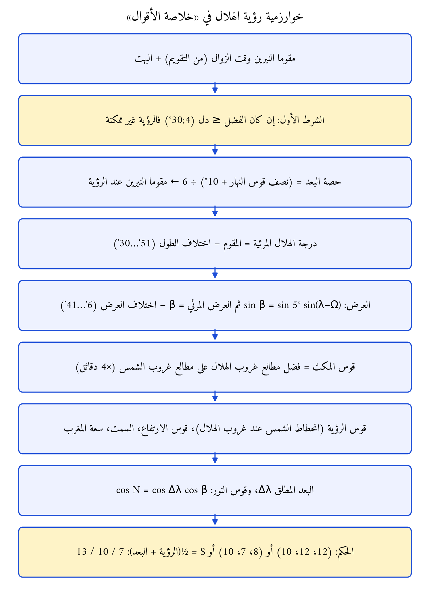

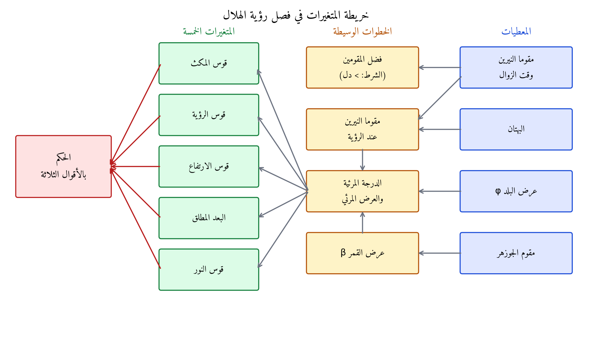

# الفصل الثالث: صياغة المعيار وتعيين متغيراته

## صياغة المعيار

بجمع الشرط الأول والأقوال الثلاثة، يمكن صياغة **معيار ابن المجدي** في أربع درجات:

| الدرجة | الحكم | الشرط |
|---|---|---|
| 0 | غير ممكنة | البعد وقت الزوال ≤ ⁦4;30⁩ درجة، **أو** مؤشر المتأخرين < 7 |
| 1 | جائزة قريبة من الخفاء | مؤشر المتأخرين من 7 إلى أقل من 10 |
| 2 | جائزة قريبة إلى البيان | مؤشر المتأخرين من 10 إلى أقل من 13 |
| 3 | يُرى بيّنًا | المكث ≥ 12 والرؤية ≥ 12 والارتفاع ≥ 10، **أو** مؤشر المتأخرين ≥ 13 |

## تعيين المتغيرات

يجمع الجدول الآتي متغيرات المعيار: معناها، وطريقة استخراجها، وقيمتها أو حدّها.

| المتغير | معناه | طريقة استخراجه | القيمة أو الحد |
|---|---|---|---|
| فضل المقوّمين وقت الزوال | البعد بين القمر والشمس في البروج ظهر التاسع والعشرين | من التقويم | الحد: **⁦4;30⁩** («دل») |
| البهت | مسير الكوكب في يوم وليلة | فرق مقوّمي زوالين | القمر من ⁦11;48⁩ إلى ⁦15;24⁩ درجة، والشمس نحو درجة |
| زمن التحرّي | الزمن بعد الغروب | ثابت | **10 أجزاء = 40 دقيقة** |
| حصة البعد | الزمن من الزوال إلى التحرّي بستينيات اليوم | (نصف قوس النهار + 10) ÷ 6 | في القاهرة من ⁦14;14⁩ (الشتاء) إلى ⁦19;06⁩ (الصيف) |
| اختلاف الطول | ما يُنقص من طول الهلال | المعادلة (4) | **51** دقيقة (الحمل) إلى **30** (الميزان) |
| اختلاف العرض | ما يُنقص من عرض الهلال | المعادلة (4) | **6** دقائق (الحمل) إلى **41** (الميزان) |
| الميل الأعظم لفلك القمر | أقصى عرض القمر | ثابت | **5** درجات |
| قوس المكث | المدة بين الغروبين | المعادلة (5) | **12** (القول الأول)، **8** (الثاني) |
| قوس الرؤية | انحطاط الشمس عند غروب الهلال | المعادلة (1) | **12** (القول الأول) |
| قوس الارتفاع | ارتفاع الهلال عند غروب الشمس | المعادلة (1) | **10** (الأول)، **7** أو **6** (الثاني) |
| البعد المطلق | فرق الطولين المرئيين | طرح | يدخل في مؤشر المتأخرين |
| قوس النور | البعد الحقيقي بين المركزين | المعادلة (7) | **10** (القول الثاني) |
| مؤشر المتأخرين | نصف مجموع الرؤية والبعد | جمع وقسمة | **7 / 10 / 13** |

# الفصل الرابع: المعايير الحديثة للمقارنة

وفي العصر الحديث وُضعت معايير كثيرة لرؤية الهلال، نذكر منها ما نحتاجه في المقارنة:

| المعيار | فكرته بإيجاز |
|---|---|
| البابليون | يُرى الهلال إذا مكث بعد الشمس 48 دقيقة (12 درجة) فأكثر |
| دانجون (1932) | لا يُرى الهلال إذا كان بعده عن الشمس أقل من نحو 7 درجات، لأن الضوء لا يتكوّن على هيئة هلال |
| يالوب (1997) | يجمع بين قوس الرؤية وعرض الهلال، ويقسم الأهلة إلى ست درجات من «سهل الرؤية» إلى «لا يُرى» |
| عودة (2004) | يطوّر معيار يالوب بأرصادٍ أكثر، ويقسم الأهلة إلى أربع درجات: يُرى بالعين المجردة، يُرى بالعين وقد يحتاج إلى أداة، لا يُرى إلا بالأداة، لا يُرى أصلًا |

وسنقارن معيار ابن المجدي بمعيار عودة خاصةً، لأنه مبنيٌّ على أكبر عددٍ من الأرصاد الحديثة، ولأنه يجمع — مثل قول المتأخرين عند ابن المجدي — بين ظلمة السماء (قوس الرؤية) وغِلَظ الهلال (البعد بين النيرين)[^modern].

[^modern]: A. Danjon, "Jeunes et vieilles lunes", *L'Astronomie* 46 (1932); B. D. Yallop, *A Method for Predicting the First Sighting of the New Crescent Moon*, NAO Technical Note 69 (1997); M. Sh. Odeh, "New Criterion for Lunar Crescent Visibility", *Experimental Astronomy* 18 (2004).

# الفصل الخامس: اختبار المعيار

## البيانات وطريقة الاختبار

طُبّقت خطوات الفصل الثاني على كل أمسيات تحرّي الهلال في القاهرة (العرض 30.04، الطول 31.24) من سنة 1990 إلى 2049: مساء يوم الاجتماع، والأمسيتان بعده، وهي 2020 أمسية. وأُخذ مقوّما النيّرين وقت الزوال من التقويم الفلكي الحديث JPL DE421. ثم حُسب لكل أمسيةٍ تصنيفها في معيار عودة (2004) ويالوب (1997) بالحساب الحديث الكامل، وقورن بحكم ابن المجدي.

## اختبار المعيار

لمعرفة مقدار صواب المعيار، كتبنا برنامجًا ينفّذ خطوات ابن المجدي كما وردت في الرسالة، ولم نأخذ من الحساب الحديث إلا ما كان ابن المجدي يأخذه من التقويم، وهو «مقوّما النيرين وقت الزوال». ثم طبّقناه على كل أمسيات تحرّي الهلال في القاهرة من سنة 1990 إلى 2049 (مساء يوم الاجتماع والأمسيتان بعده)، وهي 2020 أمسية، وقارنّا حكمه بحكم معيار عودة الحديث. والنتيجة في الشكل (3):

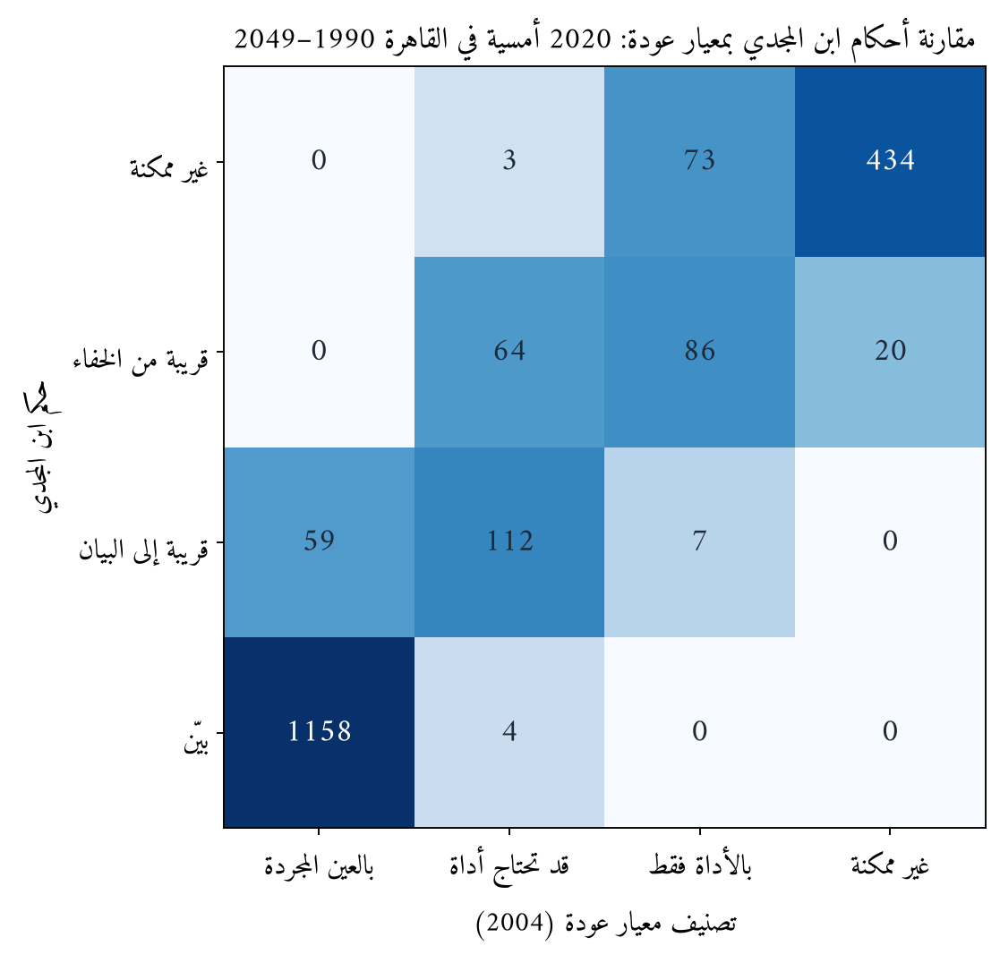

**كيف نقرأ الشكل (3)؟** كل خانةٍ فيه عدد الأمسيات التي حكم فيها ابن المجدي بالحكم المكتوب بجانب الصف، وحكم فيها معيار عودة بالحكم المكتوب أسفل العمود. ومنه نتبيّن:

1. **لا يوجد تناقضٌ حادّ**: لم يحكم ابن المجدي بأن الهلال «بيّن» في أي أمسيةٍ يقول المعيار الحديث إنه لا يُرى أو لا يُرى إلا بالأداة. ولم يحكم بأنه «غير ممكن» في أي أمسيةٍ يُرى فيها بالعين المجردة بسهولة.
2. **حكم «بيّن»** (1162 أمسية) جاء في 1158 منها موافقًا لحكم «يُرى بالعين المجردة» عند عودة، أي بنسبة **99.7٪**.
3. **حكم «غير ممكنة»** (510 أمسيات) جاء في 507 منها موافقًا لحكم «لا يُرى بالعين» عند عودة.
4. **حكم «قريبة من الخفاء»** وقع أغلبه في الأهلة التي يقول عنها المعيار الحديث إنها تُرى بالأداة أو قد تحتاج إلى أداة، وهذا وصفٌ دقيق لمعنى «الخفاء».
5. إذا عددنا «قريبة إلى البيان» فما فوقها حكمًا بالرؤية، كان الاتفاق مع حكم الرؤية بالعين عند عودة **96٪** من الحالات.

## المعيار على مستوى «البعد المطلق – قوس الرؤية»

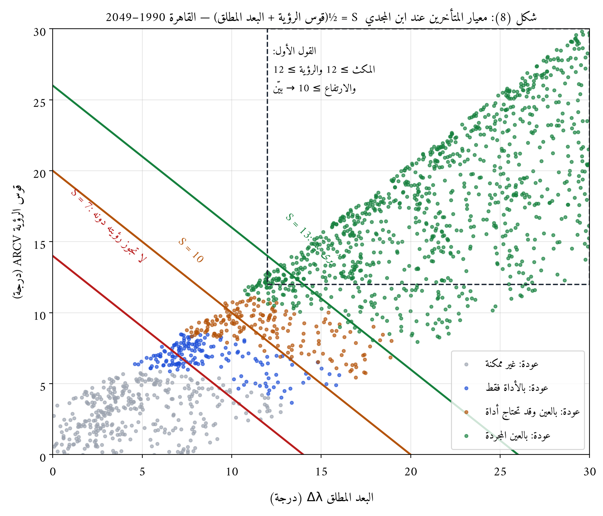

**كيف نقرأ الشكل (4)؟** كل نقطةٍ فيه أمسيةٌ من أمسيات تحرّي الهلال في القاهرة: موضعها الأفقي البعد المطلق، وموضعها الرأسي قوس الرؤية، ولونها حكم المعيار الحديث (الأخضر: يُرى بالعين، البرتقالي: قد يحتاج إلى أداة، الأزرق: لا يُرى إلا بالأداة، الرمادي: لا يُرى). والخطوط المائلة الثلاثة هي حدود المتأخرين. ونلاحظ أن:

- النقاط الرمادية كلها تقريبًا تحت خط 7 أو قريبةٌ منه.
- النقاط الخضراء كلها تقريبًا فوق خط 10.
- المنطقة بين خطي 7 و10 فيها النقاط الحرجة: الزرقاء والبرتقالية، وهي التي سمّاها ابن المجدي «قريبة من الخفاء».

## الشرط الأول: «دل»

قرأنا «دل» أربع درجات وثلاثين دقيقة، على الكتابة الستينية. ويؤيّد الحساب هذه القراءة:

**الاختبار** (الشكل 5): في 464 أمسية كان فيها البعد وقت الزوال 4.5 درجة فأقل، لم يُرَ الهلال بالعين إلا في 3 حالات فقط، بحسب معيار عودة.

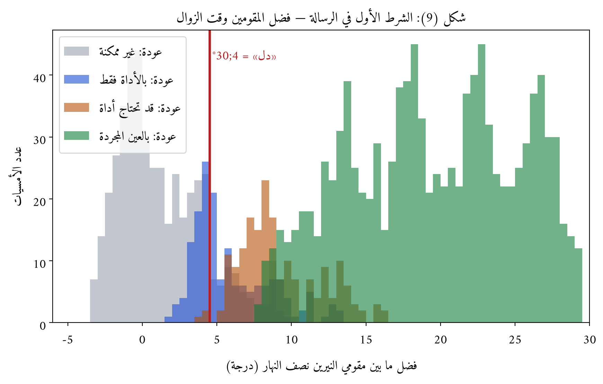

**التعليق**: ويظهر من الشكل (5) أن «دل» تقع عند الحد الفاصل بين الأهلة التي لا تُرى أصلًا (الرمادية) والأهلة التي تُرى بالأداة (الزرقاء). فهي — كما سمّاها المؤلف بدقة — حدّ **«عدم الإمكان»**، لا حدّ الرؤية. فإذا تجاوزها البعد قيل: «فيمكن»، ثم يُنظر في درجة الإمكان بالحدود الآتية.

## دقة أدوات الحساب في الرسالة

**الاختبار**: قارنّا هذه القيم بالقيم الحقيقية في 60 سنة (الشكل 6)، فوجدنا قيم ابن المجدي تتبع شكل التغيّر الحقيقي، لكنها أقل منه بنحو 4 إلى 6 دقائق في المتوسط؛ لأنه استوفى بخطٍّ مستقيم ما هو في الحقيقة منحنى. وهو فرقٌ «يسيرٌ لا يقدح في المطلوب» كما قال.

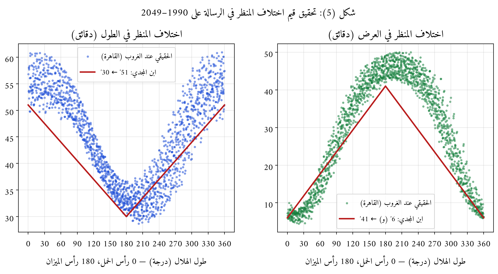

**الاختبار**: المكث المحسوب بطريقة ابن المجدي يختلف عن المكث الحقيقي بأقل من دقيقةٍ في المتوسط، وبنحو دقيقتين في أغلب الحالات.
 وقوس الرؤية المحسوب بطريقة ابن المجدي لا يختلف عن نظيره الحديث إلا بأقل من درجةٍ في أغلب الحالات.

## حدود كوشيار وابن يونس

طبّقنا هذه الحدود على الأمسيات الـ2020 نفسها، بالقيم المحسوبة بطريقة «الخلاصة»، وقارنّاها بمعيار عودة (الرؤية بالعين). والنتيجة في الشكل (7):

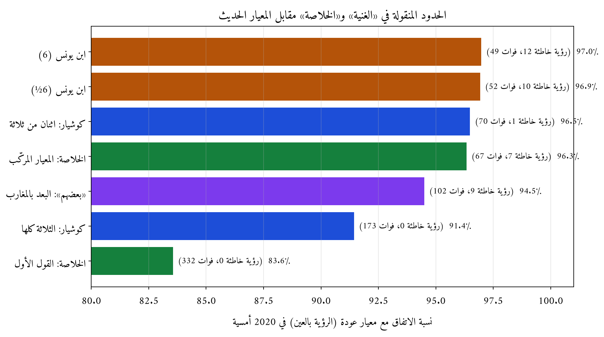

ونقرأ من الشكل (7) ما يأتي:

- **حدّ ابن يونس** أعلى الأقوال اتفاقًا مع المعيار الحديث (96.9٪)، ويليه **قول كوشيار** إذا أُخذ بقاعدته «اثنان من ثلاثة» (96.5٪)، ثم **معيار «الخلاصة» المركّب** (96.3٪). والأقوال الثلاثة متقاربة جدًّا.
- قاعدة كوشيار «فإن شهد من هذه اثنان فاحكم بالرؤية» ليست تساهلًا: فلو اشتُرطت الحدود الثلاثة كلها لانخفض الاتفاق إلى 91.4٪، لأن الشرط يفوّت أهلّةً كثيرة تُرى فعلًا. ولم يحكم قول كوشيار بالرؤية خطأً إلا في 1 أمسية.
- قول «بعضهم» بالبعد بالمغارب وحده أضعف (94.5٪)، لأنه حدٌّ واحد لا يدخل فيه البعد بين النيرين.
- القول الأول في «الخلاصة» (12، 12، 10) لا يخطئ بالإيجاب أبدًا، لكنه يفوّت كثيرًا، فهو حدّ «البيان» كما سمّاه المؤلف، لا حدّ الإمكان.

## قاعدة «الغنية»: درجتان فأقل أو عشرة فأكثر

يقول ابن المجدي في «الغنية» إن الحكم معلومٌ بلا حساب إذا كان بين النيّرين وقت الزوال «نحو درجتين فأقل أو عشرة فأكثر».

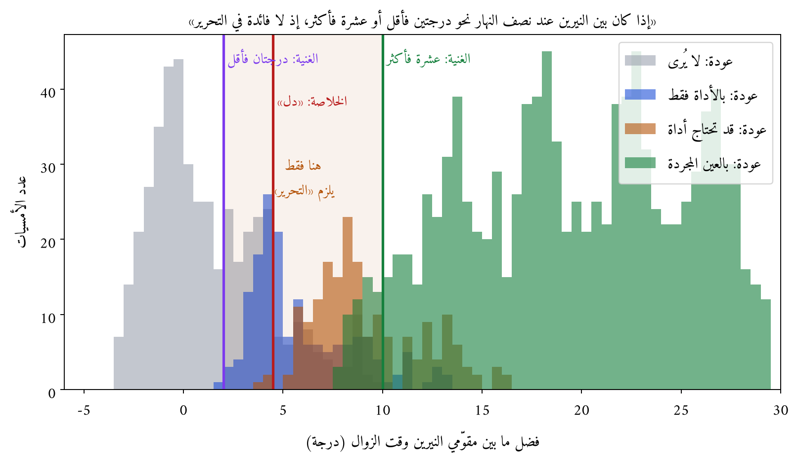

ويؤيّد الحسابُ هذه القاعدة تأييدًا تامًّا (الشكل 8):

- في 288 أمسيةً كان فيها البعد وقت الزوال درجتين فأقل، **لم يُرَ الهلال بالعين في أيٍّ منها**.
- وفي 1235 أمسيةً كان فيها عشر درجات فأكثر، رُئي بالعين في 1221 منها (98.9٪)، وكان في 1164 منها سهل الرؤية بالعين المجردة.

ونفهم من هذا أن «الخلاصة» حين جعلت حدّ عدم الإمكان «دل» (⁦4;30⁩) لم تخالف «الغنية»، بل ضيّقت المنطقة التي تحتاج إلى التحرير: فبين درجتين و⁦4;30⁩ لا يُرى الهلال بالعين إلا نادرًا (3 حالات في ستين سنة)، فحكمت «الخلاصة» فيها بعدم الإمكان دون حساب.

# الفصل السادس: معايرة الحدود والمعيار المعدّل

## هل أصاب ابن المجدي في الحدود 7 و10 و13؟

بحثنا بالحساب عن أفضل قيمةٍ لمؤشر المتأخرين تفصل بين درجات الرؤية في المعيار الحديث، فكانت النتيجة:

| الفصل بين | أفضل حدٍّ بالحساب | حدّ ابن المجدي |
|---|---|---|
| ما يمكن رؤيته بأي وسيلة، وما لا يمكن | 6.2 درجة | 7 («لا تجوز رؤيته» دونها) |
| ما يُرى بالعين، وما لا يُرى إلا بالأداة | 8.6 درجة | بين 7 و10 («قريبة من الخفاء») |
| ما يُرى بالعين بسهولة، وما دونه | 11.7 درجة | بين 10 و13 («قريبة إلى البيان») |

فالحدود الثلاثة لابن المجدي تقع في مواضعها الصحيحة: الحد الأدنى (7) قريبٌ جدًّا من حد الإمكان (6.2)، وحد البيان (13) فوق حد الرؤية السهلة (11.7) بهامش احتياط.

**مناقشة حكم المحقق**: انتهى المحقق إلى أن الرسالة تعطي معيارًا «في حدود 6 إلى 6.5 درجة»، وأنه «موافقٌ لحدود ابن يونس». وقد ظهر من «غنية الفهيم» (الباب الثامن) أن هذين العددين هما حدّ **الارتفاع** عند ابن يونس، وهو القول الثاني في «الخلاصة». فالحكم صحيحٌ في نسبته، وينبغي تقييده بأنه حدّ الارتفاع في أحد الأقوال الثلاثة، لا المعيار كله. ومن الطريف أن حدّ الإمكان الأدنى لمؤشر المتأخرين كما يظهر بالحساب (6.2) قريبٌ من هذين العددين أيضًا.

## معيار ابن المجدي المعدَّل (مقترح)

بناءً على هذا الاختبار، نقترح صيغةً معاصرة تحفظ بنية معيار ابن المجدي ومتغيراته، مع تعديل حدوده بحسب الحساب:

| مؤشر المتأخرين = (قوس الرؤية + قوس النور) ÷ 2 | الحكم |
|---|---|
| أقل من 6.2 درجة | لا يُرى مطلقًا |
| من 6.2 إلى أقل من 8.6 | لا يُرى إلا بالأداة البصرية |
| من 8.6 إلى أقل من 11.7 | يُرى بالعين في صفاء الجو |
| 11.7 فأكثر | يُرى بالعين المجردة بسهولة |

مع الإبقاء على الشرط الأول (البعد وقت الزوال أكبر من 4.5 درجة)، ورفعه إلى 6.5 درجة إن أُريدت الرؤية بالعين. وينبغي التنبيه إلى أن هذا المعيار مضبوطٌ على عرض القاهرة، لأن قيم اختلاف المنظر في الرسالة خاصةٌ بها؛ فإذا أريد تعميمه احتاج إلى اختبارٍ على عروضٍ أخرى.

# الفصل السابع: أمثلة محلولة

## المثال الأول: هلال شوال 1447 هـ

وقع الاجتماع فجر الخميس 19 مارس 2026. ويبيّن الشكل (9) موضعي الشمس والهلال في الأفق الغربي للقاهرة مساء الخميس ومساء الجمعة.

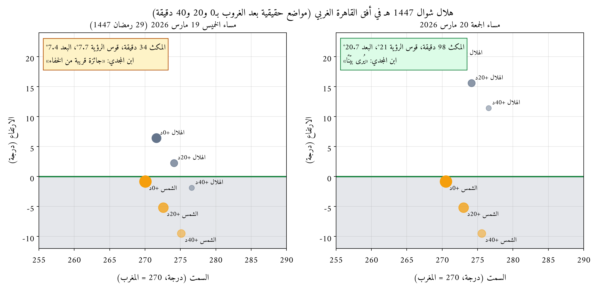

**مساء الخميس 19 مارس**، نسير مع خطوات ابن المجدي:

1. **الشرط الأول**: البعد وقت الزوال 4.63 درجة، وهو فوق «دل» (4.5) بقليل، فالرؤية «ممكنة»، ويُكمل الحساب.
2. **قوس المكث**: 8.9 درجة، أي 35 دقيقة.
3. **قوس الرؤية**: 7.7 درجة.
4. **قوس الارتفاع**: 7.7 درجة.
5. **البعد المطلق**: 7.4 درجة، و**قوس النور** 7.8 درجة.
6. **الحكم**:
   - القول الأول: المكث أقل من 12، فلا يتحقق.
   - القول الثاني: المكث أكثر من 8 والارتفاع أكثر من 7، لكن النور أقل من 10، فلا يتحقق.
   - قول المتأخرين: (7.7 + 7.4) ÷ 2 = 7.6، فهو بين 7 و10: **«جائزةٌ قريبةٌ من الخفاء»**.

ويصنّفه معيار عودة: «لا يُرى إلا بالأداة البصرية»، ويعدّه معيار يالوب أصعب من ذلك. فهو هلالٌ حرج على حدّ الإمكان، ووصفُ ابن المجدي له بأنه «قريبٌ من الخفاء» وصفٌ صادق.

**مساء الجمعة 20 مارس**: المكث 98 دقيقة، وقوس الرؤية 21 درجة، والارتفاع 21 درجة، فالقول الأول متحقق: **«يُرى بيّنًا»**.

## جدول الأمثلة

يجمع الجدول الآتي ثلاثة أهلّة، كل هلالٍ في أمسيتين. وكل الأرقام بطريقة ابن المجدي، إلا قوس المكث ففيه رقمان: الأول بطريقته، والثاني بالحساب الحديث.

| المتغير | شوال 1446 29 مارس 2025 | شوال 1446 30 مارس 2025 | رمضان 1447 17 فبراير 2026 | رمضان 1447 18 فبراير 2026 | شوال 1447 19 مارس 2026 | شوال 1447 20 مارس 2026 |
|---|---|---|---|---|---|---|
| عمر الهلال عند الغروب (ساعة) | 5.2 | 29.2 | 3.7 | 27.8 | 14.7 | 38.7 |
| البعد وقت الزوال (درجة) | -0.61 | 13.53 | -1.06 | 11.20 | 4.63 | 17.82 |
| الشرط الأول (> دل) | غير متحقق | متحقق | غير متحقق | متحقق | متحقق | متحقق |
| قوس المكث (دقيقة): ابن المجدي / الحديث | 12.5 / 9.4 | 79.4 / 79.7 | 5.4 / 2.6 | 63.4 / 63.2 | 35.4 / 33.8 | 97.7 / 98.9 |
| قوس الرؤية (درجة) | 2.7 | 16.9 | 1.1 | 13.5 | 7.7 | 21.0 |
| قوس الارتفاع (درجة) | 2.7 | 16.9 | 1.1 | 13.5 | 7.7 | 21.0 |
| البعد المطلق (درجة) | 2.6 | 16.7 | 1.3 | 13.6 | 7.4 | 20.7 |
| قوس النور (درجة) | 2.8 | 16.9 | 1.6 | 13.6 | 7.8 | 21.0 |
| مؤشر المتأخرين | 2.6 | 16.8 | 1.2 | 13.6 | 7.6 | 20.9 |
| حكم ابن المجدي | غير ممكنة | بيّن | غير ممكنة | بيّن | قريبة من الخفاء | بيّن |
| معيار عودة | لا يُرى | بالعين | لا يُرى | بالعين | بالأداة فقط | بالعين |

# الفصل الثامن: برنامج «خريطة معيار ابن المجدي»

## فكرة البرنامج

رأينا في الأبواب السابقة أن حكم ابن المجدي على الهلال يتوقف على موضع الراصد: فاختلاف العرض يغيّر قوس النهار وقوس المكث، واختلاف الطول يغيّر وقت الزوال فيغيّر البعد بين النيرين. ولكي يُرى أثر ذلك في العالم كله دفعةً واحدة، أعددنا برنامجًا يعمل في المتصفح، يطبّق خطوات الرسالة على كل موضعٍ من الأرض، ويلوّن خريطة العالم بدرجات الحكم الأربع. ولا يأخذ البرنامج من الحساب الحديث إلا ما كان ابن المجدي يأخذه من التقويم، وهو مقوّما الشمس والقمر وقت الزوال في اليوم المختار واليوم الذي بعده؛ ثم يسير بعد ذلك بخطوات الرسالة كما شرحناها في الفصل الثاني.

ويتيح البرنامج للقارئ أن يختار التاريخ بالميلادي أو بالهجري، وأن ينتقل يومًا يومًا أو إلى الاجتماع السابق والتالي، وأن يختار مدينةً من قائمةٍ أو ينقر على أي موضعٍ في الخريطة، كما في الشكل (10).

## خريطة العالم مساء الخميس 19 مارس 2026

يبيّن الشكل (11) حكم ابن المجدي في العالم كله مساء الخميس 19 مارس 2026، وهو مساء التاسع والعشرين من رمضان 1447 هـ، الذي درسناه في المثال الأول من الفصل السابع. وكل خليةٍ في الخريطة مساحتها درجتان في درجتين، ولونها درجة الحكم:

- **الأخضر الداكن**: يُرى بيّنًا.
- **الأخضر الفاتح**: جائزةٌ قريبةٌ إلى البيان.
- **البرتقالي**: جائزةٌ قريبةٌ من الخفاء.
- **الأحمر**: غير ممكنة.
- **الرمادي**: لم يقع الاجتماع بعدُ وقت الزوال، فهذا اليوم «ليس هو تاسع عشرين الرؤية» كما قال ابن المجدي.

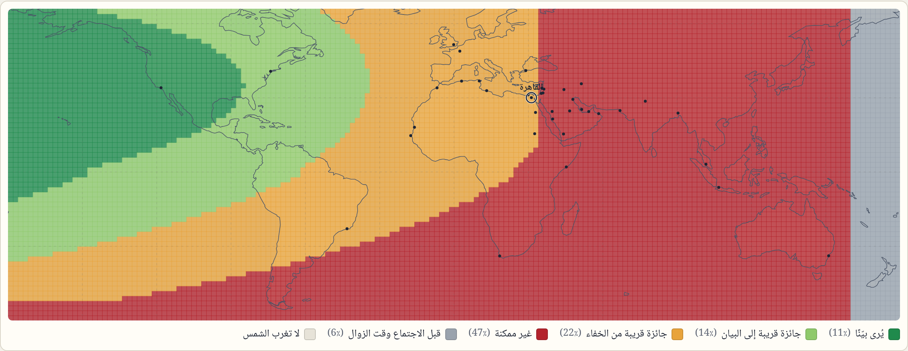

**كيف نقرأ الشكل (11)؟** تتدرّج الألوان من الشرق إلى الغرب: فآسيا كلها حمراء، أي أن الرؤية فيها غير ممكنة؛ ثم يمر الحد بين الأحمر والبرتقالي بمصر والشام تقريبًا، فتقع القاهرة على أول منطقة «الخفاء»؛ ثم يتحسّن الحكم كلما اتجهنا غربًا، حتى يصير الهلال «بيّنًا» في الأمريكتين. والسبب أن الشمس تغرب في البلاد الغربية بعد غروبها في البلاد الشرقية بساعات، فيكون القمر قد ابتعد عن الشمس أكثر، وطال مكثه بعدها. وهذا الشكل المقوّس للحدود هو الشكل المعروف في خرائط الرؤية الحديثة، وقد خرج هنا من خطوات ابن المجدي وحدها.

## لوحة القاهرة: الأوقات والقيم والخطوات

إذا اختار القارئ مدينةً، عرض البرنامج لها لوحتين (الشكل 12): الأولى فيها الحكم، ووقت غروب الشمس، ووقت غروب القمر، والمكث بينهما بالدقائق، و**فضل ما بين مقوّمي النيرين وقت الزوال** مع بيان تحقق شرط «دل» أو عدمه، ومقوّما النيرين، وبهتاهما. والثانية فيها خطوات ابن المجدي واحدةً واحدة، ثم الأقوال الثلاثة وما تحقق منها.

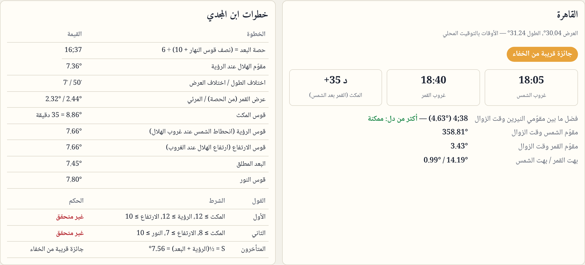

## رسم القيم

ولأن الأرقام وحدها لا تكفي لتصوّر الهلال، يرسم البرنامج قيم الموضع المختار في ثلاثة رسوم.

### السماء الغربية لحظة غروب الشمس

يرسم الشكل (13) الأفق الغربي للقاهرة كما يراه المؤقت لحظة غروب الشمس، والدرجات فيه بمقياسٍ واحد أفقيًّا ورأسيًّا، فتظهر الأقواس بنسبها الحقيقية:

- **قوس الارتفاع** (السهم الأزرق): من الأفق إلى الهلال، وهو هنا 7.7 درجة.
- **قوس النور** (الخط الأخضر): من الشمس إلى الهلال، وهو 7.8 درجة.
- **فرق السمت** (تحت الأفق): الفرق بين جهتي الشمس والهلال، وهو 1.5 درجة.
- **قوس الرؤية** (السهم الأحمر): انحطاط الشمس تحت الأفق لحظة غروب الهلال، وهو 7.7 درجة. وتظهر الشمس في موضعين: عند غروبها على الأفق، وعند غروب الهلال تحته.
- **مسار نزول الهلال** (الخط المنقّط) إلى موضع غروبه على الأفق، مع سعة مغربه.

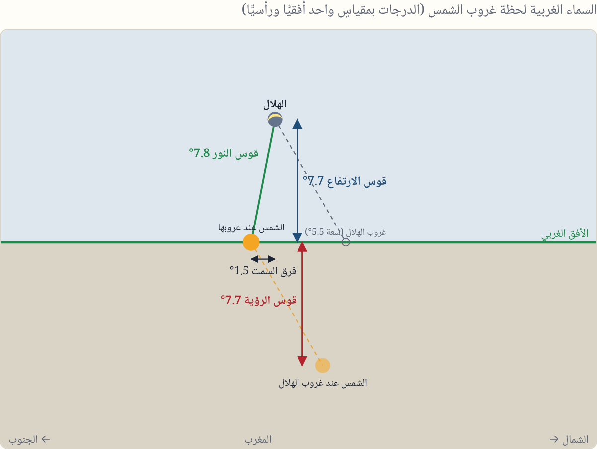

ويظهر من الشكل أن الهلال قريبٌ جدًّا من الشمس (قوس النور أقل من 8 درجات)، وأنه منخفض، وأن الشمس عند غروبه لم تنحطّ إلا قليلًا، فالسماء حوله لم تظلم بعد. وهذه صورة الهلال «القريب من الخفاء».

### فلك البروج وشريط الزمن

يرسم الجزء الأعلى من الشكل (14) فلك البروج، والطول فيه يزداد نحو اليسار (على توالي البروج)، وعليه:

- موضع الشمس وموضع القمر **وقت الزوال**، والسهم بينهما هو «فضل ما بين مقوّمي النيرين»؛ وهو هنا أكبر من «دل» بقليل، فالرؤية ممكنة.
- المنطقة المظلّلة بالأحمر هي **منطقة «دل»**: إذا وقع القمر فيها وقت الزوال فالرؤية غير ممكنة.
- موضع الهلال **عند الرؤية**، ثم انتقاله باختلاف المنظر إلى **موضعه المرئي**، و**عرضه المرئي** عن فلك البروج، و**البعد المطلق** بينه وبين الشمس.

ويرسم الجزء الأسفل **شريط الزمن** بعد الغروب: يبدأ بغروب الشمس، وينتهي بغروب الهلال بعد مكثٍ قدره 35 دقيقة بطريقة ابن المجدي، وعليه علامة الحساب الحديث للمقارنة، وعلامة وقت التحرّي بعد الغروب بأربعين دقيقة. ويظهر منه أن الهلال في هذا المساء يغرب **قبل** وقت التحرّي المعتاد، وهذا من أسباب صعوبة رؤيته.

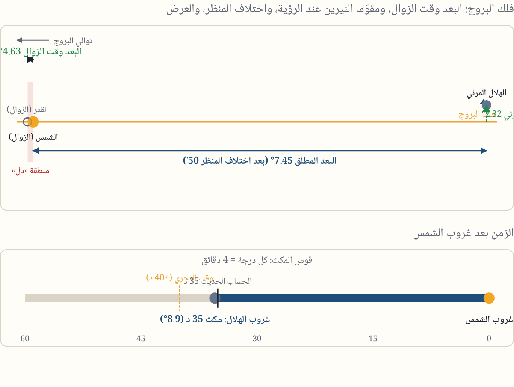

### القيم مقابل حدود الأقوال الثلاثة

يضع الشكل (15) كل قيمةٍ على مسطرةٍ عليها حدود الأقوال: فقوس المكث مقابل 8 (القول الثاني) و12 (القول الأول)، وقوس الرؤية مقابل 12، وقوس الارتفاع مقابل 7 و10، وقوس النور مقابل 10، ومؤشر المتأخرين على مسطرةٍ ملوّنة بمناطق 7 و10 و13. واللون الأخضر للقيمة التي بلغت الحد، والأحمر لما قصر عنه.

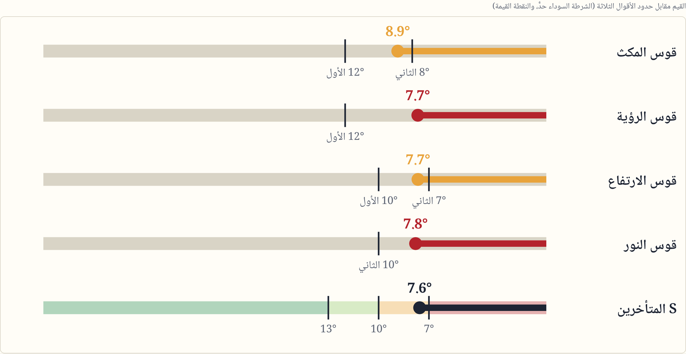

ويُقرأ الحكم من الشكل مباشرة: القيم كلها حمراء دون حدود القولين الأول والثاني، ومؤشر المتأخرين (7.6) واقعٌ في أول منطقة «القرب من الخفاء». فالحكم: **«جائزةٌ قريبةٌ من الخفاء»**، وهو ما انتهينا إليه في الفصل السابع.

## الليلة التالية: مساء الجمعة 20 مارس 2026

ثم ننتقل في البرنامج يومًا واحدًا، فيتغير المشهد كله (الشكل 16): يصير الهلال «بيّنًا» في نحو 86٪ من الخريطة، ومنها العالم الإسلامي كله، ولا يبقى «غير ممكن» إلا في شريطٍ ضيق في أقصى الجنوب، وتقع أستراليا ونيوزيلندا في منطقتي «القرب إلى البيان» و«القرب من الخفاء».

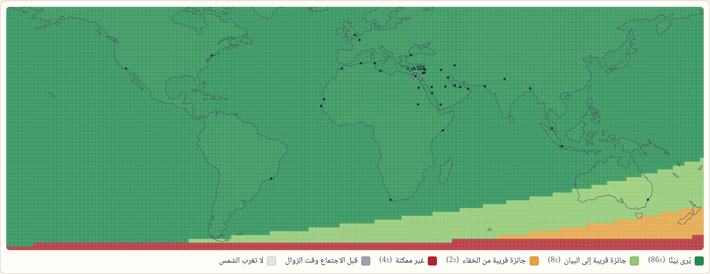

ويبيّن الشكلان (17) و(18) القاهرة في تلك الليلة: ارتفع الهلال إلى 21 درجة، وصار قوس النور 21 درجة، وانحطّت الشمس عند غروبه 21 درجة، وجاوزت القيم كلها حدود القول الأول. فالحكم: **«يُرى بيّنًا»**.

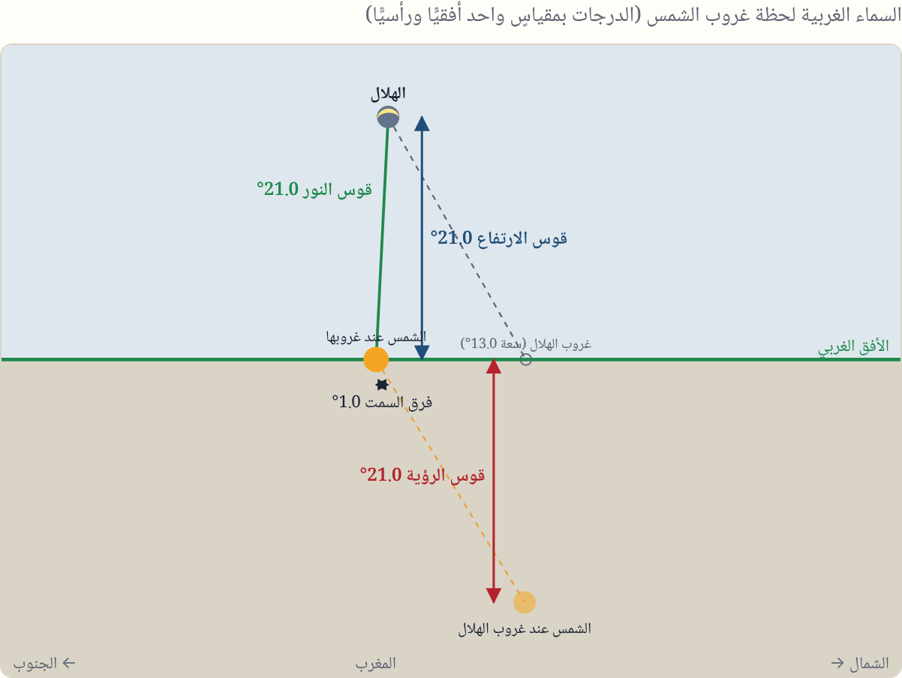

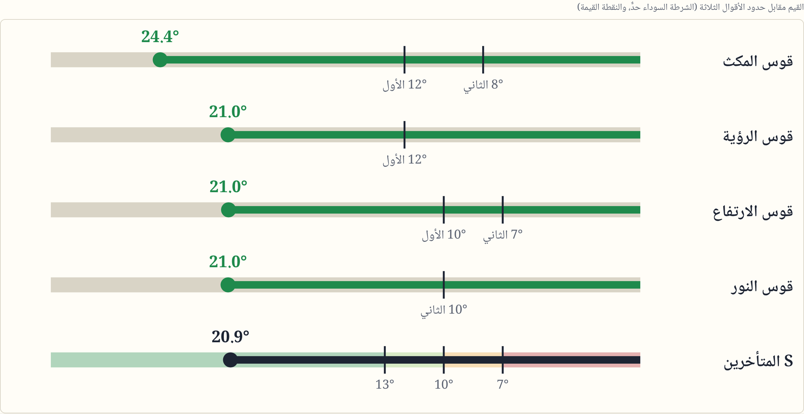

## ملاحظات على البرنامج

1. قيم اختلاف المنظر في الرسالة مضبوطةٌ على عرض القاهرة؛ وفي نصف الكرة الجنوبي عكسنا الجدول (فجعلنا الحمل مكان الميزان، والاختلاف في العرض نحو الشمال)، لأن هيئة فلك البروج عند الغروب هناك معكوسة. وهذا اجتهادٌ منّا، لا نصٌّ للمؤلف.
2. أوقات غروب الشمس والقمر في لوحة المدينة محسوبةٌ بالحساب الحديث مع الانكسار، للمقارنة بقوس المكث المحسوب بطريقة ابن المجدي.
3. التاريخ الهجري المعروض بتقويم أم القرى، وهو تقويمٌ حسابي قد يخالف الرؤية.
4. البرنامج في ملف `app/hilal_map.html`، ويُفتح في أي متصفح.

# الخاتمة

1. معيار ابن المجدي معيارٌ متدرّج من أربع درجات: شرطٌ أول وقت الزوال («دل» = ⁦4;30⁩)، ثم ثلاثة أقوال: القول الأول (المكث 12، الرؤية 12، الارتفاع 10)، وحدّ ابن يونس (المكث 8، الارتفاع 6½ أو 6، النور 10)، وقول المتأخرين (نصف مجموع قوس الرؤية والبعد المطلق: 7 و10 و13).
2. يتفق المعيار مع معيار عودة الحديث في نحو 96٪ من 2020 أمسية، دون أي تناقضٍ حاد: لم يحكم بالبيان على هلالٍ لا يُرى، ولا بالامتناع على هلالٍ يُرى بسهولة.
3. حدّ ابن يونس وقاعدة كوشيار («اثنان من ثلاثة») يتفقان مع المعيار الحديث بنحو 97٪.
4. حدود المتأخرين (7 و10 و13) قريبةٌ من أفضل الحدود بالحساب الحديث (6.2 و8.6 و11.7).
5. «دل» حدّ «عدم الإمكان»: من 464 أمسية دونه لم يُرَ الهلال بالعين إلا في 3 حالات. وقاعدة «الغنية» (درجتان فأقل أو عشرة فأكثر) صادقة.
6. يمكن صياغة معيارٍ معاصرٍ يحفظ بنية معيار ابن المجدي بحدود 6.2 و8.6 و11.7، مع التنبيه على أنه مضبوطٌ على عرض القاهرة.

# المصادر والمراجع

1. ابن المجدي: خلاصة الأقوال في معرفة الوقت ورؤية الهلال، تحقيق ودراسة: أروين جولي رخمادي بوتر–بوتر (ميدان، 2019).
2. ابن المجدي: خلاصة الأقوال، نسخة مكتبة الأزهر (1237 هـ)، النص المرقون، إعداد: د. نجلاء شمس.
3. ابن المجدي: غنية الفهيم والطريق إلى حل التقويم، فصل «في حساب رؤية الأهلة»، في: *Metode Penelitian Naskah Arab: Teori dan Aplikasi*، ص 162–167.
4. Danjon, A., "Jeunes et vieilles lunes", *L'Astronomie* 46 (1932).
5. Yallop, B. D., *A Method for Predicting the First Sighting of the New Crescent Moon*, NAO Technical Note 69 (1997).
6. Odeh, M. Sh., "New Criterion for Lunar Crescent Visibility", *Experimental Astronomy* 18 (2004).
7. King, David A., "Some Early Islamic Tables for Determining Lunar Crescent Visibility", *Annals of the New York Academy of Sciences* 500 (1987).
8. Folkner, W. M. et al., *The Planetary and Lunar Ephemeris DE421*, JPL IOM 343R-08-003 (2008).
9. Astronomy Engine (Don Cross), مكتبة حساب فلكي مفتوحة المصدر، الإصدار 2.1.19.
