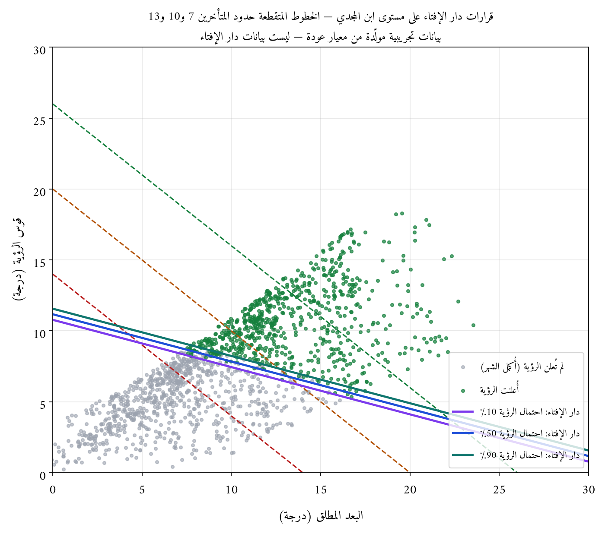
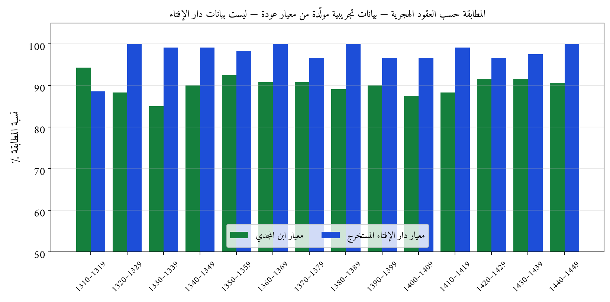

# فكرة المشروع

وضع شهاب الدين ابن المجدي (ت 850 هـ)، مؤقّت الجامع الأزهر، في رسالته «خلاصة الأقوال في معرفة الوقت ورؤية الهلال» معيارًا متدرّجًا لرؤية الهلال: شرطًا يُختبر وقت الزوال، ثم ثلاثة أقوالٍ في حدود الرؤية بعد الغروب. وقد درسنا هذا المعيار في بحثٍ مستقل، فصغناه صياغةً رياضية واختبرناه بالحساب الحديث[^crit].

ويقوم هذا المشروع على خطوةٍ تالية: أن نعرض قرارات دار الإفتاء المصرية في إثبات أوائل الشهور القمرية، على مدى نحو 130 سنة، على معيار ابن المجدي، لغرضين:

1. **معرفة مدى مطابقة معيار ابن المجدي لقرارات دار الإفتاء**: أيّ أقواله أقرب إلى قراراتها، وفي أي الحالات يختلفان، وهل تغيّرت المطابقة عبر الزمن.
2. **استخراج «معيار دار الإفتاء»**: معيارٌ يحفظ بنية معيار ابن المجدي ومتغيراته، وتُستخرج حدوده من قرارات دار الإفتاء نفسها، فيكون امتدادًا لعمل ابن المجدي في المؤسسة التي ورثت وظيفة الإثبات في مصر.

[^crit]: انظر: «معيار ابن المجدي لرؤية الهلال: صياغته من خلاصة الأقوال وغنية الفهيم، وتعيين متغيراته، واختباره بالحساب الفلكي الحديث» (بحثٌ مستقل مرفق).

# البيانات المطلوبة

## صفٌّ لكل شهر

يُدخَل لكل شهرٍ هجري صفٌّ واحد في قالبٍ معدّ لذلك (ملف Excel)، مرتّبةً من الأقدم إلى الأحدث. ومدة 130 سنة نحو **1560 شهرًا**. وأعمدة القالب:

| العمود | المضمون | لازم أو اختياري |
|---|---|---|
| السنة الهجرية | مثل 1447 | لازم |
| الشهر الهجري | من 1 إلى 12 | لازم |
| أول الشهر المعلن | التاريخ الميلادي لأول يوم من الشهر كما أعلنته دار الإفتاء | **لازم، وهو أهم الأعمدة** |
| ثبتت رؤية هلاله مساء 29 من الشهر السابق؟ | نعم / لا | اختياري، للتحقق |
| أساس القرار | رؤية / حساب / إكمال / غير معروف | مهمٌّ جدًّا |
| موضع الرؤية | اسم الموضع إن عُرف | اختياري |
| العرض والطول | إحداثيات موضع الرؤية | اختياري؛ وإلا حُسب للقاهرة |
| المصدر | رقم البيان أو السجل أو الجريدة وتاريخها | مستحسن للتوثيق |
| ملاحظات | أي ظرفٍ خاص (غيم، رؤية في بلدٍ آخر، اعتراض...) | اختياري |

## لماذا يكفي «أول الشهر المعلن»؟

إذا عُرف أول كل شهر، عُرف طول كل شهر، ومن طول الشهر تُعرف نتيجة تحرّي الهلال في آخره:

- إذا كان الشهر **29 يومًا**، فقد أُعلنت رؤية هلال الشهر التالي مساء اليوم التاسع والعشرين.
- وإذا كان **30 يومًا**، فلم تثبت الرؤية مساء التاسع والعشرين، فأُكمل الشهر ثلاثين.

ومساء التحرّي هو مساء اليوم التاسع والعشرين، أي **أول الشهر + 28 يومًا**. فسلسلةٌ من 1560 تاريخًا تعطي نحو 1560 أمسية تحرٍّ، لكلٍّ منها نتيجةٌ معلنة: «رُئي» أو «لم يُرَ».

**مثال**: إذا أُعلن أول شعبان يوم 20 يناير، وأول رمضان يوم 18 فبراير، فشعبان 29 يومًا، فتكون رؤية هلال رمضان قد أُعلنت مساء 17 فبراير، وهو مساء 29 شعبان.

## أهمية «أساس القرار»

تغيّرت طريقة إثبات الشهور في مصر خلال 130 سنة، فقد يكون القرار مبنيًّا على رؤيةٍ ثابتة، أو على حسابٍ فلكي، أو على إكمال العدّة. ولذلك يُستحسن تعيين أساس كل قرارٍ ما أمكن، ليمكن:

- استخراج المعيار من القرارات المبنية على الرؤية وحدها (خيار `--exclude-calc` في البرنامج).
- ومقارنة الفترات بعضها ببعض لمعرفة أثر تغيّر السياسة.

# الحساب لكل أمسية

لكل أمسية تحرٍّ يحسب البرنامج ما يأتي، لموضع الرؤية المذكور أو للقاهرة:

**أولًا: متغيرات ابن المجدي**، بخطوات «خلاصة الأقوال» كما في البحث المستقل:

| المتغير | معناه |
|---|---|
| البعد وقت الزوال | الفرق بين طولي القمر والشمس ظهر التاسع والعشرين (شرط «دل» = 4;30) |
| قوس المكث | المدة بين غروب الشمس وغروب الهلال |
| قوس الرؤية | انحطاط الشمس تحت الأفق لحظة غروب الهلال |
| قوس الارتفاع | ارتفاع الهلال عند غروب الشمس |
| البعد المطلق وقوس النور | بعد الهلال عن الشمس في الطول، والبعد الحقيقي بينهما |
| مؤشر المتأخرين S | نصف مجموع قوس الرؤية والبعد المطلق |
| حكم ابن المجدي | يُرى بيّنًا / جائزة قريبة إلى البيان / جائزة قريبة من الخفاء / غير ممكنة |

**ثانيًا: قيمٌ حديثة للمقارنة والتوثيق**: وقت غروب الشمس، ووقت غروب القمر، والمكث بالدقائق، وعمر القمر منذ الاجتماع، وتصنيف معيار عودة (2004).

ويُستعمل في الحساب مكتبة **Astronomy Engine** المفتوحة المصدر، وهي صالحةٌ لكل تواريخ المشروع، ومنها ما قبل سنة 1900. ولا يؤخذ منها لحساب ابن المجدي إلا مقوّما الشمس والقمر وقت الزوال، كما كان يأخذهما من التقويم.

# قياس المطابقة

## المقاييس

يُقارَن كل حكمٍ بقرار دار الإفتاء بأربعة أعداد:

| | دار الإفتاء: رُئي | دار الإفتاء: لم يُرَ |
|---|---|---|
| **المعيار: يُرى** | رؤية صحيحة | رؤية خاطئة |
| **المعيار: لا يُرى** | فوات رؤية | عدم رؤية صحيح |

ومنها تُحسب:

- **نسبة المطابقة**: نسبة الأمسيات التي اتفق فيها الحكم والقرار.
- **الحساسية**: نسبة ما توقّع المعيار رؤيته من الأهلة التي أُعلنت رؤيتها.
- **النوعية**: نسبة ما توقّع المعيار عدم رؤيته من الأهلة التي لم تُعلن رؤيتها.
- **الدقة المتوازنة**: متوسط الحساسية والنوعية، وهي أعدل المقاييس إذا اختلف عدد المرئي عن غير المرئي.

## ما يُقارن

- معيار ابن المجدي بدرجاته: الحكم بالرؤية إذا كان «قريبة من الخفاء» فما فوق، أو «قريبة إلى البيان» فما فوق، أو «بيّن» فقط.
- كل قولٍ من أقواله وحده: القول الأول (12، 12، 10)، وحدّ ابن يونس (8، 6½، 10)، وشرط «دل».
- معيار عودة (2004)، مرجعًا حديثًا.
- جدول تفصيلي لدرجات ابن المجدي الأربع مقابل قرار دار الإفتاء.
- المطابقة حسب العقود الهجرية، لرصد أثر تغيّر طرق الإثبات عبر الزمن.

**تنبيه**: أمسيات التاسع والعشرين هي أصعب الأمسيات، لأن الهلال فيها قريبٌ من حدّ الرؤية في أكثر الشهور. فنسب المطابقة فيها أقل بطبيعتها من نسبها إذا حُسبت على كل الأمسيات، كما في البحث المستقل.

# استخراج «معيار دار الإفتاء»

## البنية: بنية ابن المجدي نفسها

لا يُستخرج معيارٌ جديد من فراغ، بل تُحفظ بنية معيار ابن المجدي، ويُترك للبيانات تعيين حدوده فقط:

1. **بوابة الزوال**: يُشترط أن يزيد البعد بين النيّرين وقت الزوال على حدٍّ E0 (وهو «دل» عند ابن المجدي = 4.5).
2. **مؤشر الرؤية**: يجمع قوس الرؤية والبعد المطلق كما في قول المتأخرين، لكن بوزنٍ يُستخرج من البيانات:

$$S_w = w \times \text{قوس الرؤية} + (1 - w) \times \text{البعد المطلق}$$

وعند ابن المجدي w = ½.

3. **الحدّ**: يُحكم بالرؤية إذا بلغ المؤشر حدًّا T.

وتُختار القيم E0 وw وT التي تجعل **الدقة المتوازنة** أعلى ما يمكن على قرارات دار الإفتاء.

## الدرجات الأربع

ثم يُقدَّر **احتمال إعلان الرؤية** عند كل قيمةٍ للمؤشر S_w (بانحدارٍ لوجستي)، وتُعيَّن ثلاثة حدود تقابل درجات ابن المجدي الأربع:

| الدرجة | احتمال إعلان الرؤية |
|---|---|
| غير ممكنة | أقل من 10٪ |
| جائزة قريبة من الخفاء | من 10٪ إلى 50٪ |
| جائزة قريبة إلى البيان | من 50٪ إلى 90٪ |
| يُرى بيّنًا | أكثر من 90٪ |

فيخرج «معيار دار الإفتاء» بالصورة نفسها التي صاغ بها ابن المجدي معياره: شرط زوال، ثم مؤشرٌ بثلاثة حدود وأربع درجات. والفرق أن حدوده مستخرجةٌ من قرارات دار الإفتاء عبر 130 سنة.

## الثقة والثبات

- **فترات الثقة**: تُعاد الملاءمة على 200 عينةٍ مسحوبةٍ من البيانات، فتُعرف فترة الثقة 95٪ لكل حدّ.
- **التحقق الزمني**: يُستخرج المعيار من النصف الأول من الفترة ويُختبر على النصف الثاني، والعكس. فإن ثبتت المطابقة في النصف الذي لم يُستعمل في الاستخراج، دلّ ذلك على أن المعيار يصلح للمستقبل، لا لوصف الماضي فقط.

# المخرجات

ينتج البرنامج لكل تشغيل:

1. **ملف Excel** فيه ست أوراق:
   - «البيانات والحساب»: صفٌّ لكل أمسية، فيه قرار دار الإفتاء، وكل متغيرات ابن المجدي وحكمه ومطابقته، وحكم معيار دار الإفتاء، والأوقات الحديثة.
   - «ملخص المطابقة»: المقاييس لكل معيار، والجدول التفصيلي لدرجات ابن المجدي.
   - «المعيار المستخرج»: حدود معيار دار الإفتاء وفترات ثقتها ودرجاته الأربع ونتائج التحقق الزمني.
   - «حسب العقود»: المطابقة في كل عقدٍ هجري.
   - «تنبيهات البيانات»: كل انقطاعٍ في التسلسل، أو طول شهرٍ غير معتاد، أو تعارضٍ بين عمود النتيجة وطول الشهر.
   - «عن الملف»: بيان مصدر البيانات وطريقة الحساب.
2. **شكلان**: قرارات دار الإفتاء على مستوى «البعد المطلق – قوس الرؤية» مع حدود ابن المجدي وحدود دار الإفتاء، والمطابقة حسب العقود.
3. **ملخص** بصيغة JSON لكل الأرقام.

# اختبار البرنامج قبل وصول البيانات

لاختبار البرنامج من أوله إلى آخره، ولدقة خطوة استنتاج النتائج من أطوال الشهور، ولّدنا **تقويمًا تجريبيًّا** للقاهرة من 1317 إلى 1447 هـ (1572 شهرًا). وفيه يبدأ كل شهرٍ بعد أول ليلةٍ يُرى فيها الهلال بالعين بمعيار عودة الحديث، وإلا أُكمل الشهر ثلاثين.

**هذه البيانات ليست بيانات دار الإفتاء، ولا يُستنتج منها شيءٌ عن قراراتها.** وإنما تُعرض نتائجها هنا لبيان صورة المخرجات فقط.

وقد أكّد هذا الاختبار أمرين:

1. **صحة استنتاج النتائج من أطوال الشهور**: لأن التقويم التجريبي مولّدٌ من معيار عودة، كان ينبغي أن يطابق معيار عودة النتائج المستنتجة مطابقةً تامة، وهذا ما حصل (100٪).
2. **قدرة الملاءمة على استعادة المعيار المولِّد**: فقد استُخرج من هذه البيانات معيارٌ بدقةٍ متوازنة 98٪، وثبتت دقته في التحقق الزمني (98٪ في كلا النصفين).





# تحفظات منهجية

1. **المعيار المستخرج معيارٌ لقرارات دار الإفتاء، لا لإمكان الرؤية الفيزيائي**. فقد يُكمل الشهر وهلاله ممكن الرؤية بسبب الغيم، وقد تُعلن الرؤية بشهادةٍ من موضعٍ آخر أو بلدٍ آخر. فينبغي تسجيل هذه الظروف في عمود الملاحظات.
2. **تغيّر السياسة عبر الزمن**: إذا كانت بعض الفترات مبنيةً على الحساب، فإدخالها في الاستخراج يجعل المعيار يعكس الحساب المعتمد آنذاك لا الرؤية. ولذلك أهمية عمود «أساس القرار».
3. **موضع الرؤية**: قيم اختلاف المنظر في معيار ابن المجدي مضبوطةٌ على عرض القاهرة. فإذا كانت الرؤية من موضعٍ بعيد (كأسوان أو مرسى مطروح)، فينبغي إدخال إحداثياته.
4. **جودة البيانات**: أي خطأٍ في تاريخ أول الشهر يغيّر نتيجة شهرين. ويكشف البرنامج كثيرًا من هذه الأخطاء في ورقة «تنبيهات البيانات»، ويحسن مراجعتها قبل اعتماد النتائج.
5. **أمسيات التاسع والعشرين وحدها**: لا تُعرف من أطوال الشهور نتيجة تحرّي ليلة الثلاثين، لأن الشهر يُكمل ثلاثين على كل حال.

# خطوات العمل

1. تعبئة القالب `ifta/template/ifta_data_template.xlsx` بقرارات دار الإفتاء، شهرًا شهرًا.
2. تشغيل البرنامج:

```bash
python3 ifta/run_ifta.py ifta_data.xlsx ifta_results
```

3. مراجعة ورقة «تنبيهات البيانات» وتصحيح ما يلزم، ثم إعادة التشغيل.
4. إن عُرف أساس القرارات، يُعاد التشغيل بخيار `--exclude-calc` لاستخراج المعيار من قرارات الرؤية وحدها، وتُقارن النتيجتان.
5. كتابة تقرير النتائج: مطابقة معيار ابن المجدي، و«معيار دار الإفتاء» بحدوده ودرجاته وفترات ثقته.

# ما نحتاجه من دار الإفتاء

- قائمة بأوائل الشهور الهجرية المعلنة لأطول فترةٍ متاحة، يومًا بيوم.
- أساس كل قرار ما أمكن: رؤية، أو حساب، أو إكمال.
- مواضع الرؤية المعتمدة، ولا سيما إذا تغيّرت عبر الزمن.
- ما يتوفر من سجلات الرؤية الفعلية: هل رُئي الهلال، ومن أين، وفي أي ظروف جوية.
