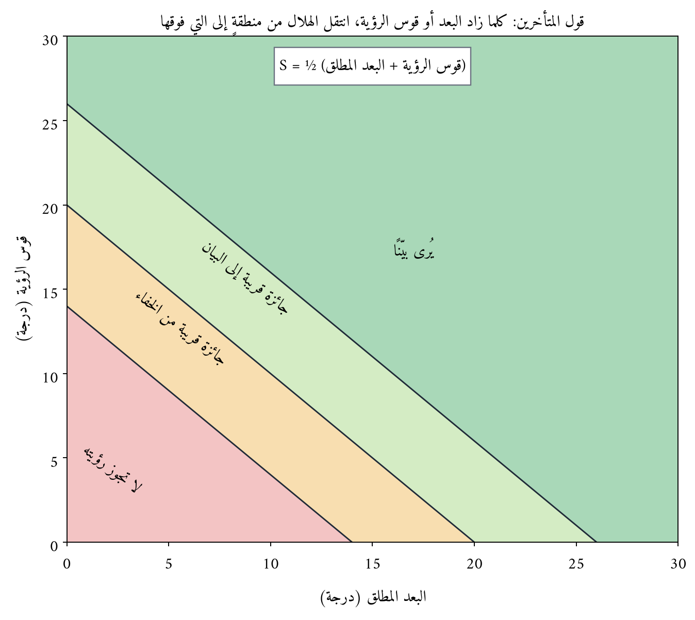
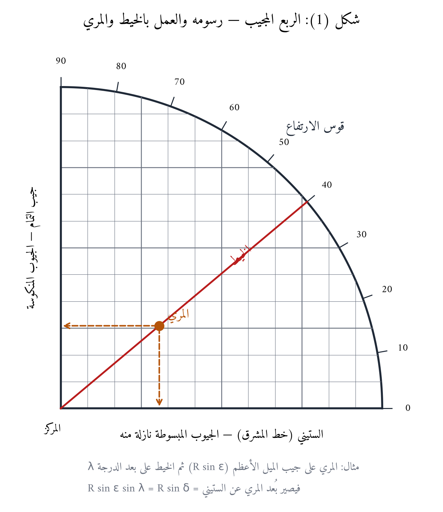
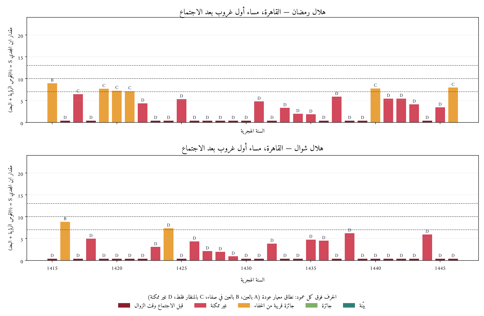
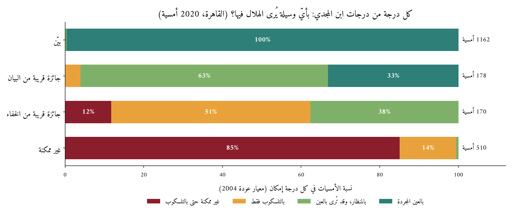
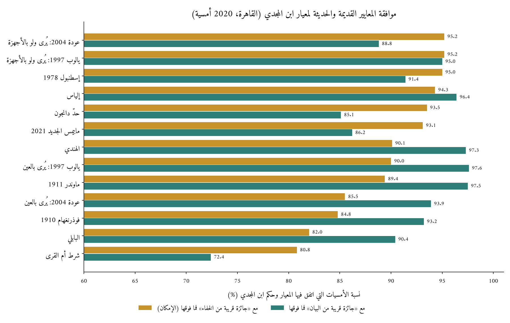
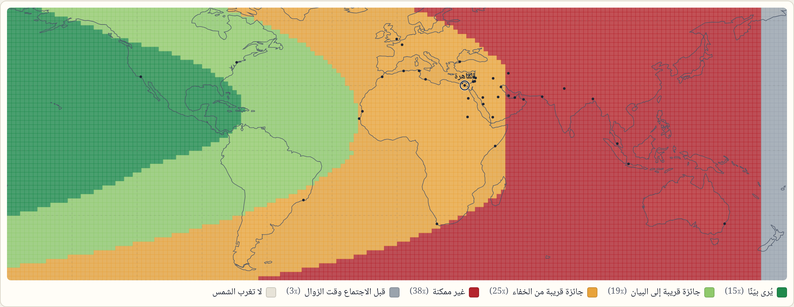
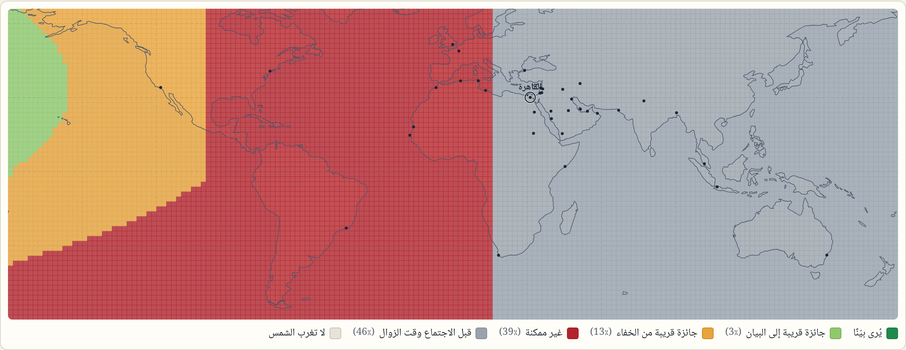
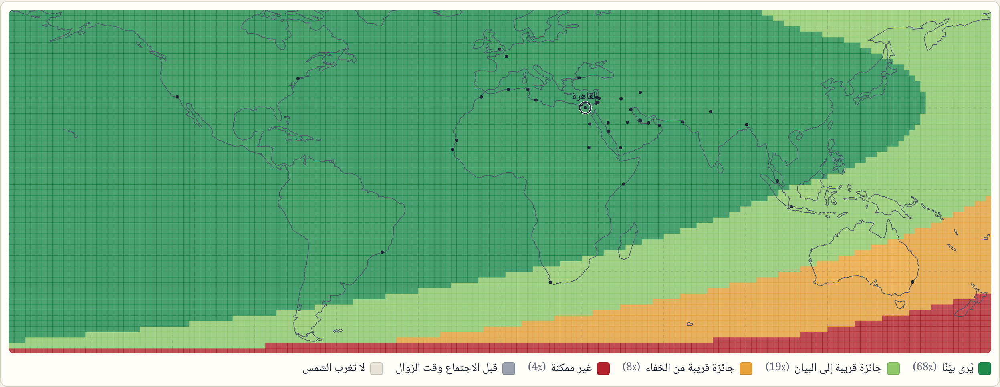

# ملخص المقترح

يقترح هذا المشروع أن تُعرض قرارات دار الإفتاء المصرية في إثبات أوائل الشهور القمرية، على مدى نحو 130 سنة (من نحو 1317 هـ إلى 1447 هـ)، على المعيار الذي وضعه شهاب الدين ابن المجدي (ت 850 هـ)، مؤقّت الجامع الأزهر، في رسالته «خلاصة الأقوال في معرفة الوقت ورؤية الهلال». ويُحسب كل مساءٍ من أمسيات الترائي بخطوات الرسالة نفسها، ثم يُقارن حكم ابن المجدي بقرار دار الإفتاء وبالمعايير الفلكية الحديثة.

وللمشروع غايتان:

1. **معرفة مدى مطابقة معيار ابن المجدي لقرارات دار الإفتاء**، وأيّ أقواله أقرب إليها، وهل تغيّرت المطابقة عبر العقود.
2. **استخراج «معيار دار الإفتاء»**: معيارٌ يحفظ متغيرات ابن المجدي وبنيته، وتُستخرج حدوده من قرارات دار الإفتاء نفسها، فيكون امتدادًا مصريًا موثقًا لتراثٍ فلكي نشأ في الأزهر.

# خلفية المشروع

## ابن المجدي ورسالته

كان ابن المجدي من أعلام علم الميقات في العصر المملوكي، تولّى التوقيت بالجامع الأزهر، وتتلمذ عليه سبط المارديني وغيره. ورسالته «خلاصة الأقوال» مختصرٌ عملي في معرفة الأوقات ورؤية الهلال، يُستعمل فيه الربع المجيب (الستيني) والتقويم، ويحيل في باب الهلال إلى كتابه «غنية الفهيم والطريق إلى حل التقويم».

## معيار ابن المجدي في سطور

يمرّ حكم ابن المجدي على الهلال بثلاث مراحل:

1. **شرط الزوال**: يُنظر في البعد المعدّل بين النيّرين وقت الزوال؛ فإن كان القمر لم يتجاوز الشمس فالحكم «قبل الاجتماع»، وإن لم يتجاوز البعد «دل» (⁦4;30⁩ درجة) فالرؤية غير ممكنة.
2. **الحساب إلى وقت الغروب**: تُنقل المقوّمات إلى وقت الغروب بحصة البعد، ويُصحّح القمر باختلاف المنظر طولًا وعرضًا من جدول الرسالة، ثم يُستخرج المكث وقوس الرؤية وقوس الارتفاع والبعد المعدّل والنور.
3. **الحكم**: يُجمع قوس الرؤية والبعد في مقدارٍ واحد هو نصف مجموعهما: S = ½ (قوس الرؤية + البعد). فإن نقص عن 7 فالرؤية غير ممكنة، ومن 7 إلى 10 فهي «جائزة قريبة من الخفاء»، ومن 10 إلى 13 «جائزة قريبة من البيان»، وما زاد على 13، أو استوفى القول الأول (مكث 12 وقوس رؤية 12 وارتفاع 10)، فالهلال «بيّن».

## الأداة المحسوبة على الربع الستيني

كانت هذه الحسابات تُجرى على الربع المجيب بنصف قطر ستين جزءًا. وقد أعيد بناؤها خطوةً خطوة في الدراسة المرفقة، ثم برمجتها، فصار في الإمكان حساب أي أمسية في أي سنة وأي مدينة بطريقة الرسالة نفسها.

# المعايير الفلكية لرؤية الهلال

المعيار قاعدةٌ تحكم من معطيات الحساب بإمكان رؤية الهلال أو امتناعها. وقد تعاقبت المعايير منذ البابليين إلى اليوم، ويمكن تقسيمها بحسب ما تحكم به إلى ثلاثة أنواع:

- **معايير الإمكان المطلق**: تحكم بأن الهلال لا يُرى أصلًا ولو بأقوى الأجهزة، مثل حدّ دانجون.
- **معايير الرؤية بالعين المجردة**: وهي أكثر المعايير القديمة، ومنها معيار ابن المجدي في أعلى درجاته.
- **المعايير المتدرجة**: تفرّق بين الرؤية بالعين المجردة، والرؤية بالمنظار (الثنائي)، والرؤية بالتلسكوب فقط، والامتناع؛ مثل معياري يالوب وعودة.

## جدول المعايير

| المعيار | السنة | المتغيرات | شرط الرؤية |
|---|---|---|---|
| البابلي | الألف الأول ق.م | عمر القمر، والمكث | العمر 24 ساعة فأكثر، والمكث 48 دقيقة فأكثر |
| القول الأول عند ابن المجدي (عن المتقدمين) | — | المكث، وقوس الرؤية، والارتفاع | المكث 12 درجة، وقوس الرؤية 12، والارتفاع 10 |
| ابن يونس (عن «غنية الفهيم») | القرن الرابع الهجري | المكث، والارتفاع، والنور | المكث 8 درجات، والارتفاع 6½، والنور 10 |
| كوشيار | القرن الخامس الهجري | البعد، والمكث، وقوس الرؤية | اثنان من ثلاثة: 10 و8 و12 |
| **ابن المجدي** | **القرن التاسع الهجري** | **البعد وقت الزوال، وقوس الرؤية، والبعد المعدّل** | **البعد وقت الزوال أكبر من ⁦4;30⁩، ثم S = ½(قوس الرؤية + البعد): 7 و10 و13** |
| فوذرنغهام | 1910 | قوس الرؤية، وفرق السمت | قوس الرؤية لا يقل عن 12 − 0.008 × (فرق السمت)² |
| ماوندر | 1911 | قوس الرؤية، وفرق السمت | قوس الرؤية لا يقل عن 11 − 0.05 × فرق السمت − 0.01 × (فرق السمت)² |
| الهندي (شوخ) | 1930 | قوس الرؤية، وفرق السمت | قوس الرؤية لا يقل عن 10.37 − 0.0137 × فرق السمت − 0.0097 × (فرق السمت)² |
| دانجون | 1936 | البعد الزاوي | لا يُرى الهلال أصلًا إذا قلّ البعد عن 7 درجات |
| إسطنبول | 1978 | الارتفاع، والبعد | الارتفاع 5 درجات فأكثر، والبعد 8 فأكثر عند الغروب |
| إلياس | 1984 | البعد الزاوي | البعد 10.5 درجات فأكثر |
| يالوب | 1997 | قوس الرؤية، وعرض الهلال | قيمة q، وست درجات من A إلى F |
| أم القرى (شرط تقويمي) | 1423 هـ | الاجتماع، والمكث | الاجتماع قبل الغروب، وغروب القمر بعد الشمس |
| عودة | 2004 | قوس الرؤية، وعرض الهلال | قيمة V، وأربع درجات من A إلى D |
| مابيمس الجديد | 2021 | الارتفاع، والبعد | الارتفاع 3 درجات فأكثر، والبعد 6.4 فأكثر عند الغروب |

## درجات الإمكان في المعايير الحديثة

يفرّق معيارا يالوب وعودة بين وسائل الرؤية. واعتمدنا في المقارنة درجات معيار عودة، مع ما يقابلها عند يالوب:

| درجة الإمكان | معيار عودة | معيار يالوب |
|---|---|---|
| يُرى بالعين المجردة | A | A وB |
| يُرى بالمنظار، وقد يُرى بالعين المجردة في صفاء الجو | B | C |
| يُرى بالتلسكوب فقط | C | D |
| لا يُرى حتى بالتلسكوب | D | E وF |

# نتائج أولية

## هلالا رمضان وشوال عبر السنين

حُسبت أمسيات أول غروبٍ بعد الاجتماع لهلالي رمضان وشوال في القاهرة على مدى 32 سنة هجرية (64 أمسية)، وقورن حكم ابن المجدي بنطاقات معيار عودة (2004). فكان الحكم «غير ممكنة» أو «قبل الاجتماع» عند ابن المجدي مقابلًا للنطاق D (غير ممكنة) في 55 أمسية، وكان الحكم «جائزة قريبة من الخفاء» مقابلًا للنطاقين B وC (بالعين في صفاء أو بالمنظار) في 7 أمسيات. أي أن الحكمين اتفقا في 62 من 64 أمسية (نحو 97%).

## مدى توافق معيار ابن المجدي مع درجات الإمكان

حُسبت 2020 أمسية في القاهرة (1990–2025 تقريبًا، المساء الأول والثاني والثالث بعد كل اجتماع)، وصُنّفت كل أمسية بدرجة ابن المجدي وبدرجة الإمكان عند عودة. فكان توزيع الأمسيات:

| درجة ابن المجدي | بالعين المجردة | بالمنظار | بالتلسكوب فقط | غير ممكنة | المجموع |
|---|---|---|---|---|---|
| بيّن | 1158 | 4 | 0 | 0 | 1162 |
| جائزة قريبة من البيان | 59 | 112 | 7 | 0 | 178 |
| جائزة قريبة من الخفاء | 0 | 64 | 86 | 20 | 170 |
| غير ممكنة (ومنها قبل الاجتماع) | 0 | 3 | 73 | 434 | 510 |

ويظهر من الجدول أن درجات ابن المجدي الثلاث تقابل درجات الإمكان الحديثة واحدةً بواحدة:

| حكم ابن المجدي | يقابل في المعيار الحديث | نسبة الاتفاق |
|---|---|---|
| «بيّن» | الرؤية بالعين المجردة (A) | **96.9%** |
| «جائزة قريبة من البيان» فما فوقها | الرؤية بالمنظار أو بالعين (A وB) | **96.3%** |
| «جائزة قريبة من الخفاء» فما فوقها | الرؤية ولو بالتلسكوب (A وB وC) | **95.2%** |

فـ«البيّن» عند ابن المجدي هو ما يُرى بالعين المجردة بلا شك، والدرجة «القريبة من البيان» هي في الغالب ما يُرى بالمنظار وقد يُرى بالعين، والدرجة «القريبة من الخفاء» هي في الغالب ما لا يُرى إلا بالتلسكوب أو المنظار. أما حكمه بالامتناع فيوافق امتناع الرؤية حتى بالتلسكوب في 85% من الحالات، والباقي في الغالب أمسياتٌ لا يُرى فيها الهلال إلا بالتلسكوب. وهذا يعني أن ابن المجدي، بأدوات القرن التاسع الهجري، رسم حدودًا لرؤية العين المجردة ودرجات الشك قريبةً جدًا مما وصلت إليه المعايير الحديثة بالأرصاد الكثيرة والأجهزة.

## موافقة المعايير الأخرى لمعيار ابن المجدي

قورن كل معيار من جدول المعايير بحكم ابن المجدي في الأمسيات نفسها، مرةً بحدّ الإمكان عنده (جائزة قريبة من الخفاء فما فوقها)، ومرةً بحدّ الرؤية الواضحة (جائزة قريبة من البيان فما فوقها):

| المعيار | موافقته لحدّ الإمكان عند ابن المجدي | موافقته لحدّ الرؤية الواضحة | موافقته للرؤية بالعين (عودة A) | موافقته للرؤية بالتلسكوب (عودة A–C) |
|---|---|---|---|---|
| يالوب: يُرى ولو بالأجهزة (A–D) | 95.2% | 95.0% | 89.1% | 93.7% |
| إسطنبول 1978 | 95.0% | 91.4% | 86.7% | 96.0% |
| إلياس | 94.3% | 96.4% | 90.8% | 90.0% |
| دانجون | 93.5% | 85.1% | 79.1% | 93.1% |
| مابيمس الجديد 2021 | 93.1% | 86.2% | 80.1% | 97.2% |
| الهندي | 90.1% | 97.3% | 95.4% | 87.3% |
| يالوب: يُرى بالعين (A–B) | 90.0% | 97.6% | 95.4% | 87.3% |
| ماوندر 1911 | 89.4% | 97.5% | 96.1% | 86.6% |
| فوذرنغهام 1910 | 84.8% | 93.2% | 99.3% | 82.0% |
| البابلي | 82.0% | 90.4% | 95.8% | 79.3% |
| شرط أم القرى | 80.8% | 72.4% | 66.3% | 83.6% |

ويُستخلص من المقارنة:

- **حدّ الإمكان عند ابن المجدي** (S = 7) أقرب ما يكون إلى معايير الرؤية بالأجهزة: يالوب (A–D) وعودة (A–C) وإسطنبول، بموافقة نحو 95%.
- **حدّ الرؤية الواضحة عنده** (S = 10) أقرب إلى معايير العين المجردة: يالوب (A–B) وماوندر والمعيار الهندي، بموافقة نحو 97%.
- **شرط أم القرى** أبعد المعايير عن ابن المجدي؛ لأنه شرطٌ تقويمي لا معيارُ رؤية، ويجيز أمسياتٍ كثيرة يمتنع فيها الهلال.

## مثال تطبيقي: رمضان وعيد الفطر 1446 هـ (2025 م)

أُخذت صور المعيار من برنامج الخريطة لأمسيات الترائي الثلاث. وقد أعلنت دار الإفتاء أن السبت 1 مارس 2025 أول رمضان، بعد استطلاع الهلال مساء الجمعة 28 فبراير؛ وأن الأحد 30 مارس متمم لشهر رمضان، والإثنين 31 مارس أول أيام عيد الفطر.

| | مساء 28 فبراير (هلال رمضان) | مساء 29 مارس (هلال شوال) | مساء 30 مارس |
|---|---|---|---|
| الاجتماع (غرينتش) | 28 فبراير 00:45 | 29 مارس 10:58 | — |
| عمر القمر عند الغروب | نحو 15 ساعة | نحو 5 ساعات | نحو 29 ساعة |
| البعد وقت الزوال | ⁦5;13⁩ (أكبر من «دل») | سالب: لم يجاوز القمرُ الشمس | ⁦13;32⁩ |
| غروب الشمس / القمر (القاهرة) | 17:53 / 18:29 | 18:11 / 18:22 | 18:12 / 19:33 |
| المكث | نحو 37 دقيقة | نحو 11 دقيقة | نحو 80 دقيقة |
| قوس الرؤية / البعد المعدّل | ⁦7;52⁩ / ⁦8;02⁩ | — | ⁦16;54⁩ / ⁦16;45⁩ |
| مقدار ابن المجدي S | ⁦7;57⁩ | — | ⁦16;49⁩ |
| **حكم ابن المجدي** | **جائزة قريبة من الخفاء** | **قبل الاجتماع وقت الزوال** | **بيّن** |
| معيار عودة | C: بالمنظار فقط | D: غير ممكنة | A: بالعين المجردة |
| قرار دار الإفتاء | ثبوت الرؤية: السبت 1 مارس أول رمضان | عدم الرؤية: الأحد 30 مارس متمم لرمضان | الإثنين 31 مارس أول شوال |

ويظهر من المثال أن قرارات دار الإفتاء الثلاثة موافقةٌ لمعيار ابن المجدي:

- **قرار رمضان**: أُعلنت الرؤية مساء 28 فبراير، والحكم عند ابن المجدي «جائزة قريبة من الخفاء»، أما المعيار الحديث فيشترط المنظار. فابن المجدي هنا أقرب إلى قرار دار الإفتاء من معيار عودة.
- **إتمام رمضان**: لم تثبت الرؤية مساء 29 مارس، والقمر عند ابن المجدي قبل الاجتماع وقت الزوال، وعند عودة غير ممكن الرؤية؛ فالقرار موافق للمعيارين.
- **عيد الفطر**: مساء 30 مارس الهلال «بيّن» عند ابن المجدي، وفي النطاق A عند عودة؛ فثبت أول شوال الإثنين 31 مارس.

# أهداف المشروع

1. بناء قاعدة بيانات موثّقة بأوائل الشهور القمرية التي أعلنتها دار الإفتاء خلال 130 سنة، مع أساس كل قرار.
2. حساب كل أمسية ترائٍ بطريقة ابن المجدي، وبمعياري عودة ويالوب للمقارنة.
3. قياس المطابقة بين قرارات دار الإفتاء ومعيار ابن المجدي بأقواله الثلاثة، ومع المعايير الحديثة، إجمالًا وحسب العقود والشهور.
4. استخراج «معيار دار الإفتاء» على بنية ابن المجدي، بأربع درجات، مع حدود الثقة واختبار الثبات عبر الزمن.
5. إصدار تقرير علمي، وبرنامج خريطة يحمل المعيار الجديد، يمكن لدار الإفتاء استعماله في التقدير المسبق لأمسيات الترائي.

# المنهجية

## البيانات

يُدخل لكل شهرٍ هجري صفٌّ واحد في قالب Excel معدّ: السنة والشهر الهجريان، وتاريخ أول الشهر المعلن (أهم الأعمدة)، وأساس القرار (رؤية، إكمال، حساب)، ومكان الرؤية وعدد الشهود إن وُجد، ورقم المرجع في السجل. ومدة 130 سنة نحو 1560 شهرًا.

ويكفي تاريخ أول الشهر لاستنتاج نتيجة الترائي: فإن كان الشهر السابق 29 يومًا فقد أُعلنت الرؤية مساء التاسع والعشرين، وإن كان 30 يومًا فلم تُعلن الرؤية وأُكمل الشهر. وقد اختُبرت هذه الطريقة على البيانات التجريبية فاستردّت النتائج كاملة.

## الحساب

يحسب البرنامج لكل أمسية متغيرات ابن المجدي (البعد وقت الزوال، والمكث، وقوس الرؤية، والارتفاع، والبعد المعدّل، والنور، ومقدار S، والحكم)، ومتغيرات المعايير الحديثة (عمر القمر، والمكث الحقيقي، وقيمة V عند عودة، وq عند يالوب).

## قياس المطابقة

تُقاس نسبة الاتفاق، والحساسية (نسبة الأمسيات المعلنة رؤيتها التي يجيزها المعيار)، والنوعية (نسبة الأمسيات غير المعلنة التي يمنعها)، والدقة المتوازنة. وتُفصّل حسب العقود الهجرية، وحسب أساس القرار.

## استخراج معيار دار الإفتاء

يُحفظ في المعيار المستخرج شرط الزوال، ويُبحث عن أنسب وزنٍ بين قوس الرؤية والبعد وأنسب حدّ، بالصيغة: S_w = w × قوس الرؤية + (1 − w) × البعد ≥ T. ثم يُستخرج من الانحدار اللوجستي أربع درجات على غرار ابن المجدي (احتمال الرؤية 10% و50% و90%). وتُقدّر حدود الثقة بإعادة المعاينة، ويُختبر الثبات بتدريب المعيار على النصف الأقدم واختباره على الأحدث.

# مخرجات المشروع

1. **قاعدة البيانات**: ملف Excel موثّق بقرارات 130 سنة.
2. **جدول الحساب**: لكل أمسية متغيرات ابن المجدي والمعايير الحديثة، في ست أوراق مرتّبة من اليمين إلى اليسار.
3. **تقرير المطابقة**: نسب الاتفاق ورسومها، والأمسيات المختلف فيها مفصّلة.
4. **معيار دار الإفتاء**: صيغته وحدوده ودرجاته وحدود ثقته.
5. **برنامج الخريطة المحدَّث**: يعرض معيار دار الإفتاء إلى جانب معيار ابن المجدي لأي تاريخ ومدينة.
6. **بحث علمي** قابل للنشر في مجلة محكّمة، وعرض تقديمي.

# مراحل العمل

1. الاتفاق على قالب البيانات، وتعيين منسّق من دار الإفتاء.
2. إدخال البيانات من السجلات ومراجعتها (نحو 1560 شهرًا).
3. الحساب، وتقرير المطابقة الأولي.
4. استخراج المعيار واختبار ثباته، ومراجعة الحالات المختلف فيها مع دار الإفتاء.
5. التقرير النهائي، والبرنامج المحدَّث، والعرض.

ويمكن البدء بعيّنة من السنوات الأحدث لعرض نتائج أولية، ثم استكمال المدة كلها.

# ما نحتاجه من دار الإفتاء

1. السماح بالاطلاع على سجلات إثبات أوائل الشهور، أو تكليف من يدخلها في القالب.
2. بيان أساس كل قرار (رؤية محلية، أو رؤية في بلدٍ آخر، أو إكمال، أو حساب)، وهو أهم ما يُفسّر الحالات المختلف فيها.
3. تعيين منسّق علمي للمراجعة والإجابة عن الاستفسارات.
4. الموافقة على نشر النتائج العلمية باسم دار الإفتاء أو بالشراكة معها.

# تحفظات منهجية

- القرار الرسمي ليس رصدًا خالصًا: قد يُبنى على شهادة، أو على رؤية في بلدٍ آخر، أو على الحساب. ولهذا لا يُستخرج المعيار إلا من القرارات المبنية على الرؤية المحلية، ويُعرض الباقي منفصلًا.
- نتيجة «لم يُر» لا تعني أن الهلال كان غير ممكن الرؤية؛ فقد يحول الغيم أو قلة المترائين.
- الرسم المأخوذ من البيانات التجريبية مثالٌ على شكل المخرجات، وليس نتيجةً من بيانات دار الإفتاء.

# الملاحق

- الدراسة: «رسالة خلاصة الأقوال لابن المجدي: دراسة وتحليل».
- البحث المستقل: «معيار ابن المجدي لرؤية الهلال».
- منهج المشروع وأدواته (وثيقة تقنية).
- قالب إدخال البيانات (ملف Excel).
- برنامج الخريطة: https://claude.ai/artifact/VC2iVk7P8b6emccEZLU2ux
