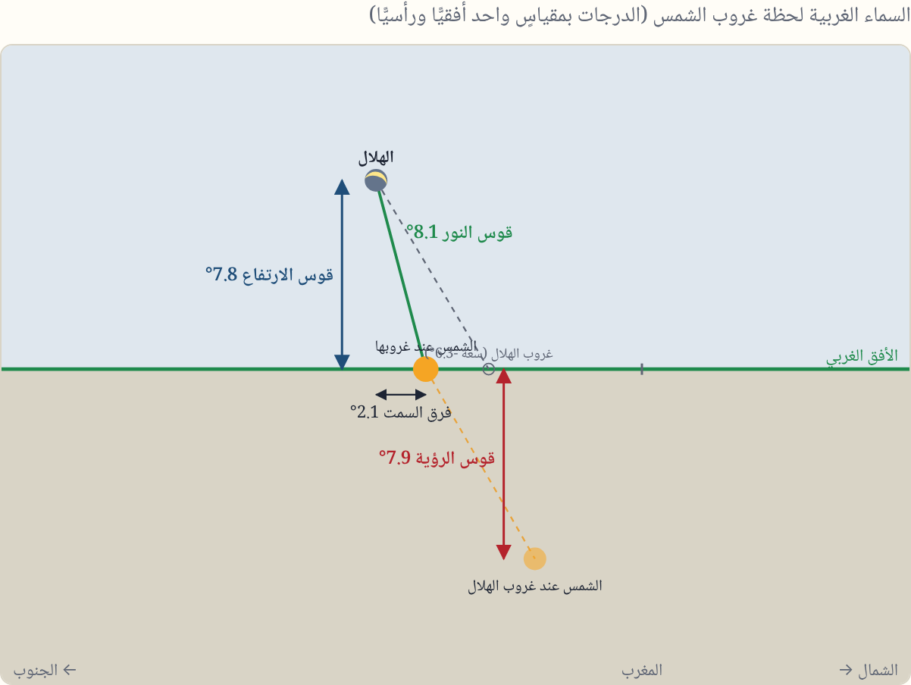
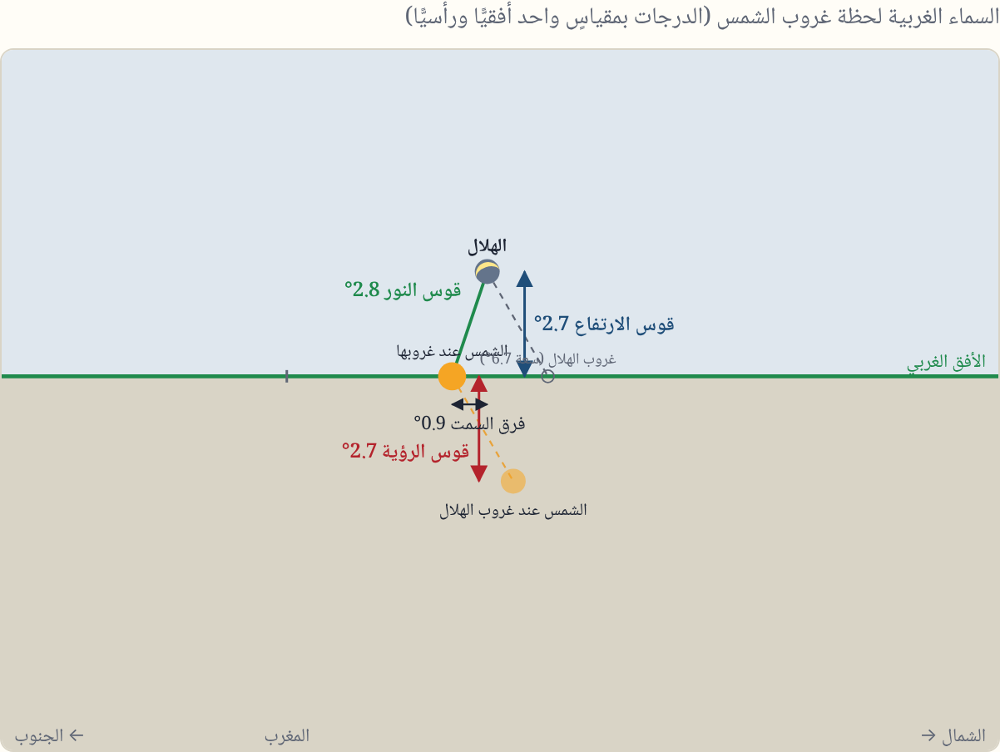
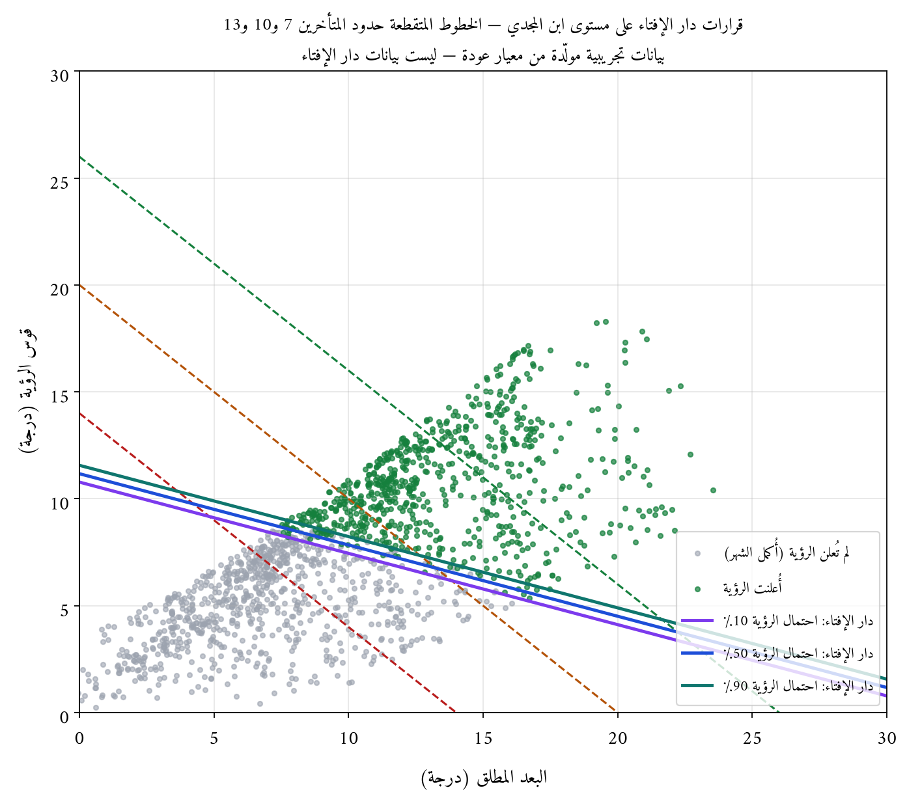

# ملخص المقترح

يقترح هذا المشروع أن تُعرض قرارات دار الإفتاء المصرية في إثبات أوائل الشهور القمرية، على مدى نحو 130 سنة (من نحو 1317 هـ إلى 1447 هـ)، على المعيار الذي وضعه شهاب الدين ابن المجدي (ت 850 هـ)، مؤقّت الجامع الأزهر، في رسالته «خلاصة الأقوال في معرفة الوقت ورؤية الهلال». ويُحسب كل مساءٍ من أمسيات الترائي بخطوات الرسالة نفسها، ثم يُقارن حكم ابن المجدي بقرار دار الإفتاء وبالمعايير الفلكية الحديثة.

وللمشروع غايتان:

1. **معرفة مدى مطابقة معيار ابن المجدي لقرارات دار الإفتاء**، وأيّ أقواله أقرب إليها، وهل تغيّرت المطابقة عبر العقود.
2. **استخراج «معيار دار الإفتاء»**: معيارٌ يحفظ متغيرات ابن المجدي وبنيته، وتُستخرج حدوده من قرارات دار الإفتاء نفسها، فيكون امتدادًا مصريًا موثقًا لتراثٍ فلكي نشأ في الأزهر.

وقد أُنجز الجانب العلمي والبرمجي التمهيدي كله: دراسة الرسالة، وصياغة المعيار، وبرنامج الخريطة، وبرنامج المطابقة مختبرًا على بياناتٍ تجريبية. ولم يبقَ إلا إدخال بيانات دار الإفتاء.

# خلفية المشروع

## ابن المجدي ورسالته

كان ابن المجدي من أعلام علم الميقات في العصر المملوكي، تولّى التوقيت بالجامع الأزهر، وتتلمذ عليه سبط المارديني وغيره. ورسالته «خلاصة الأقوال» مختصرٌ عملي في معرفة الأوقات ورؤية الهلال، يُستعمل فيه الربع المجيب (الستيني) والتقويم، ويحيل في باب الهلال إلى كتابه «غنية الفهيم والطريق إلى حل التقويم».

## معيار ابن المجدي في سطور

يمرّ حكم ابن المجدي على الهلال بثلاث مراحل:

1. **شرط الزوال**: يُنظر في البعد المعدّل بين النيّرين وقت الزوال؛ فإن كان القمر لم يتجاوز الشمس فالحكم «قبل الاجتماع»، وإن لم يتجاوز البعد «دل» (⁦4;30⁩ درجة) فالرؤية غير ممكنة.
2. **الحساب إلى وقت الغروب**: تُنقل المقوّمات إلى وقت الغروب بحصة البعد، ويُصحّح القمر باختلاف المنظر طولًا وعرضًا من جدول الرسالة، ثم يُستخرج المكث وقوس الرؤية وقوس الارتفاع والبعد المعدّل والنور.
3. **الحكم**: يُجمع قوس الرؤية والبعد في مقدارٍ واحد هو نصف مجموعهما: S = ½ (قوس الرؤية + البعد). فإن نقص عن 7 فالرؤية غير ممكنة، ومن 7 إلى 10 فهي «جائزة قريبة من الخفاء»، ومن 10 إلى 13 «جائزة قريبة من البيان»، وما زاد على 13، أو استوفى القول الأول (مكث 12 وقوس رؤية 12 وارتفاع 10)، فالهلال «بيّن».

## الأداة المحسوبة على الربع الستيني

كانت هذه الحسابات تُجرى على الربع المجيب بنصف قطر ستين جزءًا. وقد أعيد بناؤها خطوةً خطوة في الدراسة المرفقة، ثم برمجتها، فصار في الإمكان حساب أي أمسية في أي سنة وأي مدينة بطريقة الرسالة نفسها.

# ما أُنجز حتى الآن

| العمل | الحالة |
|---|---|
| دراسة الرسالة في ضوء الدراسات السابقة، مع الرسوم والمعادلات والتعليق التراثي | منجزة (ملف Word وPDF) |
| بحث مستقل في معيار ابن المجدي: صياغته ومتغيراته واختباره | منجز |
| مقابلة نص الرسالة بنص «غنية الفهيم» في باب الهلال | منجزة |
| برنامج خريطة العالم لدرجات المعيار، مع اختيار التاريخ والمدينة | منجز ومنشور |
| محرك حساب المعيار لأي تاريخ خلال القرون الأخيرة | منجز |
| برنامج المطابقة واستخراج المعيار، وقالب إدخال البيانات | منجز ومختبر على بياناتٍ تجريبية |
| إدخال بيانات دار الإفتاء لـ 130 سنة | **مطلوب من دار الإفتاء** |

## نتيجة أولية: مطابقة المعيار للمعايير الحديثة

حُسبت أمسيات أول غروبٍ بعد الاجتماع لهلالي رمضان وشوال في القاهرة على مدى 32 سنة هجرية (64 أمسية)، وقورن حكم ابن المجدي بنطاقات معيار عودة (2004). فكان الحكم «غير ممكنة» أو «قبل الاجتماع» عند ابن المجدي مقابلًا للنطاق D (غير ممكنة) في 55 أمسية، وكان الحكم «جائزة قريبة من الخفاء» مقابلًا للنطاقين B وC (بالعين في صفاء أو بالمنظار) في 7 أمسيات. أي أن الحكمين اتفقا في 62 من 64 أمسية (نحو 97%).

وفي البحث المستقل قورن المعيار بمعياري عودة ويالوب في أكثر من ألفي أمسية، فوُجد أن الحدّ الأدنى عند ابن المجدي (7) يقابل تقريبًا حدّ الرؤية بالمنظار، وأن حدّ «البيان» (13) يقابل الرؤية بالعين المجردة بسهولة.

## مثال تطبيقي: رمضان وعيد الفطر 1446 هـ (2025 م)

أُخذت صور المعيار من برنامج الخريطة لمساءي الترائي:

| | مساء 28 فبراير 2025 (هلال رمضان) | مساء 29 مارس 2025 (هلال شوال) |
|---|---|---|
| الاجتماع (بتوقيت غرينتش) | 28 فبراير 00:45 | 29 مارس 10:58 |
| عمر القمر عند الغروب | نحو 15 ساعة | نحو 5 ساعات |
| البعد وقت الزوال | ⁦5;13⁩ درجة (أكبر من «دل») | سالب: القمر لم يجاوز الشمس |
| غروب الشمس / القمر في القاهرة | 17:53 / 18:29 | 18:11 / 18:22 |
| المكث | نحو 37 دقيقة | نحو 11 دقيقة |
| قوس الرؤية / البعد المعدّل | ⁦7;52⁩ / ⁦8;02⁩ درجة | — |
| مقدار ابن المجدي S | ⁦7;57⁩ | — |
| **حكم ابن المجدي** | **جائزة قريبة من الخفاء** | **قبل الاجتماع وقت الزوال** |
| معيار عودة | C: بالمنظار فقط | D: غير ممكنة |
| قرار دار الإفتاء (يُراجع على السجل الرسمي) | أول رمضان السبت 1 مارس | عيد الفطر الأحد 30 مارس |

ويظهر من المثال أمران:

- **قرار رمضان** موافقٌ لحكم ابن المجدي («جائزة قريبة من الخفاء»)، أما المعيار الحديث فيشترط المنظار.
- **قرار العيد**: إن ثبت أنه بُني على إعلان رؤيةٍ مساء 29 مارس، فهو يخالف ابن المجدي والمعايير الحديثة معًا؛ إذ كان القمر قبل الاجتماع وقت الزوال. وقد يكون للقرار أساسٌ آخر غير الرؤية المحلية. ولهذا يطلب المشروع عمود «أساس القرار» لكل شهر؛ فلا يُحكم على قرارٍ قبل معرفة أساسه.

**تنبيه**: تاريخا القرارين أُخذا من الإعلانات المنشورة، ويجب التحقق منهما في سجلات دار الإفتاء.

# أهداف المشروع

1. بناء قاعدة بيانات موثّقة بأوائل الشهور القمرية التي أعلنتها دار الإفتاء خلال 130 سنة، مع أساس كل قرار.
2. حساب كل أمسية ترائٍ بطريقة ابن المجدي، وبمعياري عودة ويالوب للمقارنة.
3. قياس المطابقة بين قرارات دار الإفتاء ومعيار ابن المجدي بأقواله الثلاثة، ومع المعايير الحديثة، إجمالًا وحسب العقود والشهور.
4. استخراج «معيار دار الإفتاء» على بنية ابن المجدي، بأربع درجات، مع حدود الثقة واختبار الثبات عبر الزمن.
5. إصدار تقرير علمي، وبرنامج خريطة يحمل المعيار الجديد، يمكن لدار الإفتاء استعماله في التقدير المسبق لأمسيات الترائي.

# المنهجية

## البيانات

يُدخل لكل شهرٍ هجري صفٌّ واحد في قالب Excel معدّ: السنة والشهر الهجريان، وتاريخ أول الشهر المعلن (أهم الأعمدة)، وأساس القرار (رؤية، إكمال، حساب)، ومكان الرؤية وعدد الشهود إن وُجد، ورقم المرجع في السجل. ومدة 130 سنة نحو 1560 شهرًا.

ويكفي تاريخ أول الشهر لاستنتاج نتيجة الترائي: فإن كان الشهر السابق 29 يومًا فقد أُعلنت الرؤية مساء التاسع والعشرين، وإن كان 30 يومًا فلم تُعلن الرؤية وأُكمل الشهر. وقد اختُبرت هذه الطريقة على البيانات التجريبية فاستردّت النتائج كاملة.

## الحساب

يحسب البرنامج لكل أمسية متغيرات ابن المجدي (البعد وقت الزوال، والمكث، وقوس الرؤية، والارتفاع، والبعد المعدّل، والنور، ومقدار S، والحكم)، ومتغيرات المعايير الحديثة (عمر القمر، والمكث الحقيقي، وقيمة V عند عودة، وq عند يالوب).

## قياس المطابقة

تُقاس نسبة الاتفاق، والحساسية (نسبة الأمسيات المعلنة رؤيتها التي يجيزها المعيار)، والنوعية (نسبة الأمسيات غير المعلنة التي يمنعها)، والدقة المتوازنة. وتُفصّل حسب العقود الهجرية، وحسب أساس القرار.

## استخراج معيار دار الإفتاء

يُحفظ في المعيار المستخرج شرط الزوال، ويُبحث عن أنسب وزنٍ بين قوس الرؤية والبعد وأنسب حدّ، بالصيغة: S_w = w × قوس الرؤية + (1 − w) × البعد ≥ T. ثم يُستخرج من الانحدار اللوجستي أربع درجات على غرار ابن المجدي (احتمال الرؤية 10% و50% و90%). وتُقدّر حدود الثقة بإعادة المعاينة، ويُختبر الثبات بتدريب المعيار على النصف الأقدم واختباره على الأحدث.

# مخرجات المشروع

1. **قاعدة البيانات**: ملف Excel موثّق بقرارات 130 سنة.
2. **جدول الحساب**: لكل أمسية متغيرات ابن المجدي والمعايير الحديثة، في ست أوراق مرتّبة من اليمين إلى اليسار.
3. **تقرير المطابقة**: نسب الاتفاق ورسومها، والأمسيات المختلف فيها مفصّلة.
4. **معيار دار الإفتاء**: صيغته وحدوده ودرجاته وحدود ثقته.
5. **برنامج الخريطة المحدَّث**: يعرض معيار دار الإفتاء إلى جانب معيار ابن المجدي لأي تاريخ ومدينة.
6. **بحث علمي** قابل للنشر في مجلة محكّمة، وعرض تقديمي.

# خطة العمل والجدول الزمني

| المرحلة | العمل | المدة التقديرية |
|---|---|---|
| 1 | الاتفاق على القالب وتسليمه، وتعيين منسّق من دار الإفتاء | أسبوعان |
| 2 | إدخال البيانات من السجلات ومراجعتها (نحو 1560 شهرًا) | تحددها دار الإفتاء حسب حالة السجلات |
| 3 | الحساب وتقرير المطابقة الأولي | أسبوع بعد تسلّم البيانات |
| 4 | استخراج المعيار واختبار ثباته، ومراجعة الحالات المختلف فيها مع دار الإفتاء | ثلاثة أسابيع |
| 5 | التقرير النهائي والبرنامج المحدَّث والعرض | أسبوعان |

ويمكن البدء بعيّنة من السنوات الأحدث (مثل 30 سنة) لعرض نتائج أولية، ثم استكمال المدة كلها.

# ما نحتاجه من دار الإفتاء

1. السماح بالاطلاع على سجلات إثبات أوائل الشهور، أو تكليف من يدخلها في القالب.
2. بيان أساس كل قرار (رؤية محلية، أو رؤية في بلدٍ آخر، أو إكمال، أو حساب)، وهو أهم ما يُفسّر الحالات المختلف فيها.
3. تعيين منسّق علمي للمراجعة والإجابة عن الاستفسارات.
4. الموافقة على نشر النتائج العلمية باسم دار الإفتاء أو بالشراكة معها.

# تحفظات منهجية

- القرار الرسمي ليس رصدًا خالصًا: قد يُبنى على شهادة، أو على رؤية في بلدٍ آخر، أو على الحساب. ولهذا لا يُستخرج المعيار إلا من القرارات المبنية على الرؤية المحلية، ويُعرض الباقي منفصلًا.
- نتيجة «لم يُر» لا تعني أن الهلال كان غير ممكن الرؤية؛ فقد يحول الغيم أو قلة المترائين.
- تاريخا 2025 في هذا المقترح من الإعلانات المنشورة، والأرقام الإجمالية التجريبية ليست نتائج دار الإفتاء.

# الملاحق

- الدراسة: «رسالة خلاصة الأقوال لابن المجدي: دراسة وتحليل».
- البحث المستقل: «معيار ابن المجدي لرؤية الهلال».
- منهج المشروع وأدواته (وثيقة تقنية).
- قالب إدخال البيانات (ملف Excel).
- برنامج الخريطة: https://claude.ai/artifact/VC2iVk7P8b6emccEZLU2ux
