# مقدمة

إنّ التراث العلمي العربي المنتشر في مكتبات العالم لا يزال في حاجةٍ إلى بحثٍ عميقٍ يكشف عن مضمونه، ويبيّن قيمته، ويضعه في موضعه من تاريخ العلم الإنساني. ومن أغنى هذا التراث ما خلّفه علماء الفلك المسلمون في «علم الميقات»، وهو العلم الذي خدم المسلمين في ثلاث حاجاتٍ يوميةٍ لا غنى عنها: معرفة أوقات الصلاة، ومعرفة جهة القبلة، ومعرفة أوائل الشهور برؤية الهلال.

ومن أعلام هذا العلم في عصر المماليك شهابُ الدين أحمد بن رجب بن طيبغا، المعروف بابن المَجْدي (767–850 هـ)، الذي لازم الجامع الأزهر، وانتهت إليه رئاسة الحساب والميقات في القاهرة في زمانه. وله رسالةٌ صغيرة الحجم كبيرة الفائدة عنوانها «خُلاصة الأقوال في معرفة الوقت ورؤية الهلال»، جمع فيها طريقة العمل بالربع المُجيَّب في مسائل الوقت، ثم ختمها بفصلٍ في رؤية الهلال لخّص فيه أقوال الفلكيين في حدود الرؤية.

وقد حقّق هذه الرسالة الأستاذ أروين جولي رخمادي بوتر–بوتر، وقدّم لها بدراسةٍ عن المؤلف ومصطلحات الكتاب[^butar]. غير أنّ الرسالة مكتوبةٌ بأسلوب المؤقّتين المضغوط، الذي يقوم على عباراتٍ من قبيل: «ضع الخيط على كذا، وانقل المريّ إلى كذا، وانزل إلى القوس»، فلا يفهمها القارئ المعاصر إلا إذا عرف الآلة التي كُتبت لها، وعرف ما وراء كل عملٍ من أعمالها من حساب. ولذلك جاءت هذه الدراسة لتحقيق أربعة أغراض:

1. وضع الرسالة في سياقها: علم الفلك والميقات في العصر المملوكي، ومكانة ابن المجدي بين أهله.
2. شرح الرسالة شرحًا واضحًا: كل عملٍ فيها يُعرض نصُّه، ثم يُشرح معناه بعبارةٍ سهلة، ثم يُرسم، ثم يُكتب في صورة معادلة، ثم تُبيَّن طريقة استخراج المعادلة خطوةً خطوة، ثم يُضرب له مثالٌ عددي لمدينة القاهرة، ثم يُعلَّق عليه تعليقًا تراثيًّا.
3. استخراج معيار ابن المجدي لرؤية الهلال، وتعيين متغيراته وقيمها العددية، وفكّ رموزه المكتوبة بحساب الجُمَّل.
4. اختبار هذا المعيار بالحساب الفلكي الحديث، لمعرفة مقدار صوابه.

أما منهج الدراسة فقد اعتمد ثلاثة طرق: **الطريق الوصفي التاريخي** في عرض السياق والدراسات السابقة، و**الطريق التحليلي الرياضي** في تحويل أعمال الربع إلى معادلات، و**الطريق التجريبي الحاسوبي** في اختبار معيار الرؤية؛ إذ كُتب برنامجٌ ينفّذ خطوات ابن المجدي كما وردت في الرسالة، ثم طُبّق على كل أهلّة القاهرة في ستين سنة (1990–2049 م)، أي على 2020 أمسيةً من أمسيات تحرّي الهلال، وقورنت أحكامه بالمعايير الحديثة.

وقد اعتمدت الدراسة على نصّين: التحقيق المنشور الذي أعدّه بوتر–بوتر عن نسختي مكتبة الأزهر ودار الكتب المصرية، والنص المرقون لنسخة الأزهر الذي أعدّته الدكتورة نجلاء شمس[^shams]. ثم أضفنا إليهما فصل «في حساب رؤية الأهلة» من كتاب ابن المجدي «غنية الفهيم والطريق إلى حل التقويم»، الذي تحيل عليه «الخلاصة»، ودرسناه في الباب الثامن.

[^butar]: ابن المجدي: خلاصة الأقوال في معرفة الوقت ورؤية الهلال، تحقيق ودراسة: أروين جولي رخمادي بوتر–بوتر، وأصله بحثٌ لنيل درجة الماجستير في تحقيق التراث بمعهد المخطوطات العربية بالقاهرة (2009 م)، بإشراف الأستاذ الدكتور محمد عبد الوهاب جلال والأستاذ عصام محمد الشنطي، ومقدمة النشر مؤرخة في ميدان (سومطرة الشمالية) 12 ربيع الأول 1441 هـ / 9 نوفمبر 2019 م. وسنشير إليه فيما يأتي بـ«التحقيق».

[^shams]: خلاصة الأقوال، نسخة مكتبة الأزهر المكتوبة سنة 1237 هـ، إعداد: د. نجلاء شمس، مساعد مدير مركز الفلك. وسنشير إليه بـ«النص المرقون».

# الباب الأول: الفلك والميقات في العصر المملوكي

## الفلك في عصر المماليك

حكمت دولة المماليك مصر والشام من سنة 648 هـ إلى سنة 923 هـ (1250–1517 م)، وكانت القاهرة ودمشق في هذا العصر أكبر مركزين للعلم في العالم الإسلامي. وقد عاش ابن المجدي في القرنين الثامن والتاسع الهجريين (الرابع عشر والخامس عشر الميلاديين)، وهو — كما يقول محقق الرسالة — «عصرٌ ازدهر فيه العلم، ويؤكّد ذلك ما خلّفه لنا من الكتب القيّمة، وإن كان بعضها لم يصلنا»[^butar18].

وقد ورث فلكيّو هذا العصر تراثًا طويلًا: فقد وضع ابن يونس المصري (ت 399 هـ) في القاهرة الفاطمية «الزيج الحاكمي»، ووضع جداول لأوقات الصلاة بالقاهرة صارت أساسًا لما بعدها. ثم جاء عصر المماليك فاتجه الفلك فيه اتجاهين متكاملين:

- **اتجاه الهيئة والزيجات**: أي النظر في حركات الكواكب وتصحيح نماذجها. وأشهر أعلامه ابن الشاطر الدمشقي (ت 777 هـ)، رئيس المؤقتين في الجامع الأموي، الذي وضع نماذج جديدة لحركات الكواكب خاليةً من مآخذ النظام البطلمي. وقد شارك ابن المجدي في هذا الاتجاه؛ يقول المحقق: «ولقد تجلّت نشاطات ابن المجدي العلمية في تطوير نظرية حركة الكواكب. ففي هذا التطوير نجد تكملةً لجهود الفلكيين السابقين وتنقيةً لنظام بطليموس من المآخذ، وفي نفس الوقت نجدها محافظةً على درجةٍ عاليةٍ من الدقة في حساب مواضع هذه الكواكب»[^butar21].
- **اتجاه الميقات**: أي خدمة العبادات بمعرفة الأوقات والقبلة والأهلة. وفيه ظهر منصب **المؤقّت** في المساجد الجامعة، وهو عالمٌ بالفلك يحدّد للمؤذنين أوقات الأذان، ويعلّم الطلبة العمل بالآلات. وكثرت في هذا العصر الرسائل في الآلات، ولا سيما **الربع المُجيَّب** و**الربع المُقنطَر**، وكثرت الجداول الجاهزة لأوقات الصلاة في القاهرة ودمشق.

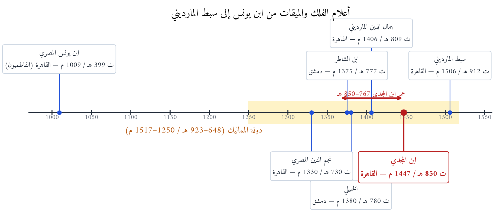

ويبيّن الشكل (1) موقع ابن المجدي في سلسلة هؤلاء الأعلام: فقد أخذ الميقات عن جمال الدين عبد الله بن خليل المارديني (ت 809 هـ)، موقّت الجامع الأزهر، وأخذ عنه بدر الدين محمد بن محمد المعروف بسبط المارديني (ت نحو 912 هـ)، حفيد شيخه من جهة أمه، صاحب الرسائل الكثيرة في الربعين التي انتشرت في العالم الإسلامي قرونًا بعده[^sibt]. فابن المجدي هو الحلقة الوسطى في المدرسة الميقاتية المصرية بين الجدّ والسبط.

[^sibt]: يرد اسم الشيخ في المصادر «المارداني» و«المارديني». ومن تلاميذ ابن المجدي في ترجمة السخاوي «البدر المارداني»، والأظهر أنه بدر الدين سبط المارديني نفسه، فلقبه «البدر» ونسبته إلى جدّه. وانظر في نسب السبط وصلته بجدّه: كشف الظنون 2/1599، وشذرات الذهب 9/105.

[^butar18]: التحقيق، ص 18.

[^butar21]: التحقيق، ص 21–22.

## مكانة ابن المجدي بين فلكيي عصره

يعدّ الباحث الأمريكي دافيد كينج — وهو من أوسع المعاصرين اطلاعًا على مخطوطات الفلك المصري — ابنَ المجدي «من أعلام الفلك في عصره إلى جانب الأعلام الأخرى كابن الشاطر وسبط المارديني»، بل يرى أنه «استطاع أن يمثّل نموذجًا للفلك في العصر المملوكي»[^king20]. وقد كانت كتبه — كما يقول المحقق — «مَعينًا لا ينضب للعلماء في عصره، حيث استحوذ بعضها بدراساتٍ علمية جادة، وشغل العلماء ببعضٍ منها فوضعوا عليها الشروح والتنقيحات والتعليقات»[^butar21b].

ولم يقتصر ابن المجدي على الميقات؛ فقد عرض «لاختلاف قياسات أوج الشمس، وتناول التقاويم المختلفة عند العرب والفرس والقبط والسرياني والعبري، وبحث في تعديل الكواكب وحركاتها التي تختلف من موضعٍ لآخر في المدار»، ووضع «مباحث هامة في معرفة عمق الآبار، وسعة الأنهار، ومسافة ما بين الجبلين»[^butar19]. وبرهن على مسائل كثيرة «بواسطة الخطوط وأشكالها، وبواسطة طريق النسبة وترتيب حدودها، وبواسطة الطرق الهندسية». وهذا المنهج البرهاني هو ما نتابعه في هذه الدراسة حين نحوّل أعمال الربع إلى أشكالٍ ومعادلات.

[^king20]: التحقيق، ص 20 و22، نقلًا عن: David A. King & E. S. Kennedy, *Ibn al-Majdī's Tables for Calculating Ephemerides*, in King, *Islamic Mathematical Astronomy* (London: Variorum Reprints, 1986), p. 48.

[^butar21b]: التحقيق، ص 21.

[^butar19]: التحقيق، ص 19–21.

## الآلة التي كُتبت لها الرسالة: الربع المُجيَّب

الربع المُجيَّب (ويسمّى أيضًا ربع الجيب) لوحٌ من النحاس أو الخشب على هيئة ربع دائرة، عليه خطوطٌ مستقيمة متعامدة كخطوط الشبكة. وقد شاع في العصر المملوكي حتى صار آلة المؤقت الأولى، لأنه سهل الصنع، ولأنه يصلح لكل البلاد، بخلاف الإسطرلاب الذي يحتاج إلى صفيحةٍ خاصة لكل عرض.

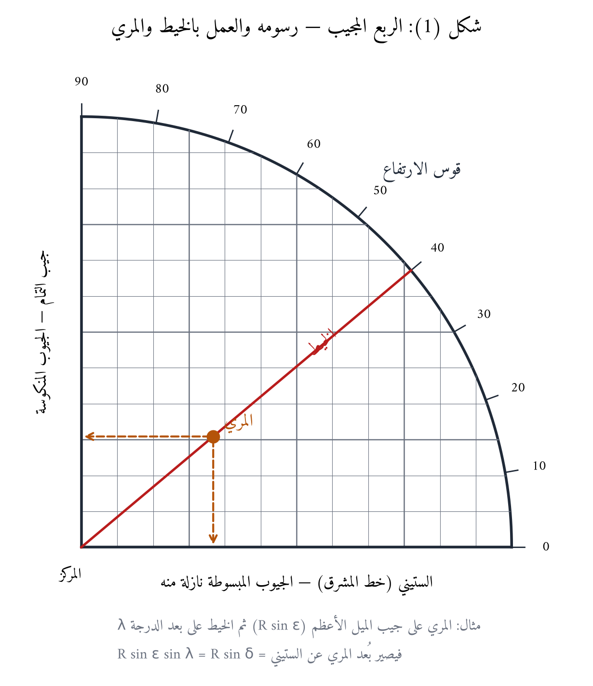

وأجزاؤه كما في الشكل (2):

- **المركز**: رأس الربع، وفيه ثقبٌ يخرج منه الخيط.
- **القوس**: محيط الربع، مقسومٌ تسعين درجة.
- **الستّيني**: أحد ضلعي الربع، وهو نصف القطر مقسومًا ستين قسمًا. وسُمّي ستينيًّا لأن الحساب عندهم كان بالنظام الستيني، فنصف القطر يساوي 60[^sittini].
- **الجيوب المبسوطة**: الخطوط النازلة من الستيني موازيةً للضلع الآخر.
- **الجيوب المنكوسة** (أو المعكوسة): الخطوط النازلة من الضلع الآخر (جيب التمام) موازيةً للستيني.
- **الخيط**: يخرج من المركز ويُمدّ إلى أي درجةٍ من القوس.
- **المَرِيّ**: خرزةٌ صغيرة في الخيط تتحرك عليه، «والأحسن أن يكون لونه مخالفًا للون الخيط»[^mari].

والفكرة التي يقوم عليها الربع بسيطة: إذا مُدّ الخيط إلى قوسٍ ما، كان بُعد أي نقطةٍ عليه عن الستيني مساويًا لبعدها عن المركز مضروبًا في جيب ذلك القوس. فالربع **آلةٌ لضرب الأعداد في الجيوب**، وكل مسائل الفلك الكروي — كما سنرى — ترجع إلى ضربٍ في الجيوب وقسمةٍ عليها.

وعلى بعض الأرباع رسومٌ زائدة تختصر العمل، يبيّنها الشكل (3) كما وصفها جمال الدين المارديني وشارحه علي بن مامي كرباصة: **دائرة الميل** تقطع الستيني على 24 (وهو جيب الميل الأعظم: 60 × جيب ⁦23;35⁩ ≈ 24)، و**دائرة نصف الفضلة** و**دائرة بعد القطر** (وهما خاصتان بعرض بلدٍ بعينه)، و**دائرتا التجييب**، و**قوس العصر**، و**خطوط الساعات الزمانية**. وقد اختلفوا فيها: فالمارديني يرى أنه «لا يُحتاج إليه؛ إذ في وجوده تشويشٌ للناظر، ويحصل المقصود بدونه»، وبعضهم يراها «من محاسن الربع، لأن العمل يحصل بها بسرعةٍ وسهولة». والحق أن دائرتي نصف الفضلة وبعد القطر تربطان الربع بعرضٍ واحد، فيفقد بهما ميزته الكبرى[^karbasa].

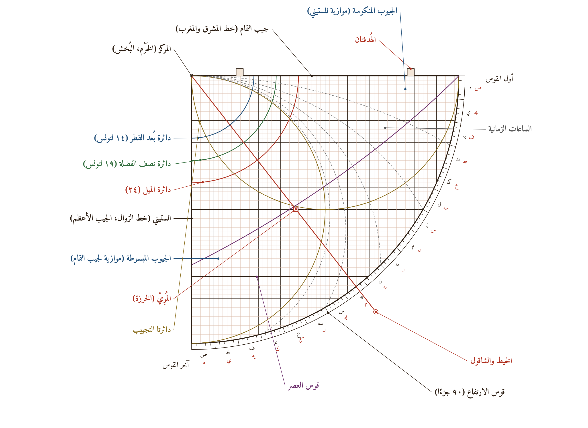

[^karbasa]: اعتمدنا في وصف رسوم الربع ومدرسة المارديني على: تعليقٌ تراثيٌّ على كتاب «إتحاف المحبوب بشرح مجملة المطلوب في العمل بربع الجيوب» لأبي الحسن علي بن مامي الحنفي التونسي المعروف بكرباصة (ق 11 هـ)، وهو شرحٌ على رسالة جمال الدين المارديني، وفيه إعادة رسم أشكال الكتاب وتقويم أمثلته العددية. وسنشير إليه بـ«التعليق على إتحاف المحبوب».

## أنواع الأرباع، ولماذا فضّل المؤقتون الربع المجيب

عرف علم الآلات الإسلامي أنواعًا من الأرباع، أشهرها:

- **ربع الساعات**: لمعرفة الساعات الزمانية من الارتفاع، وأقدم أوصافه في بغداد في القرن الثالث الهجري.
- **الربع المجيب**: شبكةٌ من الجيوب المبسوطة والمنكوسة، يُحلّ بها كل ما يُردّ إلى تناسب أربعة مقادير. وأقدم وصفٍ معروفٍ له في بغداد في القرن الثالث الهجري، ثم شاع منذ القرن الثامن في مصر والشام، وبقي مستعملًا في الدولة العثمانية والمغرب إلى القرن الرابع عشر الهجري.
- **الربع المقنطر**: نُقلت فيه رسوم الإسطرلاب إلى ربع دائرة، وهو مرتبطٌ بعرض بلدٍ بعينه، وظهر في مصر في القرن السابع الهجري.
- **ربع الدستور** و**الربع الشكّازي** و**الربع التام**: أنواعٌ مركّبة؛ فالربع الشكّازي للمارديني يحلّ المسائل لأي عرض، والربع التام لابن الشاطر يجمع أكثر من وجه.

واحتجّ المارديني لاختيار الربع المجيب بأنه «من أحسن الآلات الفلكية»، لثلاثة أسباب: صحة العمل به «وإن بَعُد زمان تخطيطه»، أي أنه لا يرتبط بعرض بلدٍ ولا بزمن؛ و«سهولة اختبار صحة رسومه»؛ و«كون أعماله مبنيةً على قواعد حسابية وبراهين هندسية». وهذه الأسباب نفسها تفسّر اختيار تلميذه ابن المجدي لهذه الآلة في «خلاصة الأقوال».

## مدرسة المارديني: من القاهرة إلى تونس

تمثّل أسرة المارديني ذروة مدرسة الميقات المملوكية. فالجدّ جمال الدين عبد الله بن خليل المارديني (ت 809 هـ) موقّت الجامع الأزهر، صاحب الرسائل في الربع المجيب وربع الدستور والربع الشكّازي، ومنها رسالته «مُجملة المطلوب في العمل بربع الجيوب». وتلميذه ابن المجدي (ت 850 هـ). وسبطه بدر الدين (ت نحو 912 هـ) صاحب «الرسالة الفتحية» و«حاوي المختصرات».

وقد صارت رسائلهم المختصرة «متونًا» مدرسية في العالم العثماني والمغرب، تُحفظ وتُشرح وتُحشّى. ومن أمثلة ذلك أن رسالة المارديني في الربع المجيب شرحها في تونس العثمانية علي بن مامي الحنفي المعروف بكرباصة، في كتابه «إتحاف المحبوب بشرح مجملة المطلوب في العمل بربع الجيوب»، الذي أُلّف نحو سنة 1090 هـ (1679 م)، وضرب فيه الأمثلة العددية على عرض تونس، ونقل كثيرًا عن «حاوي المختصرات» لسبط المارديني. ثم صار هذا الشرح نفسه متنًا شرحه علي النوري الصفاقسي، ووُقفت نسخةٌ منه على رواق المغاربة بالجامع الأزهر. فالكتاب الذي بدأ في الأزهر رجع إليه بعد ثلاثة قرون.

فرسالة ابن المجدي ليست عملًا منفردًا، بل حلقةٌ في مدرسةٍ حيّةٍ امتدت من القاهرة المملوكية إلى تونس العثمانية، وبقيت تُدرَّس إلى القرن الثالث عشر الهجري.

[^sittini]: «السّتّيني هو خطٌّ مستقيمٌ نازلٌ من المركز إلى آخر القوس مقسومٌ مثل جيب التمام». محمد مختار بن عطارد: تقريب المقصد في العمل بالربع المجيب، ص 5، نقلًا عن التحقيق ص 26 و56.

[^mari]: تقريب المقصد، ص 6، نقلًا عن التحقيق ص 26.

# الباب الثاني: ابن المجدي ورسالته

## أصله ونشأته

هو أحمد بن رجب بن طيبغا المجدي العلائي، شهاب الدين، أبو العباس، القاهري الشافعي. ويُعرف بابن المجدي نسبةً إلى جدّه المقرّ الأشرف الأمير الأتابكي طيبغا العلائي، وكان هذا الجدّ أحد مقدّمي الألوف في جيش المماليك[^tarjama].

وُلد ابن المجدي بالقاهرة في العشر الأولى من ذي الحجة سنة 767 هـ (1366 م)، ونشأ بها، فحفظ القرآن الكريم، ودرس ألفية ابن مالك في النحو، وتفقّه على كتاب «منهاج الطالبين وعمدة المفتين» للنووي. وجدّ في طلب العلم حتى «برع في فنونٍ، وتقدّم بذكائه المفرط الذي قلّ أن يُوازى فيه، وأُشير إليه بالتقدّم قديمًا، وصار رأسَ الناس في أنواع الحساب والهندسة والهيئة والفرائض وعلم الوقت بلا منازع»[^sakhawi].

وكان يعيش ملازمًا لداره المجاورة للجامع الأزهر، مستغنيًا عن الناس بما ورثه عن أبيه وجده من أرضٍ وعقارات، بل كان ينفق من ماله على طلبته الفقراء. ولم يُعرف عنه أنه تولّى شيئًا من وظائف الدولة، فكان منصرفًا إلى العلم وحده. وتوفي ليلة السبت حادي عشر ذي القعدة سنة 850 هـ (1447 م) عن أربعٍ وثمانين سنة[^wafat].

[^tarjama]: انظر ترجمته في: السخاوي: الضوء اللامع 1/300–303، السيوطي: بغية الوعاة 1/307 وحسن المحاضرة 1/250، ابن تغري بردي: المنهل الصافي 1/79، الشوكاني: البدر الطالع 56–58، ابن العماد: شذرات الذهب 7/268، الزركلي: الأعلام 1/125، كحالة: معجم المؤلفين 1/138. وانظر: التحقيق، ص 8.

[^sakhawi]: السخاوي: الضوء اللامع 1/300.

[^wafat]: الضوء اللامع 1/301–302، البدر الطالع 57–58. وانظر: التحقيق، ص 9–12.

## شيوخه وتلاميذه

ذكر السخاوي شيوخ ابن المجدي فقال: «تفقّه بالبلقيني وابن الملقّن والكمال الدميري ... وأخذ الفرائض والحساب عن التقي بن عز الدين الحنبلي، واللغة العربية عن الشمس العجيمي ... وفي الميقات ومتعلقاته الجمال المارداني»، وهو جمال الدين المارديني الذي سبق ذكره في الباب الأول. وتخرّج على يديه جماعة، «منهم ابن الجيعان أبو زكريا الدمياطي الذي لازمه وأخذ عنه علوم الرياضيات وتفوّق فيها، والمناوي حسن بن علي بن محمد البدر الذي أخذ عنه الحساب والفلك»[^shuyukh].

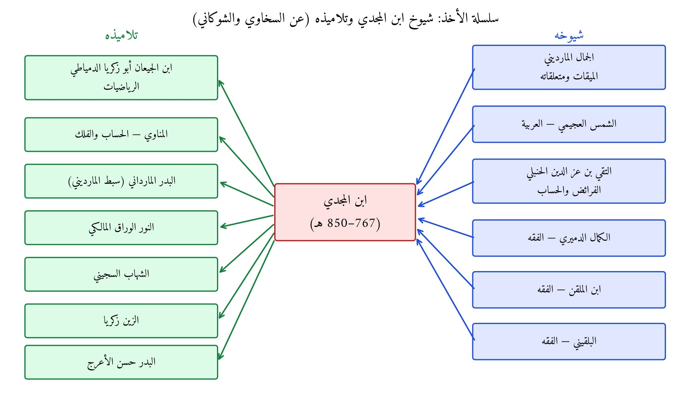

ويُلاحظ من الشكل (4) أن ابن المجدي جمع بين الفقه (على أئمة الشافعية في عصره) والعلوم الرياضية (الحساب والفرائض والميقات). وهذا الجمع ظاهرٌ في رسالتنا: فهو حين يتكلم في الهلال يتكلم بلغة الفلكي، لكنه يجعل غاية كلامه خدمة الحكم الشرعي: متى تكون الرؤية ممكنة، ومتى لا تكون.

[^shuyukh]: الضوء اللامع 1/300، البدر الطالع 57–58. وانظر: التحقيق، ص 10–11.

## مؤلفاته

نسبت كتب التراجم والفهارس إلى ابن المجدي نحو أربعين مؤلفًا، أكثرها في الفلك والحساب، ومخطوطاتها منتشرة في مكتبات القاهرة وليدن وأكسفورد وغيرها[^muallafat]. ومما يتصل برسالتنا منها:

- **«غُنية الفهيم والطريق إلى حلّ التقويم»**: يحيل إليه في آخر فصل الهلال، فهو الكتاب الحسابي المطوّل الذي تُعدّ «الخلاصة» مختصرًا عمليًّا له بالربع.
- **«الجامع المفيد في الكشف عن أصول مسائل التقويم والمواليد»**: يحيل إليه في آخر الرسالة لمن أراد حقيقة مسائل القمر والكواكب.
- **«المنهل العذب الزلال في معرفة حساب الهلال»**، و**«الدرر في مباشر القمر»**.
- **«إرشاد الحائر إلى تخطيط فضل الدائر»**، و**«زاد المسافر في معرفة فضل الدائر»**، و**«تحفة الأحباب في نصب الباذاهيج والمحراب»**.

[^muallafat]: التحقيق، ص 12–17.

## الهلال: تعريفه في اللغة والاصطلاح

قال الله تعالى: ﴿يَسْأَلُونَكَ عَنِ الْأَهِلَّةِ ۖ قُلْ هِيَ مَوَاقِيتُ لِلنَّاسِ وَالْحَجِّ﴾ [البقرة: 189]. والهلال في اللغة — كما قال ابن منظور — «غُرّة القمر حين يُهِلّه الناس في غرّة الشهر. وقيل: يسمّى هلالًا لليلتين من الشهر، ثم لا يسمّى به إلى أن يعود في الشهر الثاني. وقيل: يسمّى به ثلاث ليالٍ ثم يسمّى قمرًا. وقيل: يسمّى هلالًا إلى أن يَبهر ضوؤه سوادَ الليل، وهذا لا يكون إلا في الليلة السابعة»[^lisan].

والكلمة مشتقةٌ من الجذر «هلل» الذي يجمع معنيين: بداية الشيء وأوله، ورفع الصوت؛ فكأنّ الهلال سُمّي بذلك لأنه أول علامةٍ على ولادة الشهر، ولأن الناس يرفعون أصواتهم عند رؤيته مخبرين غيرهم بدخول الشهر[^shah].

أما عند أهل الهيئة فـ«الهلال ما يُرى من المضيء منه أول ليلة»[^kashshaf]، وهو المعنى الذي تدور عليه الرسالة: أي **أول ظهورٍ** للقمر بعد اجتماعه بالشمس.

[^lisan]: ابن منظور: لسان العرب، مادة هلل، 11/701. وانظر: التحقيق، ص 5.

[^shah]: ذو الفقار علي شاه: الحسابات الفلكية وإثبات شهر رمضان، رؤية مقاصدية فقهية (فرجينيا: المعهد العالمي للفكر الإسلامي، 1430 هـ)، ص 69. وانظر: التحقيق، ص 6–7.

[^kashshaf]: التهانوي: كشاف اصطلاحات الفنون والعلوم 2/1743. وانظر: التحقيق، ص 35.

## الرسالة: عنوانها ونسخها وتاريخ تأليفها

يقول المؤلف في أولها: «أما بعد، فهذه رسالةٌ مختصرةٌ منقّحةٌ محرّرةٌ في العمل بالربع المجيّب، سمّيتها بخلاصة الأقوال في معرفة الوقت ورؤية الهلال». فالرسالة إذن **دليلٌ عمليٌّ للعمل بالربع المجيب**، ويدل عنوانها على قسميها: «معرفة الوقت» و«رؤية الهلال»، ويدل لفظ «خلاصة الأقوال» على منهجه في القسم الثاني، وهو تلخيص أقوال الفلكيين في حدود الرؤية.

وقد اعتمد المحقق على نسختين:

- **نسخة مكتبة الأزهر**، كُتبت سنة 1237 هـ، في أربع ورقات، مسطرتها 23 سطرًا، بخط نسخٍ واضح، وجعلها أصلًا لأنها الأقدم والأكمل.
- **نسخة دار الكتب المصرية**، غير مؤرخة وغير كاملة، ورمز لها بالحرف «أ»، وهي مجلّدة مع رسالةٍ أخرى للمؤلف هي «تحفة الأحباب في نصب الباذاهيج والمحراب»[^nusakh].

**ملاحظة على تاريخ التأليف**: في نسخة الأزهر: «هذا ما ألّفتُه في سنة اثني عشر ومائة من الهجرة المطهرة». وهذا التاريخ لا يصح، لأن المؤلف وُلد سنة 767 هـ. والأقرب أن الناسخ أسقط كلمة «ثمان» فصارت «ومائة» بدل «وثمانمائة»، فيكون تاريخ التأليف **سنة 812 هـ** (1409–1410 م)، وعمر المؤلف يومئذٍ خمسٌ وأربعون سنة، وهي سنٌّ تناسب رسالةً «مختصرة منقحة محررة» تحيل على كتبٍ أكبر منها سبق تأليفها. وهذا ترجيحٌ يحتاج إلى نسخةٍ ثالثة تؤيده.

[^nusakh]: التحقيق، ص 40–43.

## أقسام الرسالة

تنقسم الرسالة — على صغرها — إلى خمسة أقسام، يبيّنها الجدول الآتي:

| القسم | ما يشتمل عليه | صفحاته في التحقيق |
|---|---|---|
| المقدمة | رسوم الربع، والتجييب والتقويس، وأخذ الارتفاع | 55–56 |
| مسائل الوقت | الظل، الميل، الغاية، المحفوظان، نصف قوس النهار، الدائر وفضل الدائر، السمت، العصر، الفجر والشفق، القبلة، خط المشرق والمغرب، المطالع | 56–65 |
| فصل في القمر | عرض القمر، بعده، تقويمه لوقتٍ مفروض، مطالعه، تعديل ارتفاعه | 65–73 |
| فصل في رؤية الهلال | الشرط الأول، تقويم النيرين عند الرؤية، اختلاف المنظر، الأقواس الخمسة، حدود الرؤية | 74–79 |
| فصل في الشهور | توالي الشهور النواقص والكوامل، ومكث الهلال في الليلتين الثانية والثالثة | 79–80 |

## مقابلة النصّين

قابلنا النص المرقون بالنص المحقق، فوجدنا في فصل الهلال مواضع يتغيّر فيها المعنى الفلكي بتغيّر حرفٍ واحد، لأن الأعداد فيها مكتوبة بحروف الجمّل (انظر الملحق الأول). وأهمها:

| الموضع | النص المرقون | النص المحقق | الراجح عندنا وسببه |
|---|---|---|---|
| حدّا المكث والرؤية في القول الأول | «12 12» | «12 12»، وفي «أ»: «يب يب» | يب = 12، فالروايات متفقة |
| ارتفاع القول الثاني | «و» | «ز»، وفي «أ»: «و» | ز = 7 و و = 6، والروايتان صحيحتان: فالقول حدّ ابن يونس، وفيه الارتفاع «ستّة ونصف، وقيل ستّة فقط» كما في «غنية الفهيم» (الباب الثامن) |
| حدّ «البيان» في قول المتأخرين | «ح» | «يح» | «يح» = 18 لا يستقيم مع بقية الحدود. والصواب **«يج» = 13**، والفرق بين الحاء والجيم نقطة، وقد فسّره المحقق نفسه في دراسته بـ13 |
| اختلاف العرض في رأس الحمل | «واختلاف العرض ودقائق في رأس الحمل» | كذلك | الواو هنا عددٌ لا حرف عطف: **«و دقائق» = 6 دقائق**، وسيأتي إثباته بالحساب في الباب السابع |
| «والذي جزء المتأخرون» | كذا | «جرّ به المتأخرون» | الصواب «جرى به المتأخرون»، أي جرى عليه عملهم |

# الباب الثالث: الدراسات السابقة

## الدراسات عن ابن المجدي

تنقسم الدراسات التي تناولت ابن المجدي إلى ثلاث طبقات:

**الطبقة الأولى: كتب التراجم**، كالضوء اللامع للسخاوي، والبدر الطالع للشوكاني، وشذرات الذهب لابن العماد، وغيرها. وهي تثبت مكانة الرجل، وتذكر شيوخه وتلاميذه وأسماء كتبه، لكنها لا تدرس محتوى رسائله.

**الطبقة الثانية: دراسات مؤرّخي العلم المعاصرين**، وأهمها:

- فهرس دافيد كينج لمخطوطات دار الكتب المصرية العلمية[^kingsurvey]، وفيه وصف مخطوطات ابن المجدي وموضعه من الفلك المصري.
- دراسة كينيدي وكينج لجداول ابن المجدي في حساب التقاويم[^kk]. وهي مهمة لرسالتنا، لأنها تبيّن كيف كان ابن المجدي يستخرج «مقوّمَي النيّرين» اللذين يبدأ بهما فصل الهلال.
- أعمال كينج العامة في الميقات المصري والمملوكي[^kingbooks]، التي بيّنت وظيفة المؤقت وتاريخ الربع المجيب.

**الطبقة الثالثة: تحقيق الرسالة نفسها**، وهو تحقيق بوتر–بوتر، وفيه دراسةٌ عن المؤلف، ومعجمٌ للمصطلحات الفلكية الواردة في الرسالة، وتخريجٌ لبعض الأعداد الأبجدية. وقد لخّص المحقق «رأي ابن المجدي في رؤية الهلال وإمكانيته» في ثلاثة أقوال[^raay]، وانتهى في الخاتمة إلى أن الرسالة «تعطي معيار إمكان الرؤية في حدود 6 إلى 6.5 درجة، وهذا التحديد موافقٌ لحدود ابن يونس»[^khatima]. ولم يتعرّض التحقيق للجانب الرياضي: فلم يرسم أشكال الرسالة، ولم يكتب معادلاتها، ولم يختبر معيارها، ولم يفسّر بعض رموزها كـ«دل» و«و دقائق».

[^kingsurvey]: David A. King, *A Survey of the Scientific Manuscripts in the Egyptian National Library* (Winona Lake: Eisenbrauns / American Research Center in Egypt, 1986), pp. 72–74.

[^kk]: E. S. Kennedy & David A. King, "Ibn al-Majdī's Tables for Calculating Ephemerides", *Journal for the History of Arabic Science* 4 (1980)، وأعيد نشرها في: King, *Islamic Mathematical Astronomy* (London: Variorum, 1986).

[^kingbooks]: David A. King, *Islamic Mathematical Astronomy* (London: Variorum, 1986); *Astronomy in the Service of Islam* (Aldershot: Variorum, 1993); *In Synchrony with the Heavens* (Leiden: Brill, 2004–2005).

[^raay]: التحقيق، ص 24–25.

[^khatima]: التحقيق، ص 81.

## الدراسات عن رؤية الهلال في الفلك الإسلامي

اهتم الفلكيون المسلمون برؤية الهلال منذ القرن الثاني الهجري، ودرس المعاصرون كثيرًا من أعمالهم:

- درس كينيدي نظرية الرؤية عند يعقوب بن طارق، وعند ثابت بن قرة، وجدول الرؤية في زيج الخوارزمي[^kennedy]. وتبيّن من دراساته أن أقدم المعايير كانت تعتمد على **قوس المكث** وحده (أي مدة بقاء الهلال بعد الشمس)، وهو معيارٌ وصل إلى المسلمين عن طريق الهنود، ثم أضاف المسلمون إليه **قوس الرؤية** (انحطاط الشمس تحت الأفق) و**البعد بين النيرين**.
- ومسح كينج جداول الرؤية الإسلامية من القرن الثالث إلى الثامن الهجري، ومنها معايير حبش الحاسب والبتاني وابن يونس والطوسي[^kingvis]، ودرس هوخندايك ثلاثة جداول أخرى[^hog].

[^kennedy]: E. S. Kennedy, "The Crescent Visibility Theory of Thābit ibn Qurra" (1960); E. S. Kennedy & M. Janjanian, "The Crescent Visibility Table in al-Khwārizmī's Zīj", *Centaurus* 11 (1965); E. S. Kennedy, "The Lunar Visibility Theory of Yaʿqūb ibn Ṭāriq", *Journal of Near Eastern Studies* 27 (1968).

[^kingvis]: David A. King, "Some Early Islamic Tables for Determining Lunar Crescent Visibility", *Annals of the New York Academy of Sciences* 500 (1987).

[^hog]: J. P. Hogendijk, "Three Islamic Lunar Crescent Visibility Tables", *Journal for the History of Astronomy* 19 (1988).

## المعايير الحديثة التي نقيس عليها

وفي العصر الحديث وُضعت معايير كثيرة لرؤية الهلال، نذكر منها ما نحتاجه في المقارنة:

| المعيار | فكرته بإيجاز |
|---|---|
| البابليون | يُرى الهلال إذا مكث بعد الشمس 48 دقيقة (12 درجة) فأكثر |
| دانجون (1932) | لا يُرى الهلال إذا كان بعده عن الشمس أقل من نحو 7 درجات، لأن الضوء لا يتكوّن على هيئة هلال |
| يالوب (1997) | يجمع بين قوس الرؤية وعرض الهلال، ويقسم الأهلة إلى ست درجات من «سهل الرؤية» إلى «لا يُرى» |
| عودة (2004) | يطوّر معيار يالوب بأرصادٍ أكثر، ويقسم الأهلة إلى أربع درجات: يُرى بالعين المجردة، يُرى بالعين وقد يحتاج إلى أداة، لا يُرى إلا بالأداة، لا يُرى أصلًا |

وسنقارن معيار ابن المجدي بمعيار عودة خاصةً، لأنه مبنيٌّ على أكبر عددٍ من الأرصاد الحديثة، ولأنه يجمع — مثل قول المتأخرين عند ابن المجدي — بين ظلمة السماء (قوس الرؤية) وغِلَظ الهلال (البعد بين النيرين)[^modern].

[^modern]: A. Danjon, "Jeunes et vieilles lunes", *L'Astronomie* 46 (1932); B. D. Yallop, *A Method for Predicting the First Sighting of the New Crescent Moon*, NAO Technical Note 69 (1997); M. Sh. Odeh, "New Criterion for Lunar Crescent Visibility", *Experimental Astronomy* 18 (2004).

## دراسات الربع المجيب ومدرسة المارديني

ولأن «الخلاصة» رسالةٌ في العمل بالربع المجيب، فهي تتصل بدراسات هذه الآلة ومدرسة المارديني، وأهمها:

- ترجمة وريل وكاربنتر لمقدمة المارديني في الربع إلى الإنجليزية سنة 1944 م[^worrell]، وهي من أقدم ما كُتب عن هذه المدرسة بلغةٍ أوروبية.
- دراسة دافيد كينج للربع الشكّازي للمارديني، وقد وصفه بأنه «حاسبةٌ تناظرية لحل مسائل الفلك الكروي»[^kingshak].
- كتاب نجيب بولاهية في استعمال الربع المجيب عند العرب[^boul1]، وبحثه في الأمثلة العددية عند كرباصة[^boul2].
- التعليق على «إتحاف المحبوب» الذي أشرنا إليه في الباب الأول، وفيه إعادة رسم أشكال الكتاب، وتقويم ستةٍ وعشرين مثالًا عدديًّا على عرض تونس. وسنفيد منه في مقارنة أعمال ابن المجدي بأعمال شيخه في الباب الخامس.

[^worrell]: W. H. Worrell & W. Carpenter, "Mardini's Introduction to the Use of the Quadrant", *Scripta Mathematica* 10 (1944), pp. 170–180.

[^kingshak]: David A. King, "An Analog Computer for Solving Problems of Spherical Astronomy: The Shakkāziyya Quadrant of Jamāl al-Dīn al-Māridīnī", in *Islamic Astronomical Instruments* (London: Variorum, 1987).

[^boul1]: Nejib Boulahia, *Usage du Quadrant-Sinus chez les Arabes* (Paris: Geuthner, 2019).

[^boul2]: Nejib Boulahia, "Some Numerical Examples, Using the Sine-Quadrant, by ʿAlī Ibn Māmī Karbāṣā", *Actes du 14e Colloque maghrébin sur l'histoire des mathématiques arabes* (Sousse, 2022), pp. 65–81.

## ما تضيفه هذه الدراسة

يتبيّن مما سبق أن الرسالة حُقّقت تحقيقًا نصّيًّا، ولم تُدرس دراسةً رياضية. فتضيف هذه الدراسة: شرح كل عملٍ من أعمال الرسالة بالرسم والمعادلة، وفكّ الرموز العددية المشكلة بالحساب، واستخراج معيار الرؤية في صورةٍ محددة قابلة للتطبيق، واختباره على ستين سنةً من الأهلة، ومناقشة حكم المحقق بأن معيارها «6 إلى 6.5 درجة».

# الباب الرابع: مبادئ لا بدّ منها لفهم الرسالة

يكتب ابن المجدي لقارئٍ يعرف الهيئة والربع، فلا يشرح المصطلحات الأساسية. ولذلك نقدّم في هذا الباب ما يحتاج إليه القارئ المعاصر من مبادئ، بأبسط عبارةٍ ممكنة.

## الكرة السماوية والأفق

يرى الراصد السماء كأنها قبةٌ نصف كرية فوقه، يحدّها من أسفل **الأفق**. والنقطة التي فوق رأسه تمامًا هي **سمت الرأس**، والنقطة المقابلة لها تحت قدميه هي **النظير**. وتبدو الكواكب كلها دائرةً حول محورٍ يمر بـ**القطب الشمالي** للسماء، فيرسم كل كوكبٍ في اليوم دائرةً كاملة موازيةً لدائرةٍ عظمى تسمى **معدل النهار** (خط الاستواء السماوي).

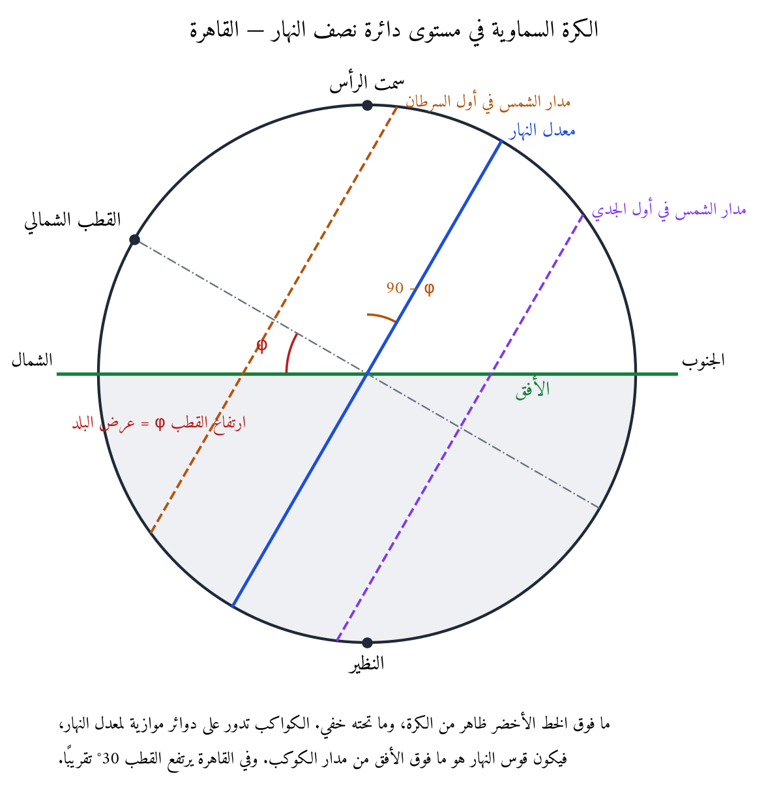

وأهم ما في الشكل (5) ثلاث حقائق يقوم عليها كل ما في الرسالة:

1. **ارتفاع القطب فوق الأفق يساوي عرض البلد** (ونرمز له بالرمز φ)، وهو في القاهرة نحو 30 درجة.
2. **قوس النهار** هو الجزء الظاهر فوق الأفق من دائرة الشمس اليومية. فإذا كانت الشمس شمال معدل النهار (في الصيف) كان أكثر دائرتها فوق الأفق فطال النهار، وإذا كانت جنوبه قصر النهار.
3. **دائرة نصف النهار** هي الدائرة التي تمر بالقطب وسمت الرأس، وإذا بلغتها الشمس كان **الزوال** (الظهر)، وكان ارتفاع الشمس أعلى ما يكون في يومها.

## الميل والمطالع

تتحرك الشمس في السنة على دائرةٍ عظمى أخرى هي **فلك البروج**، مائلةٍ عن معدل النهار بزاويةٍ تسمى **الميل الأعظم** (ونرمز لها ε)، وكانت قيمتها عند فلكيي القرن التاسع الهجري 23 درجة و35 دقيقة. ويُقسَم فلك البروج اثني عشر برجًا، أولها الحمل عند الاعتدال الربيعي.

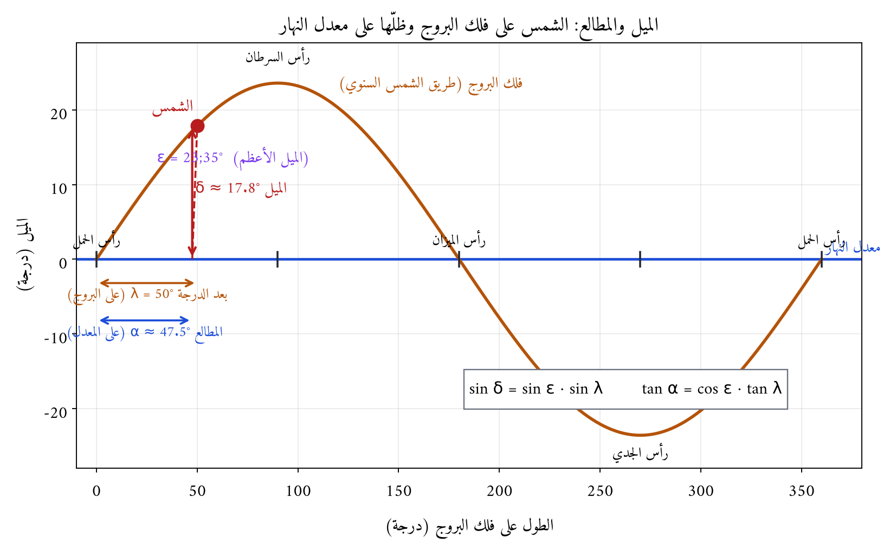

ويبيّن الشكل (6) ثلاثة مقادير:

- **بُعد الدرجة** (λ): بُعد الشمس عن أول الحمل مقيسًا على فلك البروج، ويسمى أيضًا **مقوّم الشمس**.
- **الميل** (δ): بُعد الشمس عن معدل النهار شمالًا أو جنوبًا. وأقصاه ⁦23;35⁩ في أول السرطان شمالًا، وفي أول الجدي جنوبًا.
- **المطالع الفلكية** (α): القوس من معدل النهار الذي يقابل قوس البروج من أول الحمل إلى الشمس[^matali].

[^matali]: كان المؤقتون المصريون يعدّون المطالع الفلكية من أول الجدي لا من أول الحمل، فالمطالع عندهم تساوي α + 90 درجة. انظر: التحقيق، ص 30 و64.

## المثلث الفلكي

إذا وصلنا بين ثلاث نقاطٍ في السماء — **القطب** و**سمت الرأس** و**الشمس** — بأقواسٍ من دوائر عظمى، حصلنا على مثلثٍ كروي يسمى **المثلث الفلكي** (الشكل 7). وفيه العناصر التي هي مادة كل مسائل الوقت:

| العنصر | اسمه عند ابن المجدي | رمزه |
|---|---|---|
| القوس من القطب إلى سمت الرأس | تمام العرض | 90 − φ |
| القوس من القطب إلى الشمس | تمام الميل | 90 − δ |
| القوس من سمت الرأس إلى الشمس | تمام الارتفاع | 90 − h |
| الزاوية عند القطب | فضل الدائر (البعد الزمني عن الزوال) | t |
| الزاوية عند سمت الرأس | السمت | A |

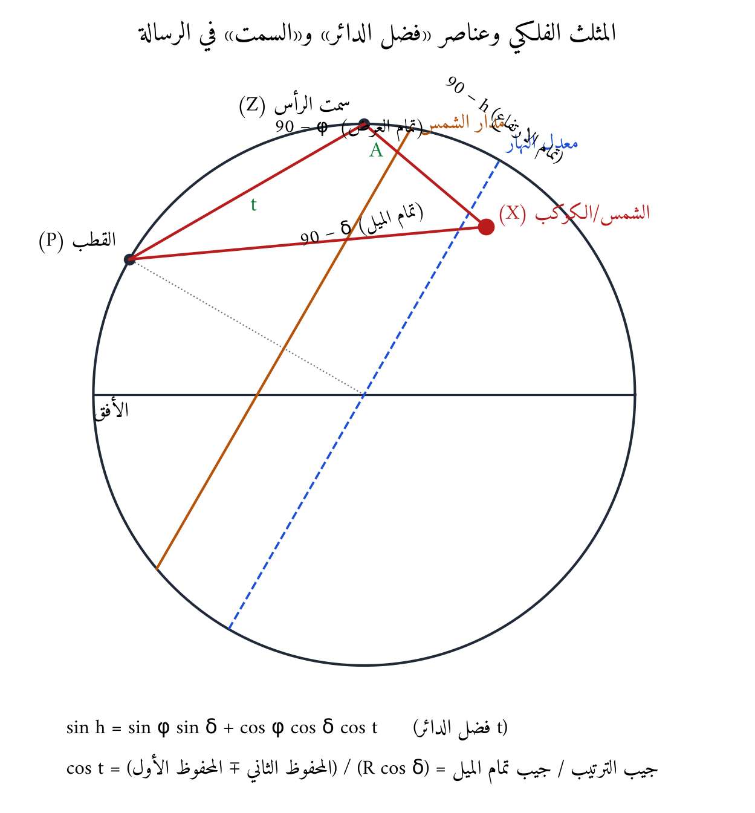

وتربط بين هذه العناصر قاعدةٌ واحدة من حساب المثلثات الكروية، هي «قاعدة جيب التمام»:

$$\sin h = \sin\varphi\,\sin\delta + \cos\varphi\,\cos\delta\,\cos t \tag{1}$$

ونقرؤها هكذا: **جيب الارتفاع = جيب العرض × جيب الميل + جيب تمام العرض × جيب تمام الميل × جيب تمام فضل الدائر**. وكل ما في القسم الأول من الرسالة إنما هو طرقٌ لحساب هذه المعادلة أو عكسها على الربع.

## الأعمال الثلاثة على الربع

كل عملٍ في الرسالة مركّبٌ من ثلاثة أعمالٍ بسيطة، يبيّنها الشكل (8):

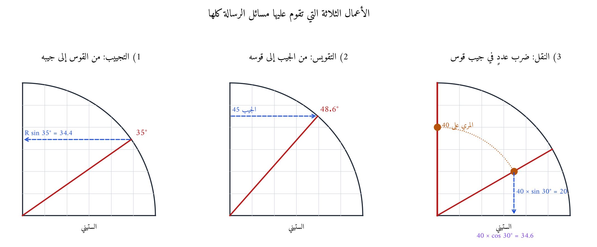

1. **التجييب**: إيجاد جيب قوسٍ معلوم. يُمدّ الخيط على القوس، ثم يُنظر أين يقطع الخيطُ القوسَ، ويُرجَع من تلك النقطة إلى الضلع، فالعدد هناك هو الجيب (مضروبًا في 60). مثاله: جيب 35 درجة = 34.4 من ستين.
2. **التقويس**: عكس التجييب، أي إيجاد القوس من جيبه. يُدخَل بالعدد من الضلع حتى يُلاقى القوس، ثم يُمدّ الخيط إلى نقطة اللقاء فيُقرأ القوس.
3. **النقل**: وهو أهمها، وبه يُضرب عددٌ في جيب قوس. يوضع الخيط على الستيني والمريّ على العدد المطلوب ضربه، ثم «يُنقل» الخيط — أي يُحرّك — إلى القوس المطلوب، فيكون بُعد المريّ عن الستيني هو حاصل الضرب. مثاله في الشكل: المري على 40، ونُقل الخيط إلى 30 درجة، فبُعد المري عن الستيني = 40 × جيب 30 = 20.

ومن هنا نفهم عبارة ابن المجدي التي تتكرر في الرسالة: «ضع على الستيني والمريّ على كذا، وانقل إلى كذا»؛ معناها: **اضرب كذا في جيب كذا**.

## أصل العمل: الأعداد الأربعة المتناسبة

وقد لخّص المؤقتون هذه الأعمال كلها في قاعدةٍ واحدة. نقل كرباصة عن البرديني في رسالته «أعمال المجيب» أنها «كلّها مأخوذةٌ من أربعة أعدادٍ متناسبة، يكون نسبة الأول إلى الثاني كنسبة الثالث إلى الرابع، فلذلك يقال: ضَعْ على الأول، وعلِّمْ على الثاني، وانقُلْ إلى الثالث، يخرج لك الرابع».

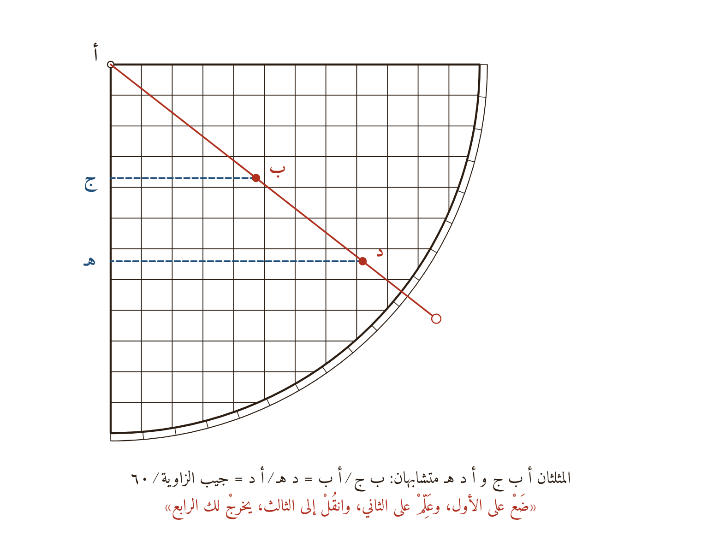

وبيانه في الشكل (9): إذا وُضع الخيط على قوسٍ ما، صنع مع الجيوب المبسوطة مثلثاتٍ متشابهة، فتكون نسبة بُعد أي نقطةٍ على الخيط عن الضلع إلى بُعدها عن المركز ثابتةً، وهي جيب القوس مقسومًا على 60. فالمريّ يحفظ المقدار، والخيط يحمل الزاوية، والجيوب تُخرج الحاصل. وهذه القاعدة هي التي يعبّر عنها ابن المجدي بـ«ضع ... وانقل ... وانزل».

## اختبار صحة الربع قبل العمل به

وذكر شرّاح المارديني أربعة اختباراتٍ سهلة لصحة رسوم الربع، كلها مبنيةٌ على تناظره حول القطر المنصِّف (خط 45 درجة):

1. يوضع الخيط على 45 درجة، فإن مرّ برؤوس زوايا المربعات التي تحته كلها فالرسم صحيح.
2. يُمدّ خيطٌ من أول القوس إلى آخره، فيجب أن يقسم المربعات تحته.
3. يُنزل من أحد الضلعين بعددٍ إلى القوس ومن الآخر بمثله، فيجب أن يقطع الأول من أول القوس مثل ما يقطع الثاني من آخره.
4. يُعلَّم بالمريّ على عددٍ في أحد الضلعين، ثم يُنقل الخيط إلى الضلع الآخر، فيجب أن يقع المريّ على مثله.

والاختباران الأولان يتحققان من تعامد الشبكة وتساوي أقسامها، والثالث من انطباق تقسيم القوس على الجيوب (جيب القوس = جيب تمام تمامه)، والرابع من تساوي تقسيم الضلعين. وهذا من معنى قول المارديني: «سهولة اختبار صحة رسومه».

# الباب الخامس: مسائل الوقت — شرحٌ ورسمٌ ومعادلة

نسير في هذا الباب مع الرسالة مسألةً مسألة. وفي كل مسألةٍ نذكر: **النص**، ثم **المعنى** بعبارةٍ سهلة، ثم **الرسم**، ثم **المعادلة وطريقة استخراجها**، ثم **مثالًا** لمدينة القاهرة (عرضها 30 درجة ودقيقتان ونصف)، ثم **التعليق**.

## المسألة الأولى: الظل وقطره

**النص**: «فإذا وضعتَ الخيط على مثل الارتفاع من القوس، ونزلتَ إليه بالقامة من الجيوب الموافقة للظل، ورجعتَ إلى الجهة الأخرى، وجدتَ الظل؛ أو علّمتَ ونقلتَ إلى الستيني وجدتَ قطره».

**المعنى**: إذا عُرف ارتفاع الشمس، أمكن معرفة طول ظل المقياس (القامة)، ومعرفة «قطر الظل» وهو المسافة من رأس المقياس إلى طرف الظل.

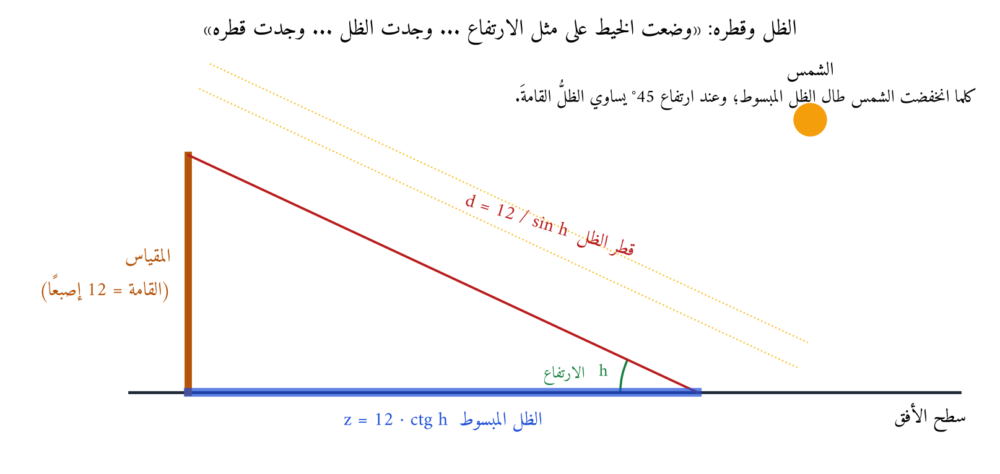

**المعادلة**: إذا كان طول المقياس 12 إصبعًا، والارتفاع h، فإن:

$$\text{الظل} = 12 \times \frac{\cos h}{\sin h},\qquad \text{قطر الظل} = \frac{12}{\sin h} \tag{2}$$

**طريقة الاستخراج**: في الشكل (10) مثلثٌ قائم الزاوية: ضلعه القائم المقياس، وقاعدته الظل، ووتره قطر الظل، والزاوية عند طرف الظل هي ارتفاع الشمس. ومن تعريف الجيب في المثلث القائم: المقياس ÷ قطر الظل = جيب الارتفاع، ومنه: قطر الظل = المقياس ÷ جيب الارتفاع. ومن تعريف الظل: الظل ÷ المقياس = جيب تمام الارتفاع ÷ جيب الارتفاع. وعلى الربع: الخيط الممدود على الارتفاع يصنع هذا المثلث نفسه، والنزول بالقامة (12) يعيّن رأس المقياس، فيُقرأ الظل والقطر مباشرة.

**مثال**: إذا كان ارتفاع الشمس 45 درجة كان الظل 12 إصبعًا (مساويًا للقامة)، وقطره 16.97 إصبعًا.

**التعليق**: «الظل المبسوط» ظل المقياس القائم على الأرض، و«الظل المنكوس» ظل المقياس المغروز في حائطٍ موازيًا للأرض. ويذكر ابن المجدي العكس أيضًا: «وإن نزلتَ بالقامة من الجهة الموافقة للظل، وبالظل من الجهة الأخرى، ووضعتَ الخيط على التقاطع، حاز من القوس الارتفاع»؛ أي إذا قيس الظل عُرف منه ارتفاع الشمس، وهذا أساس أعمال الوقت بالظل.

**عند المارديني وشارحه**: العمل نفسه في الباب الثالث من رسالة المارديني. وفيه تنبيهان يتصلان بـ«الخلاصة»:

- قال المارديني: «متى نزلتَ من الستيني بالقامة ولم تلقَ الخيط فانزل بجزءٍ من أجزائها»، وهي حيلة التصغير بالتناسب حين يخرج المقدار عن الربع، و«هذا العمل جارٍ في جميع الأبواب». وهي بعينها قاعدة ابن المجدي في «الخلاصة»: «ومتى دخلتَ بمقدارٍ ولم يلقَ الخيط، أو استعملتَ من الجيوب أكثر من الستين، فادخل بجزئه الممكن».
- ونقل كرباصة عن سبط المارديني كلام ابن يونس المصري: أن الظل المرصود ليس لمركز الشمس بل لحافّتها العليا، والفرق بين الارتفاعين «دوين نصف قطر الشمس»، أي نحو ربع درجة. وهذه ملاحظةٌ رصدية دقيقة، تبيّن حدّ الدقة الذي كان المؤقتون يعملون به.

## المسألة الثانية: الميل

**النص**: «وإن وضعتَ على الستيني والمريّ على جيب الميل الأعظم، ونقلتَ إلى بعد الدرجة، حاز المريّ جيبَ الميل، وجهته جهة البرج».

**المعنى**: يُعرف ميل الشمس في أي يومٍ من موضعها في البروج.

**الرسم**: الشكل (6) في الباب السابق.

**المعادلة**:

$$\sin\delta = \sin\varepsilon \times \sin\lambda \tag{3}$$

أي: **جيب الميل = جيب الميل الأعظم × جيب بعد الدرجة**.

**طريقة الاستخراج**: هذا «نقلٌ» واحد على الربع: المري على جيب الميل الأعظم (وهو 24 من ستين تقريبًا)، ثم يُنقل الخيط إلى قوس بُعد الدرجة، فيصير بعد المري عن الستيني هو جيب الميل. وأصله في الهندسة المثلث الكروي القائم بين معدل النهار وفلك البروج ودائرة الميل.

**مثال**: في أول السرطان (λ = 90) جيب 90 يساوي واحدًا، فالميل يساوي الميل الأعظم: ⁦23;35⁩ شمالًا. وفي أول الثور (λ = 30) جيب 30 يساوي نصفًا، فجيب الميل نصف جيب الميل الأعظم، والميل ⁦11;31⁩.

## المسألة الثالثة: الغاية

**النص**: «وإن نقصتَ الميل من تمام العرض في الجنوب، وزدته عليه في الشمال، حصلت الغاية. فإن زاد المجموع على ص فهي تمام الزائد، وتكون موافقةً للعرض، وإلا فمخالفة».

**المعنى**: «الغاية» هي أعلى ارتفاعٍ تبلغه الشمس في يومها، وذلك وقت الزوال.

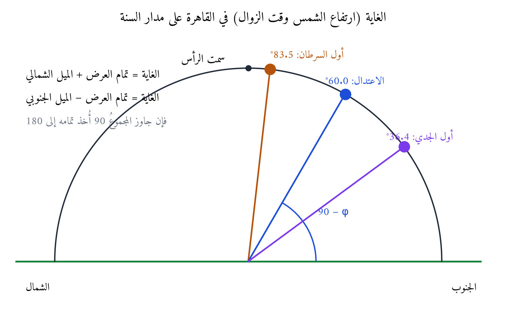

**المعادلة**:

$$\text{الغاية} = (90 - \varphi) + \delta \tag{4}$$

مع اعتبار الميل الجنوبي سالبًا.

**طريقة الاستخراج**: في الشكل (11): معدل النهار يرتفع عن أفق الجنوب بقدر «تمام العرض» (90 − φ)، والشمس تزيد عليه بقدر ميلها إن كانت شمالية، وتنقص عنه إن كانت جنوبية. و«ص» بحساب الجمّل = 90؛ فإن زاد المجموع على 90 فقد جاوزت الشمس سمت الرأس إلى جهة الشمال، فتؤخذ الغاية تمامها إلى 180، وتكون الشمس حينئذٍ «موافقةً للعرض» أي في جهة القطب.

**مثال**: في القاهرة: الغاية في أول السرطان ⁦83;32⁩، وفي الاعتدالين ⁦59;57⁩، وفي أول الجدي ⁦36;22⁩.

## المسألة الرابعة: قوس النهار ونصف التعديل

**النص**: «وإن وضعتَ على الستيني والمري على جيب تمام الميل وحرّكتَ الخيط، فإن وقع المريّ على مثل المحفوظ الأول، قطع الخيطُ من أول القوس نصفَ التعديل، ومن آخره نصفَ القوس».

**المعنى**: يُعرف طول النهار في أي يوم. و«التعديل» هو زيادة قوس النهار على 180 درجة (أي على 12 ساعة) في الصيف، أو نقصه عنها في الشتاء. و«نصف القوس» هو نصف قوس النهار، أي الزمن من الشروق إلى الزوال.

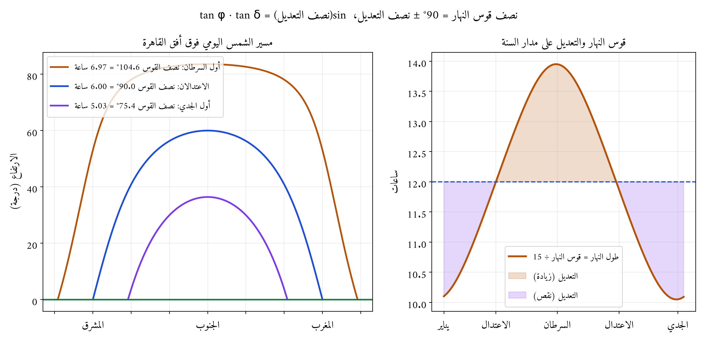

**المعادلة**:

$$\sin(\text{نصف التعديل}) = \tan\varphi \times \tan\delta,\qquad \text{نصف قوس النهار} = 90 \pm \text{نصف التعديل} \tag{5}$$

**طريقة الاستخراج**: عند الشروق والغروب يكون الارتفاع صفرًا. فإذا جعلنا h = 0 في المعادلة (1) صار: جيب تمام فضل الدائر = − ظل العرض × ظل الميل. وفضل الدائر عند الغروب هو نصف قوس النهار، فيزيد على 90 بقوسٍ جيبه «ظل العرض × ظل الميل»، وهذا القوس هو «نصف التعديل». وعلى الربع: «المحفوظ الأول» (المسألة الخامسة) مقسومًا على جيب تمام الميل يساوي جيب نصف التعديل، ولذلك قال: «فإن وقع المري على مثل المحفوظ الأول قطع الخيط من أول القوس نصف التعديل».

**مثال**: في القاهرة في أول السرطان: نصف التعديل ⁦14;37⁩، فنصف قوس النهار ⁦104;37⁩، أي **6 ساعات و58 دقيقة** (لأن كل 15 درجة ساعة)، وطول النهار 13 ساعة و56 دقيقة. وفي أول الجدي: نصف قوس النهار ⁦75;23⁩ أي 5 ساعات ودقيقتان، وطول النهار 10 ساعات و4 دقائق.

## المسألة الخامسة: الأصل وبعد القطر والمحفوظان وجيب الترتيب

هذه المسألة قلب القسم الأول من الرسالة، وفيها أدقّ صناعة ابن المجدي. وغرضها: **معرفة الوقت من ارتفاع الشمس**؛ أي إذا رصد المؤقت ارتفاع الشمس بالربع، كم مضى من النهار؟

**النص** (مختصرًا): «وإن وضعتَ على تمام العرض، ودخلتَ إليه من الميل، ورجعتَ إلى خط المشرق، وجدتَ المحفوظ الأول. أو دخلتَ إليه بالارتفاع، وعلّمتَ ونقلتَ إلى الستيني، وجدتَ المحفوظ الثاني ... وإن جمعتَ المحفوظين في الجنوب، وأخذتَ الفضل في الشمال، حصل جيب الترتيب ... فإن وقع المري على مثل جيب الترتيب، قطع [الخيط] من آخره فضل الدائر».

**المعنى**: يقسم ابن المجدي حساب الوقت إلى ثلاث خطوات، كلٌّ منها نقلةٌ واحدة على الربع:

1. يحسب عددًا من الميل وحده، يسمّيه **المحفوظ الأول** (أي العدد الذي يُحفظ أولًا).
2. يحسب عددًا من الارتفاع وحده، يسمّيه **المحفوظ الثاني**.
3. يطرح الأول من الثاني (أو يجمعهما في الجنوب)، فيحصل **جيب الترتيب**، ومنه يُعرف فضل الدائر.

ولكي نفهم لماذا يصح هذا، ننظر في الشكل (13):

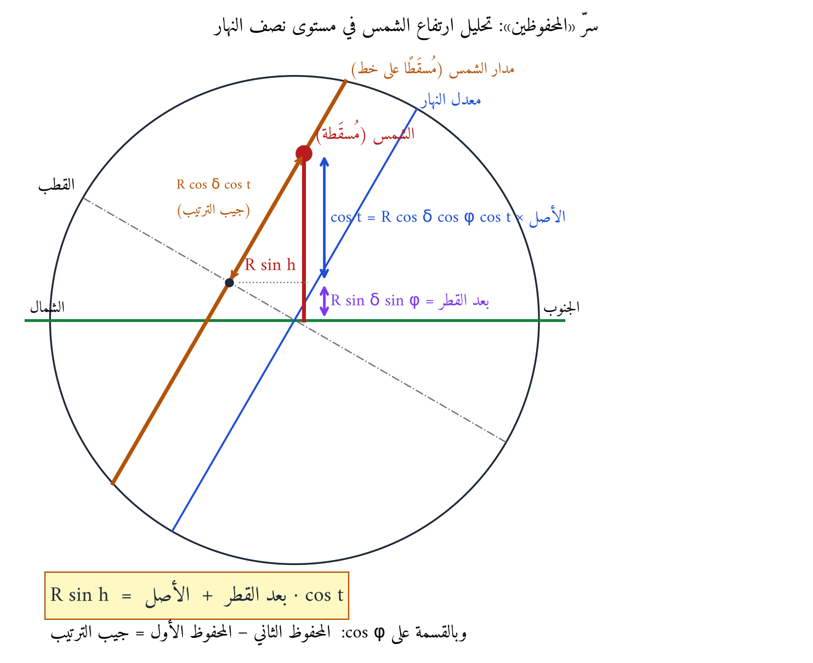

**الشرح بالرسم**: الشكل (13) رسمٌ للكرة في مستوى نصف النهار، تظهر فيه دائرة الشمس اليومية خطًّا مستقيمًا (برتقاليًّا) لأننا ننظر إليها من جانبها. ومركز هذه الدائرة نقطةٌ سوداء على محور القطب. وارتفاع الشمس (الخط الأحمر) ينقسم إلى جزأين:

- **الجزء السفلي** (البنفسجي): ارتفاع مركز دائرة الشمس عن الأفق، ويسميه ابن المجدي **«بعد القطر»**. وهو لا يتغير طول اليوم، لأنه يتعلق بالميل والعرض فقط.
- **الجزء العلوي** (الأزرق): يتغير بتغير الوقت؛ يكون أكبر ما يكون عند الزوال، ثم يصغر حتى يصير صفرًا حين تكون الشمس في منتصف دائرتها بين الزوال والغروب. ويساوي **«الأصل» × جيب تمام فضل الدائر**.

**المعادلات**: نعرّف المقادير كما عرّفها ابن المجدي (والعدد 60 هو الستيني):

| المصطلح | تعريفه | المعادلة |
|---|---|---|
| الأصل | نصف قطر دائرة الشمس مضروبًا في جيب تمام العرض | 60 × cos δ × cos φ |
| بعد القطر | ارتفاع مركز دائرة الشمس عن الأفق | 60 × sin δ × sin φ |
| المحفوظ الأول | بعد القطر مقسومًا على جيب تمام العرض | 60 × sin δ × tan φ |
| المحفوظ الثاني | جيب الارتفاع مقسومًا على جيب تمام العرض | 60 × sin h ÷ cos φ |
| جيب الترتيب | المحفوظ الثاني − المحفوظ الأول | 60 × cos δ × cos t |

**طريقة الاستخراج**: من الشكل (13) مباشرة:

$$60\sin h = \underbrace{60\sin\delta\sin\varphi}_{\text{بعد القطر}} + \underbrace{60\cos\delta\cos\varphi}_{\text{الأصل}}\times\cos t \tag{6}$$

وهي المعادلة (1) نفسها مضروبةً في 60. ثم نقسم الطرفين على جيب تمام العرض (cos φ):

$$\underbrace{\frac{60\sin h}{\cos\varphi}}_{\text{المحفوظ الثاني}} - \underbrace{60\sin\delta\tan\varphi}_{\text{المحفوظ الأول}} = \underbrace{60\cos\delta\cos t}_{\text{جيب الترتيب}} \tag{7}$$

ثم: **جيب تمام فضل الدائر = جيب الترتيب ÷ جيب تمام الميل**، وهو قوله: «ضع على الستيني والمري على جيب تمام الميل، وحرّك الخيط حتى يقع المري على مثل جيب الترتيب، فما قطعه الخيط من آخر القوس فهو فضل الدائر».

ولماذا «يجمع المحفوظين في الجنوب ويأخذ الفضل في الشمال»؟ لأن الميل الجنوبي سالب، فيصير طرح المحفوظ الأول جمعًا.

**مثال**: في القاهرة في أول السرطان: الأصل 47.60، وبعد القطر 12.02، والمحفوظ الأول 13.88. فإذا رُصد ارتفاع الشمس قبل الزوال 40 درجة كان المحفوظ الثاني 44.52، وجيب الترتيب 30.64، وفضل الدائر ⁦56;06⁩، أي أن الباقي إلى الزوال **3 ساعات و44 دقيقة**.

**التعليق**: هذه الطريقة غاية الإتقان في صناعة الآلة: فالمعادلة (1) فيها ضربٌ ثلاثي، ولا يمكن تنفيذها بنقلةٍ واحدة. ففكّكها ابن المجدي إلى عددين يُحسب كلٌّ منهما بنقلةٍ واحدة، ثم يُطرح أحدهما من الآخر. والمحفوظ الأول ثابتٌ في اليوم كله، فيحسبه المؤقت مرةً واحدة صباحًا، ثم لا يحتاج عند كل رصدٍ إلا إلى حساب المحفوظ الثاني وطرحه. وذكر ابن المجدي بعدها طريقةً أخرى بـ«نصف الأصل» تؤدي إلى النتيجة نفسها.

**بين ابن المجدي وشيخه**: يحسب المارديني فضل الدائر في رسالته بطريق «الأصل المعدل»: يُطرح بعد القطر من جيب الارتفاع في الشمال (ويُزاد في الجنوب) فيحصل «الأصل المعدل»، ثم يُقسم على الأصل، فيكون الناتج جيب تمام فضل الدائر. وهي المعادلة (6) نفسها مرتّبةً على وجهٍ آخر. ويقابل الجدول الآتي بين اصطلاح الرجلين:

| المقدار | عند المارديني وشارحه | عند ابن المجدي في «الخلاصة» |
|---|---|---|
| 60 × cos δ × cos φ | الأصل (الأصل المطلق) | الأصل |
| 60 × sin δ × sin φ | بعد القطر | بعد القطر |
| 60 sin h ∓ بعد القطر | الأصل المعدل | — |
| 60 × cos δ × cos t | — | جيب الترتيب |
| الفرق بين نصف قوس النهار و90 | نصف الفضلة | نصف التعديل |
| طريقة فضل الدائر | الأصل المعدل ÷ الأصل | المحفوظان، أو «نصف الأصل» |

فطريقة الأصل المعدل هي طريقة الشيخ، وطريقة المحفوظين زيادة التلميذ؛ وفضلها أن المحفوظ الأول يُحسب مرةً واحدةً في اليوم، فلا يبقى عند كل رصدٍ إلا نقلةٌ واحدة.

**الارتفاع الذي لا سمت له**: وذكر في أثناء ذلك «جيب الارتفاع الذي لا سمت له»، وهو ارتفاع الشمس حين تكون على دائرة المشرق والمغرب تمامًا (في الصيف). ومعادلته: جيب هذا الارتفاع = جيب الميل ÷ جيب العرض. وهو في القاهرة في أول السرطان ⁦53;03⁩.

## المسألة السادسة: السمت

**النص**: «وإن وضعتَ على تمام الارتفاع، والمري على جيب فضل الدائر، ونقلتَ إلى [تمام] الميل ... وجدتَ السمت، وجهته شمال إن كان الارتفاع أقل من الارتفاع الذي لا سمت له».

**المعنى**: «السمت» هو جهة الشمس على الأفق، أي الزاوية بين جهتها وجهة المشرق أو المغرب.

**الرسم**: الشكل (7)؛ السمت هو الزاوية عند سمت الرأس.

**المعادلة** (من قاعدة الجيوب في المثلث الفلكي):

$$\sin(\text{السمت}) = \frac{\cos\delta \times \sin t}{\cos h} \tag{8}$$

**التعليق**: والجهة شمالية إذا كان الارتفاع أقل من «الارتفاع الذي لا سمت له»، لأن الشمس حينئذٍ لم تبلغ دائرة المشرق والمغرب بعد.

## المسألة السابعة: العصر

**النص**: «وإن زدتَ على ظل مبسوط الغاية قامةً، واستخرجتَ ارتفاع الجملة، حصل ارتفاع العصر. وفضل دائره هو ما بين الظهر والعصر، وتمامه إلى نصف القوس هو ما بين العصر والغروب».

**المعنى**: يدخل وقت العصر إذا صار ظل الشيء مثل ظله وقت الزوال مضافًا إليه مثل طوله.

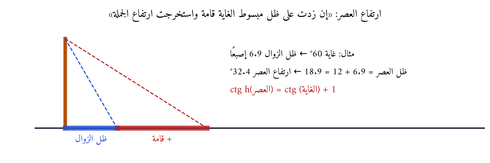

**المعادلة**:

$$\frac{\cos h_{\text{العصر}}}{\sin h_{\text{العصر}}} = \frac{\cos(\text{الغاية})}{\sin(\text{الغاية})} + 1 \tag{9}$$

**طريقة الاستخراج**: بالمسألة الأولى يُعرف ظل الغاية، ثم يُزاد عليه 12 إصبعًا (قامة)، ثم يُستخرج الارتفاع من الظل الجديد بعكس المسألة الأولى. ثم يُحسب فضل دائر هذا الارتفاع بالمسألة الخامسة، فيكون هو الزمن بين الظهر والعصر.

**مثال**: في القاهرة في الاعتدالين: الغاية ⁦59;57⁩، وظلها 6.9 إصبعًا، فظل العصر 18.9، وارتفاع العصر ⁦32;22⁩. وفي أول السرطان ارتفاع العصر ⁦41;56⁩.

**عند المارديني وشارحه**: العمل نفسه في الباب التاسع من رسالة المارديني، وعلى بعض الأرباع «قوس العصر» (الشكل 3) تُقرأ بها مباشرةً جيب ارتفاع العصر من الغاية. ومثال كرباصة على عرض تونس في آخر الجوزاء: ظل الغاية ⁦2;45⁩ إصبعًا، وظل العصر ⁦14;45⁩، وارتفاع العصر 39 درجة، وفضل دائره 58 درجة، أي 3 ساعات و52 دقيقة بعد الزوال. والحساب الحديث بمعطياته يعطي ⁦57;51⁩، فالفرق دقائق قليلة.

## المسألة الثامنة: الفجر والشفق

**النص**: «وإن استخرجتَ الدائر لارتفاع يط أو يز بدرجة النظير فيهما، حصل حصّتا الفجر والشفق».

**المعنى**: يطلع الفجر حين تكون الشمس تحت الأفق بـ19 درجة («يط» = 19)، ويغيب الشفق الأحمر — وهو وقت العشاء — حين تكون تحته بـ17 درجة («يز» = 17).

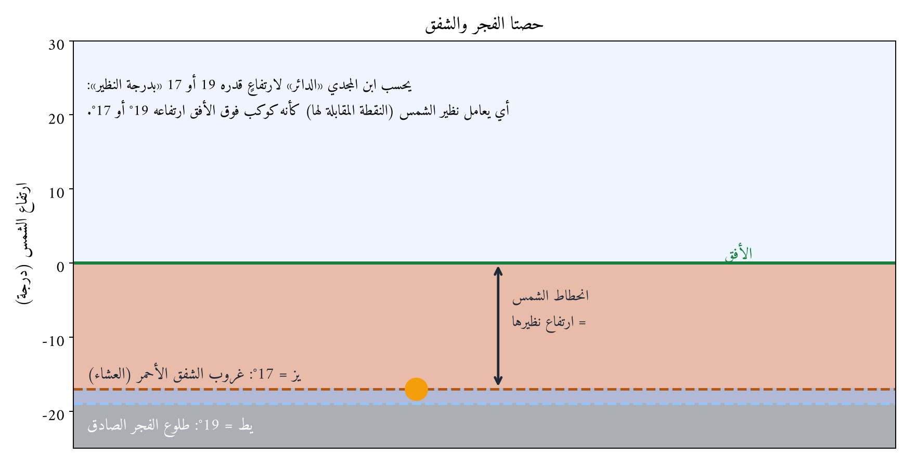

**طريقة الاستخراج**: يُحسب فضل الدائر بالمسألة الخامسة لارتفاعٍ قدره 19 أو 17 درجة، لكن «بدرجة النظير». و«النظير» النقطة المقابلة للشمس في الكرة؛ فإذا كانت الشمس تحت الأفق بـ19 درجة كان نظيرها فوق الأفق بـ19 درجة. فيعامل المؤقت النظيرَ كأنه كوكبٌ ميله عكس ميل الشمس، ويحسب له فضل الدائر كالمعتاد. وهي حيلةٌ لطيفة تغني عن التعامل مع الارتفاعات السالبة.

**عند المارديني وشارحه**: الحدّان نفسهما في الباب العاشر من رسالة المارديني: «جيب تسعة عشر» للفجر و«جيب سبعة عشر» للشفق، بطريق الأصل المعدل. وفرّق كرباصة — وهو حنفي — بين الشفق الأحمر (عند الصاحبين ومالك والشافعي) والشفق الأبيض (عند أبي حنيفة). وفي مثاله لتونس في آخر الجوزاء خرجت حصة الفجر 33 درجة، والحساب ⁦31;12⁩، والفرق نحو درجتين، لأن القوس تُقرأ هنا في موضعٍ يتغيّر فيه الجيب ببطء، وهذا حدّ دقة الآلة لا خطأٌ في الطريقة.

**التعليق**: هذان الحدّان (19 و17) هما المشهوران عند مؤقتي مصر في ذلك العصر.

## المسألة التاسعة: سمت القبلة

**النص**: «وإن جعلتَ عرض مكة أو غيرها بُعدًا موافقًا لجهة عرضها، وفضل الطولين فضل دائر، وحصّلتَ سمت ارتفاعه، حصل سمت تلك البلد عن بلدك».

**المعنى**: يُعرف اتجاه مكة (القبلة) من أي بلد، إذا عُرف عرض البلدين والفرق بين طوليهما.

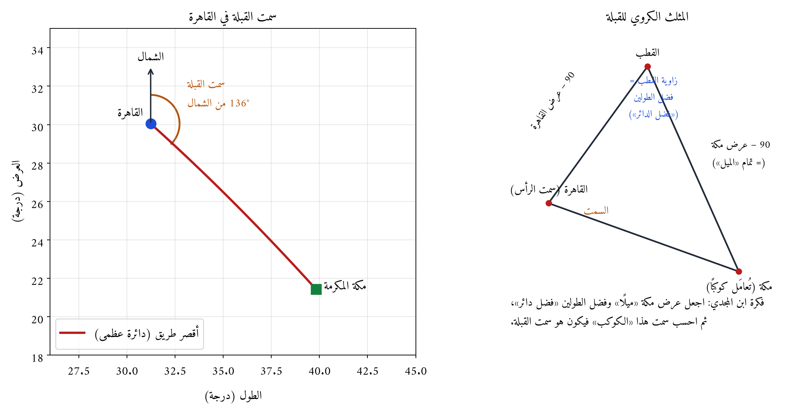

**طريقة الاستخراج**: الفكرة — كما في الشكل (16) — أن المثلث الكروي الذي رؤوسه: القطب، وسمت رأس القاهرة، ومكة، هو نفسه المثلث الفلكي إذا وضعنا مكة موضع الكوكب. فيكون:

- «ميل» هذا الكوكب = عرض مكة،
- و«فضل دائره» = فرق الطول بين القاهرة ومكة،
- فيكون «سمته» المحسوب بالمسألة السادسة هو **سمت القبلة** نفسه.

**المعادلة**:

$$\tan(\text{سمت القبلة}) = \frac{\sin(\text{فضل الطولين})}{\cos\varphi \tan\varphi_{\text{مكة}} - \sin\varphi\cos(\text{فضل الطولين})} \tag{10}$$

**مثال**: سمت القبلة في القاهرة 136 درجة من الشمال نحو الشرق، أي 46 درجة من نقطة الجنوب نحو الشرق.

**التعليق**: هذه الطريقة دقيقةٌ لا تقريبية، لأنها تطبيقٌ مباشر لحساب المثلثات الكروية. وهي تبيّن وحدة المنهج في الرسالة: مسألةٌ جغرافية (القبلة) تُحلّ بأدوات مسألةٍ فلكية (السمت).

**عند المارديني وشارحه**: الفكرة نفسها في الباب الرابع عشر من رسالة المارديني: تُعامَل مكة كأنها «شمسٌ» ميلها عرض مكة، وفضل الطولين فضل دائرها، فيُحسب ارتفاع سمت رأس مكة فوق أفق البلد، ثم سمتها. وهي طريقةٌ ترجع إلى ابن معاذ الجيّاني كما أشار بولاهية. ويبيّن الشكل (17) أوضاع الخيط والمريّ في هذا العمل كما في مثال كرباصة لتونس.

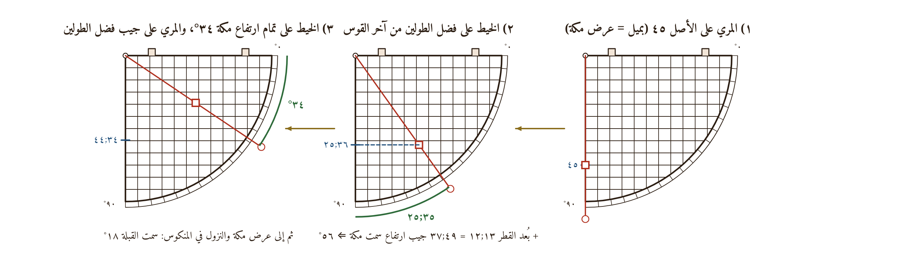

وفي مثاله: ارتفاع سمت رأس مكة بتونس 56 درجة (والحساب ⁦55;54⁩)، وسمت القبلة 18 درجة من المشرق إلى الجنوب، والحساب الكروي بمعطياته نفسها ⁦16;10⁩. أما السمت الحقيقي بالإحداثيات الحديثة فنحو ⁦22;40⁩. وأكبر الخطأ ليس من الآلة، بل من فضل الطولين الموروث عن بطليموس (⁦35;25⁩ بدل نحو ⁦29;39⁩).

وذكر كرباصة أيضًا طريقةً تقريبية بـ«الدائرة الهندية» (الشكل 18): يُعدّ من نقطتي الجنوب والشمال بقدر فضل الطولين، ومن نقطتي المشرق والمغرب بقدر فضل العرضين، ويُوصل بين النهايات بخطين، فالخط الخارج من المركز إلى تقاطعهما «هو على صوب القبلة». وهي طريقةٌ مسطّحة تعامل فرقي الطول والعرض كإحداثيين على مستوٍ. ومن الطريف أنها أعطت لتونس نحو 24 درجة، أقرب إلى الحقيقة من الطريقة الكروية، لأن خطأ الطول يضرّ الطريقة الكروية أكثر.

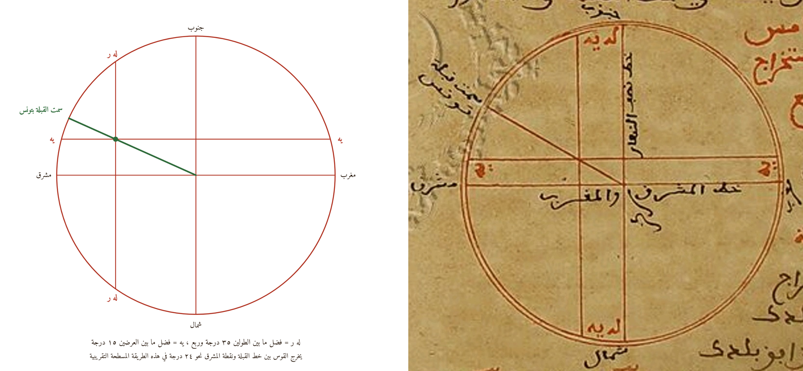

## المسألة العاشرة: خط المشرق والمغرب

**النص**: «وإن أبعدتَ عن طرف خط ظل الخيط الشاقول الذي في جهة الشمس، على محيط الدائرة المرسومة على الأفق، بقدر سمت الوقت في خلاف جهته، وأخرجتَ من ثَمّ قطرًا، حصل خط المشرق والمغرب ... ومنه تعرف نصب سمت القبلة».

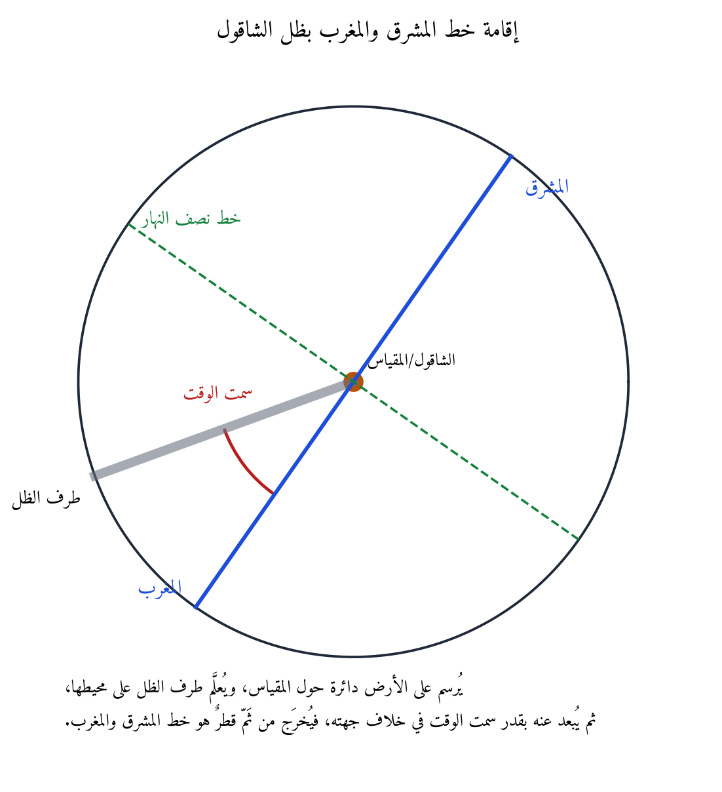

**المعنى**: هذه طريقةٌ عملية لرسم الجهات على الأرض (لنصب المحراب مثلًا): يُرسم على أرضٍ مستوية دائرةٌ حول شاقولٍ أو مقياس، ويُعلَّم طرف ظله، ويُحسب سمت الشمس في تلك اللحظة، ثم يُعدّ على محيط الدائرة قوسٌ بقدر هذا السمت في الجهة المخالفة، فالقطر المار بالنقطة الحاصلة هو خط المشرق والمغرب. ومنه يُعدّ سمت القبلة.

**عند المارديني وشارحه**: في الباب الخامس عشر من رسالة المارديني طريقةٌ قريبة، يُستعمل فيها الربع نفسه بدل الدائرة المرسومة على الأرض (الشكل 20): يُثبَّت الخيط على سمت الوقت، ويوضع الربع على أرضٍ مستوية، ثم يُدار حتى ينطبق ظل خيط الشاقول على الخيط، فيقع جيب التمام على خط المشرق والمغرب. وللتسوية ذكر كرباصة «الكونيا»، وهي مثلث البنّائين يعلّقون فيه الشاقول.

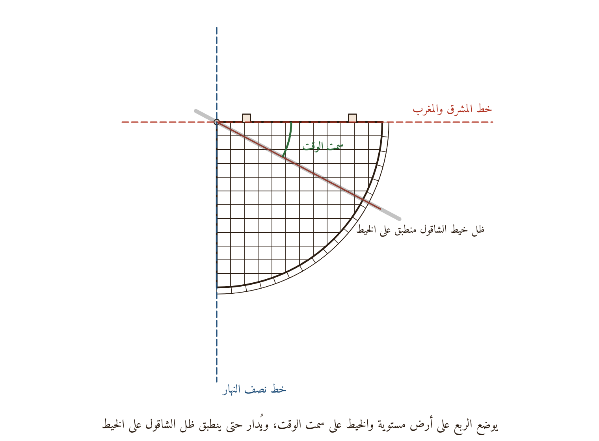

## المسألة الحادية عشرة: المطالع

**النص**: «وإن وضعتَ على الميل، ودخلتَ إليه في المنكوسة بقدر خمسةٍ وخمسين، وعلّمتَ ونقلتَ إلى بعد الدرجة، ونزلتَ من المري إلى القوس، وجدتَ المطالع الفلكية».

**المعنى**: «المطالع» هي الأجزاء من معدل النهار التي تطلع مع جزءٍ من فلك البروج. فالبروج وإن كانت متساوية (30 درجة لكل برج)، فإن ما يطلع معها من معدل النهار يختلف، لأن فلك البروج مائلٌ عن معدل النهار.

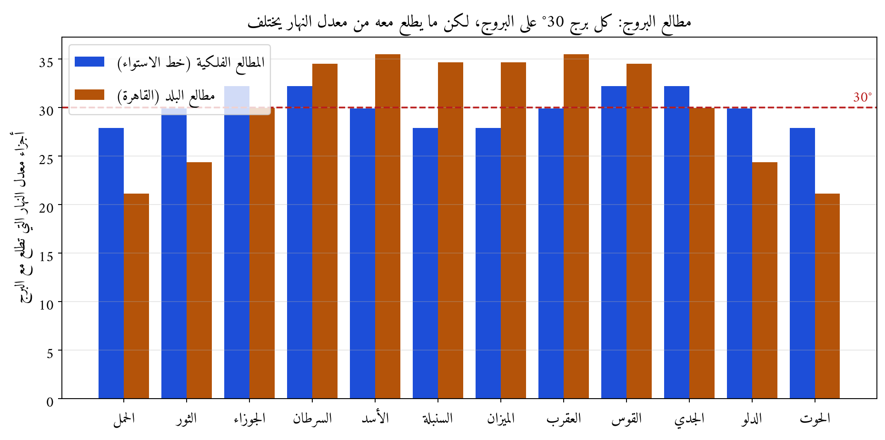

**المعادلة**:

$$\tan\alpha = \cos\varepsilon \times \tan\lambda \tag{11}$$

**طريقة الاستخراج**: العدد «خمسة وخمسون» هو 60 × جيب تمام الميل الأعظم = 60 × جيب ⁦66;25⁩ = 54.99. فالعمل تنفيذٌ للمعادلة (11) على الربع.

**التعليق**: يبيّن الشكل (21) أن بعض البروج (الحمل والحوت والثور والدلو) تطلع في القاهرة سريعًا (أقل من 30 جزءًا)، وبعضها (السنبلة والميزان والعقرب والأسد) يطلع بطيئًا. ولهذا أثرٌ مباشر في رؤية الهلال، كما سيأتي: فالهلال في الربيع يمكث بعد الشمس أكثر مما يمكث في الخريف عند البعد نفسه، لأن البروج التي تغرب مساء الربيع بطيئة الغروب.

ثم ذكر ابن المجدي مطالع الشروق والغروب ومطالع الوقت والطالع، وقال: «وإذا أقمتَ بعد الكوكب وجهته مقام ميل الشمس وجهته، حصل جميع ما تقدّم للكوكب»، أي أن كل هذه الأعمال تصلح للقمر والكواكب، وبهذا ينتقل إلى فصل القمر.

## دقة الربع المجيب في يد المؤقت

كيف نعرف أن هذه الأعمال كانت دقيقةً في الاستعمال الفعلي، لا في الحساب النظري فقط؟ أفضل شاهدٍ على ذلك الأمثلة العددية التي أثبتها كرباصة في شرحه لرسالة المارديني على عرض تونس، وقد أُعيد حسابها بمعطياته نفسها[^karbasa2]. ومنها:

| المسألة | قيمة الشارح بالربع | الحساب الحديث بمعطياته | الفرق |
|---|---|---|---|
| جيب 25 درجة | ⁦25;20⁩ | ⁦25;21⁩ | دقيقة واحدة |
| الأصل المطلق | 44 | ⁦44;6⁩ | 6 دقائق |
| نصف الفضلة (نصف التعديل) | 19 | ⁦18;58⁩ | دقيقتان |
| فضل الدائر لارتفاع 30 | 69 | ⁦69;12⁩ | 12 دقيقة |
| ارتفاع العصر | 39 | ⁦39;3⁩ | 3 دقائق |
| سعة المشرق | ⁦28;30⁩ | ⁦28;39⁩ | 9 دقائق |
| الارتفاع الذي لا سمت له | ⁦41;40⁩ | ⁦42;4⁩ | 24 دقيقة |
| حصة الفجر | 33 | ⁦31;12⁩ | نحو درجتين |
| سمت القبلة | 18 | ⁦16;10⁩ | نحو درجتين |

وأغلب الفروق دون نصف درجة، وهو حدّ القراءة المعقول بالعين على ربعٍ نصف قطره نحو عشرين سنتيمترًا. والفروق الكبيرة تقع حيث يُستعمل جزءٌ صغير من الربع، أو يُلجأ إلى النزول بجزءٍ من المقدار. ولهذا عُني ابن المجدي — كشيخه — بالتنبيه على هذه الحالات، وقال في آخر فصل القمر: «فالتفاوت بينهما يسيرٌ لا يقدح في المطلوب».

[^karbasa2]: التعليق على إتحاف المحبوب، الفصل السادس: تقويم الأمثلة العددية.

# الباب السادس: فصل القمر

القمر أصعب من الشمس في الحساب لثلاثة أسباب: أنه يخرج عن فلك البروج شمالًا وجنوبًا (العرض)، وأنه سريع الحركة فيتغير موضعه في ساعاتٍ قليلة (البهت)، وأنه قريبٌ من الأرض فيختلف موضعه باختلاف موضع الراصد (اختلاف المنظر). وقد تناول ابن المجدي الثلاثة.

## عرض القمر

**النص**: «وإن أسقطتَ مقوّم الجوزهر من مقوّم القمر تبقى الحصة، فضع على الستيني والمري على خمسة، وانقل إلى الحصة طردًا وعكسًا، وانزل من المري إلى القوس، تجد عرض القمر، وجهته شمال إن كانت الحصة أقل من ستة بروج».

**المعنى**: فلك القمر مائلٌ عن فلك البروج خمس درجات، ويتقاطعان في نقطتين: **الرأس** (العقدة الصاعدة، وتسمى «الجوزهر») و**الذنب**. فالقمر عند العقدتين يكون على فلك البروج، وبينهما يكون شماليًّا أو جنوبيًّا بقدرٍ أقصاه خمس درجات.

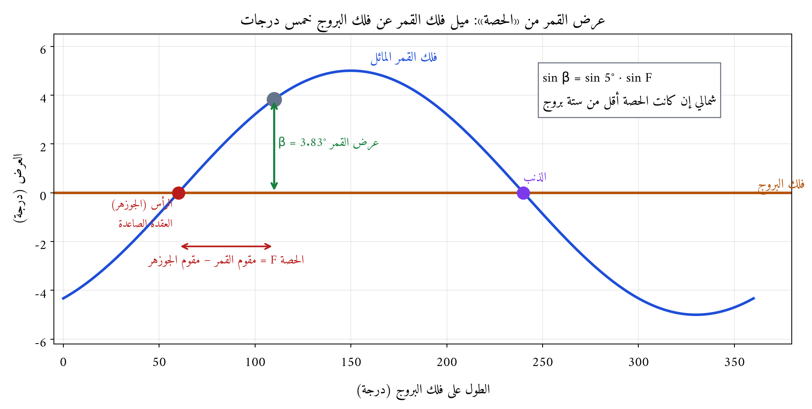

**المعادلة**:

$$\text{الحصة} = \text{مقوم القمر} - \text{مقوم الجوزهر},\qquad \sin\beta = \sin 5^\circ \times \sin(\text{الحصة}) \tag{12}$$

**التعليق**: «طردًا وعكسًا» أي تُستعمل الحصة كما هي إن كانت في الربع الأول، وتمامها إن كانت في الربع الثاني، وهكذا. وقد اختبرنا هذه القاعدة على 2020 حالة، فوجدنا الفرق بينها وبين العرض الحقيقي صغيرًا جدًّا (الشكل 23): متوسطه صفرٌ تقريبًا، وانحرافه نحو خُمس درجة، وسببه حركاتٌ صغيرة في فلك القمر عُرفت بعد ذلك.

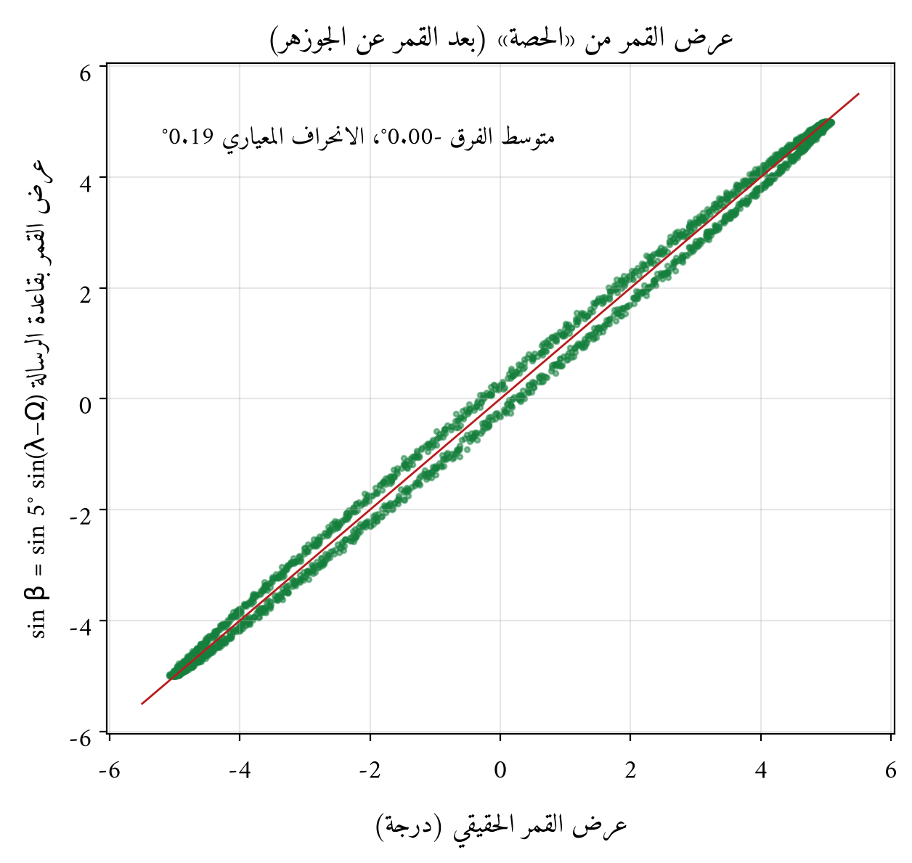

**ميل القمر**: ثم قال: «وإن جمعتَ عرض القمر وميل درجته إن اتفقا في الجهة، وأخذتَ الفضل إن اختلفا، حصل بعد القمر بتقريب»؛ أي: ميل القمر ≈ ميل درجته من البروج ± عرضه. وهو تقريبٌ لا يخطئ بأكثر من ربع درجةٍ تقريبًا.

## تقويم القمر لوقتٍ مفروض: البُهت

**النص**: «فاعرف مقوّمه وقت الزوال، وزد عليه نصف البُهت، يحصل مقوّمه لنصف الليلة الآتية ... وإلا فاقسم ما بين الوقت المفروض وأقرب الزوالين إليه من الدرج على ستة أبدًا، وما خرج اجعله جيبًا ... ثم ضع على الستيني والمري على البهت وانقل إلى المحفوظ ... والبهت هو فضل ما بين مقوّمي الزوالين».

**المعنى**: كانت التقاويم (الجداول السنوية) تعطي موضع القمر وقت الزوال من كل يوم. فإذا أراد المؤقت موضعه في وقتٍ آخر (كوقت الغروب)، زاد عليه من «البهت» — وهو مسير القمر في يومٍ وليلة — بنسبة ما مضى من الزمن.

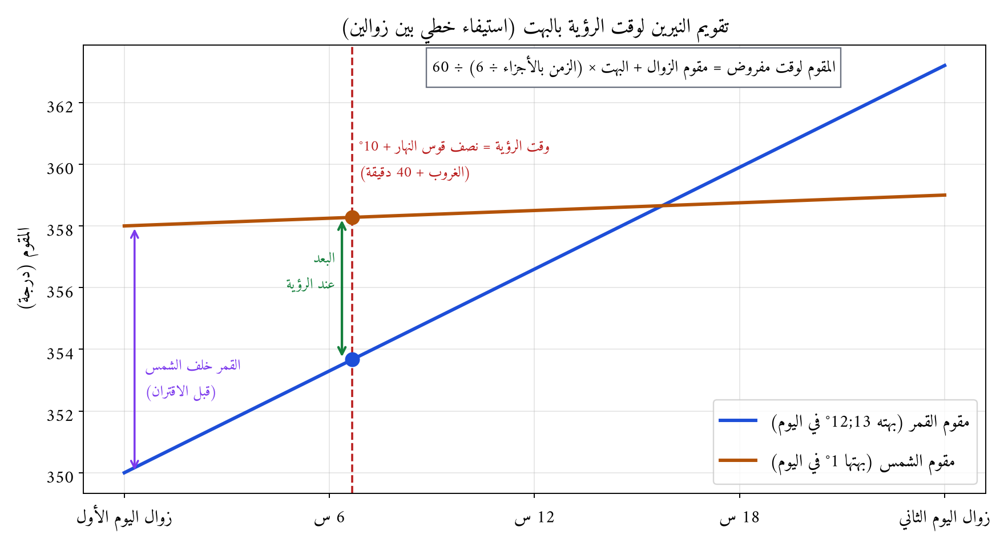

**المعادلة**:

$$\text{المقوم لوقت مفروض} = \text{مقوم الزوال} + \text{البهت} \times \frac{\text{الزمن بالأجزاء}}{360} \tag{13}$$

**لماذا القسمة على ستة؟** اليوم 360 جزءًا زمنيًّا (كل ساعة 15 جزءًا). والربع آلة نسبةٍ أساسها 60. فإذا قُسم الزمن على 6 صار «أجزاءً من ستين من اليوم»، فيُضرب في البهت بنقلةٍ واحدة على الربع. وهذا ما يسمى اليوم «الاستيفاء الخطي».

## تعديل ارتفاع القمر: اختلاف المنظر

**النص**: «ثم اعرف ارتفاع الوقت المفروض، وينبغي أن تعدّل بزيادة درجةٍ على الارتفاع من أول ارتفاعه إلى ثلاثين، ومن إحدى وثلاثين إلى ستين ثلاثة أرباع درجة، وبتمام الزائد على ذلك دقائق».

**المعنى**: الراصد على سطح الأرض لا في مركزها، والقمر قريب، فيرى الراصد القمر أخفض مما لو رآه من مركز الأرض. وهذا الفرق يسمى **اختلاف المنظر** (الشكل 25)، وهو عند الأفق نحو درجة، ويقل كلما ارتفع القمر. فإذا أراد المؤقت الارتفاع «الحقيقي» زاد على المرصود هذا المقدار.

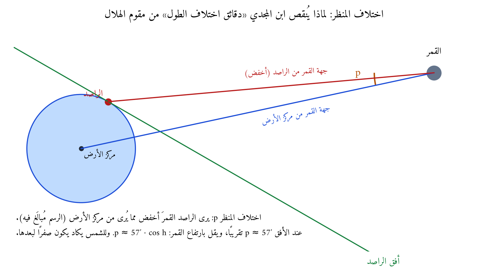

**قاعدة ابن المجدي**:

| ارتفاع القمر | ما يُزاد عليه |
|---|---|
| من 0 إلى 30 درجة | درجةٌ كاملة (60 دقيقة) |
| من 31 إلى 60 درجة | ثلاثة أرباع درجة (45 دقيقة) |
| أكثر من 60 درجة | دقائق بعدد تمام الارتفاع إلى 90 |

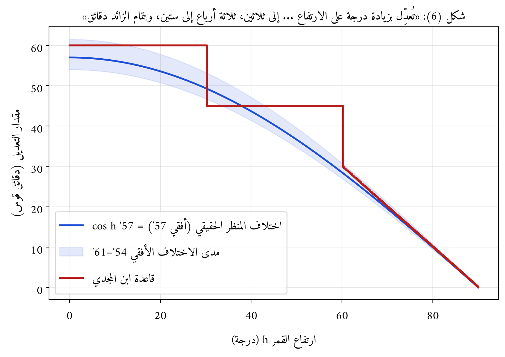

**التعليق**: القيمة الحقيقية لاختلاف المنظر نحو 57 دقيقة مضروبةً في جيب تمام الارتفاع. ويُظهر الشكل (26) أن قاعدة ابن المجدي — على بساطتها — تتبع هذا المنحنى بدقة. والجزء الثالث منها لطيفٌ جدًّا: فعند ارتفاع 70 درجة تعطي القاعدة 20 دقيقة، والقيمة الحقيقية 19.5 دقيقة.

**موقفه من التدقيقات**: ثم قال: «وأما من اعتبر غير ذلك من التدقيقات من اختلاف منظره في الطول والعرض وتعديل الأيام وغير ذلك، فالتفاوت بينهما يسيرٌ لا يقدح في المطلوب، وفي استقصاء ذلك فوات المقصود». وهذا موقفٌ منهجي واضح: الدقة المطلوبة هي دقة الآلة والعين، وما زاد عليها تضييعٌ للوقت. غير أنه — كما سنرى — أدخل اختلاف المنظر في الطول والعرض في فصل الهلال، لأنه هناك مؤثّر.

# الباب السابع: فصل رؤية الهلال

هذا أهم فصول الرسالة، وفيه يجمع ابن المجدي كل ما سبق ليجيب عن سؤالٍ واحد: **هل يمكن رؤية الهلال هذه الليلة؟** ونسير معه خطوةً خطوة، ثم نجمع الخطوات في الشكلين (35) و(36) في آخر الباب.

## الخطوة الأولى: الشرط الأول (اختبار «دل»)

**النص**: «متى كان بين مقوّمي النيّرين نصف نهار التاسع والعشرين من الرؤية **دل** فأقل، فرؤية الهلال تلك الليلة غير ممكنة، وإلا فيمكن. فإن لم يكن أول الشهر معلومًا بالرؤية، فانظر إلى مقوّميهما نصف نهار التاسع والعشرين بالحساب، فإن استويا أو كان الفضل للشمس، فذلك اليوم ليس هو تاسع عشرين الرؤية، فانتقل إلى الذي بعده، وإلا فكما تقدّم».

**المعنى**: في وقت الزوال من اليوم التاسع والعشرين من الشهر، يُنظر في الفرق بين موضع القمر وموضع الشمس في البروج:

- فإن كان الفرق «دل» أو أقل، فالرؤية في تلك الليلة **غير ممكنة**، ولا حاجة إلى حسابٍ آخر.
- وإن كان أكثر، فالرؤية **ممكنة**، ويُكمل الحساب لمعرفة درجة إمكانها.
- وإن كانت الشمس لا تزال متقدمةً على القمر (لم يقع الاجتماع بعد)، فهذا اليوم ليس هو اليوم التاسع والعشرين الحقيقي، فيُنتقل إلى اليوم الذي بعده.

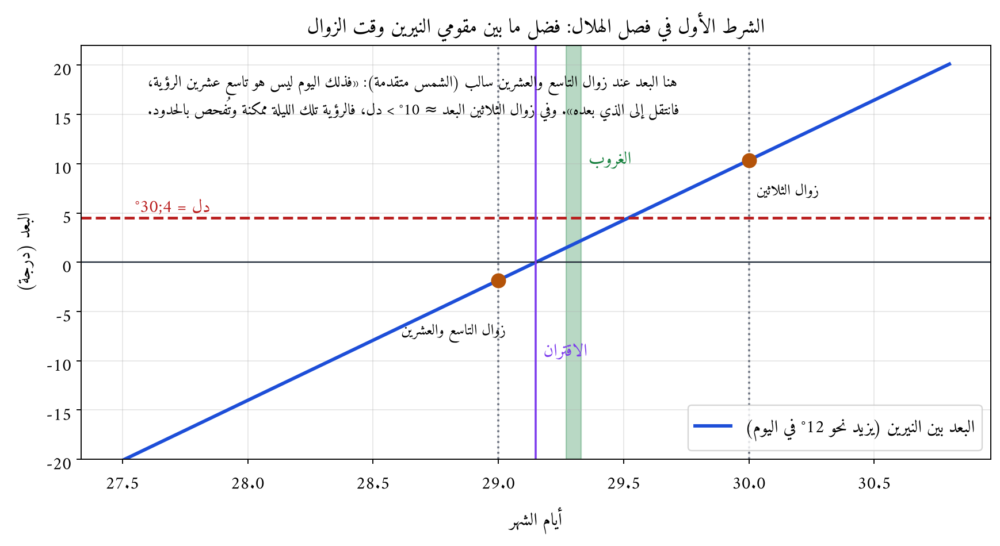

**ما معنى «دل»؟** لم يفسّره المحقق. وهو عندنا عددٌ مكتوبٌ بحساب الجمّل على الطريقة الستينية: الحرف الأول للدرجات والثاني للدقائق. فـ«د» = 4، و«ل» = 30، أي **أربع درجات وثلاثون دقيقة** (4.5 درجة). والدليل على صحة هذه القراءة من ثلاثة وجوه:

1. **من جهة الحساب**: القمر يبتعد عن الشمس نحو 12 درجة في اليوم. وبين الزوال ووقت تحرّي الهلال (بعد الغروب بقليل) في القاهرة نحو 6 إلى 7.5 ساعات، فيزيد البعد في هذه المدة بنحو 3 إلى 4 درجات. فإذا كان البعد وقت الزوال 4.5 درجة صار عند الرؤية نحو 7.5 إلى 8.5 درجة.
2. **من جهة الرسالة نفسها**: هذا يوافق الحد الأدنى الذي ذكره ابن المجدي في آخر الفصل («سبع درج»)، فالشرط متسقٌ مع بقية كلامه.
3. **من جهة الاختبار الحديث** (الشكل 28): في 464 أمسية كان فيها البعد وقت الزوال 4.5 درجة فأقل، لم يُرَ الهلال بالعين إلا في 3 حالات فقط، بحسب معيار عودة.

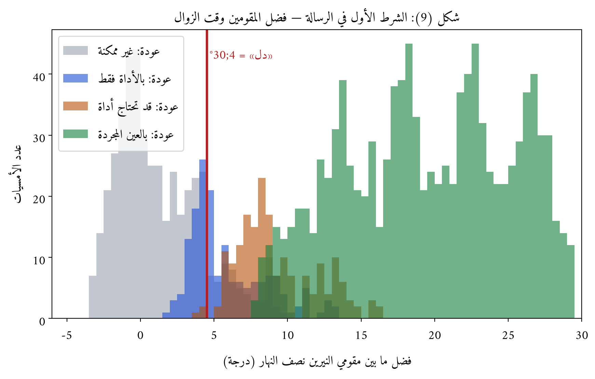

**التعليق**: يظهر من الشكل (28) أن «دل» تقع عند الحد الفاصل بين الأهلة التي لا تُرى أصلًا (الرمادية) والأهلة التي تُرى بالأداة (الزرقاء). فهي — كما سمّاها المؤلف بدقة — حدّ **«عدم الإمكان»**، لا حدّ الرؤية. فإذا تجاوزها البعد قيل: «فيمكن»، ثم يُنظر في درجة الإمكان بالحدود الآتية.

## الخطوة الثانية: تقويم النيرين عند الرؤية

**النص**: «وإن استخرجتَ نصف قوس النهار الممكن بزيادة عشرة درجٍ أبدًا، وقسمتَ المبلغ على **و**، حصل حصة البعد. فضع على الستيني والمري على بهت القمر أو بهت الشمس ... وانقل إلى قوس الحصة فيهما، تجد بعدي البهت، فزد كل بعدٍ على مقوّمه، يحصل مقوّما النيرين عند الرؤية».

**المعنى**: مقوّما الزوال معلومان، والمطلوب مقوّماهما وقت تحرّي الهلال. ووقت التحرّي = نصف قوس النهار (من الزوال إلى الغروب) + 10 أجزاء (أي 40 دقيقة بعد الغروب). ثم يُطبّق «البهت» كما في المعادلة (13). والقسمة على «و» (= 6) هي القسمة التي سبق شرحها.

**الرسم**: الشكل (24).

**مثال**: في الربيع بالقاهرة نصف قوس النهار نحو 90 درجة، فحصة البعد = (90 + 10) ÷ 6 = ⁦16;40⁩. أي أن وقت الرؤية بعد الزوال بـ⁦16;40⁩ جزءًا من ستين من اليوم، فيُزاد على مقوّم القمر ⁦16;40⁩ من ستين من بهته، أي نحو ⁦3;40⁩ درجة.

## الخطوة الثالثة: اختلاف المنظر في الطول والعرض

**النص**: «وإن نقصتَ من مقوّم الهلال عند الرؤية دقائق اختلاف الطول، حصلت درجته المرئية، وهو في رأس الحمل إحدى وخمسين دقيقة، وفي الميزان ثلاثين دقيقة، وفيما بينهما يؤخذ بنسبة الفضل ... واختلاف العرض **و** دقائق في رأس الحمل، وفي الميزان إحدى وأربعين دقيقة».

**المعنى**: اختلاف المنظر (الشكل 25) يُخفض القمر نحو الأفق. والهلال عند الغروب قريبٌ من الأفق، فيكون اختلاف منظره نحو درجة. لكن ابن المجدي لا يحتاج إلى الارتفاع هنا، بل إلى **الطول والعرض المرئيين**. فقسم اختلاف المنظر إلى جزأين: جزءٌ على امتداد فلك البروج (يُنقص من الطول)، وجزءٌ عموديٌّ عليه (يُنقص من العرض الشمالي).

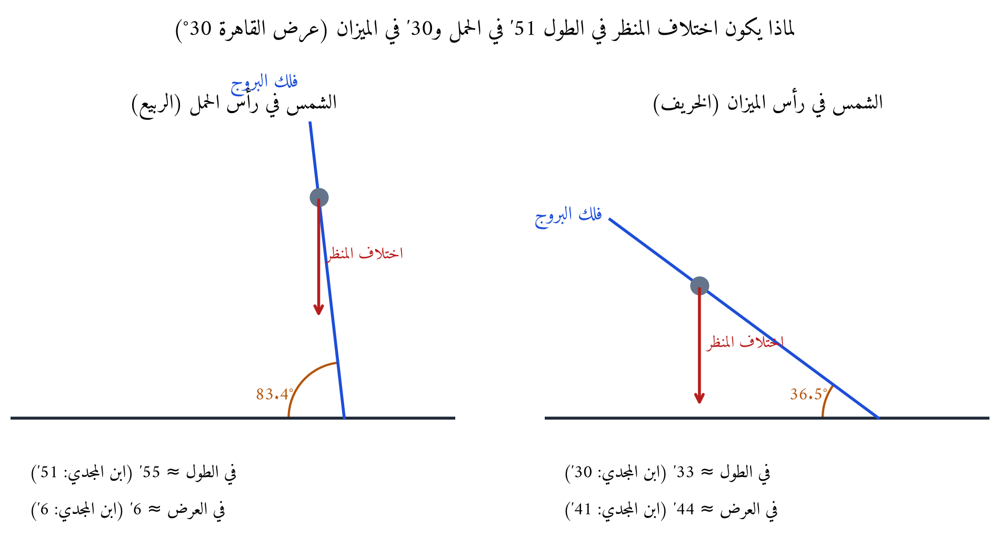

**لماذا تختلف القيم بين الحمل والميزان؟** يبيّن الشكل (29) السبب:

- **في الربيع** (الشمس قرب رأس الحمل) يكون فلك البروج عند الغروب **قائمًا تقريبًا** على الأفق الغربي (زاويته في القاهرة نحو 83 درجة). واختلاف المنظر يكون عموديًّا نحو الأفق، أي على امتداد فلك البروج تقريبًا. فيكون أكثره في الطول (نحو 55 دقيقة) وأقله في العرض (نحو 6 دقائق).
- **في الخريف** (الشمس قرب رأس الميزان) يكون فلك البروج **مضطجعًا** على الأفق (زاويته نحو 37 درجة). فينقسم اختلاف المنظر: نحو 33 دقيقة في الطول، ونحو 45 دقيقة في العرض.

وقيم ابن المجدي (51 و6 في الحمل، و30 و41 في الميزان) **موافقةٌ لهذا التحليل الهندسي لعرض القاهرة**. وهذا ما يحسم أن «و دقائق» عددٌ قيمته **6 دقائق**، لا حرف عطف.

**المعادلة** (الاستيفاء بين الاعتدالين): إذا كان d بُعد درجة الهلال عن رأس الحمل (من 0 إلى 180):

$$\text{اختلاف الطول} = 51 - 21 \times \frac{d}{180},\qquad \text{اختلاف العرض} = 6 + 35 \times \frac{d}{180} \quad\text{(بالدقائق)} \tag{14}$$

**الاختبار**: قارنّا هذه القيم بالقيم الحقيقية في 60 سنة (الشكل 30)، فوجدنا قيم ابن المجدي تتبع شكل التغيّر الحقيقي، لكنها أقل منه بنحو 4 إلى 6 دقائق في المتوسط؛ لأنه استوفى بخطٍّ مستقيم ما هو في الحقيقة منحنى. وهو فرقٌ «يسيرٌ لا يقدح في المطلوب» كما قال.

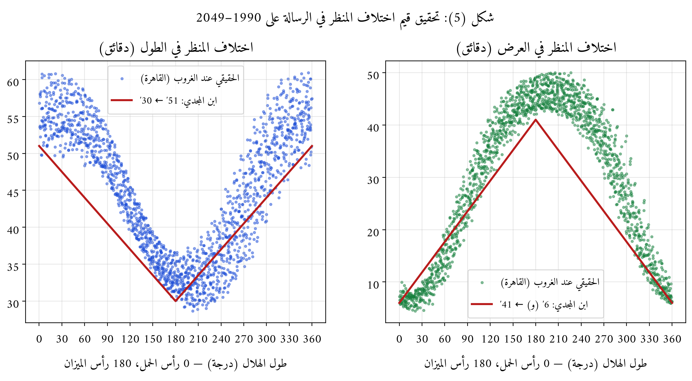

## الخطوة الرابعة: الأقواس الخمسة

بعد أن عرف ابن المجدي موضع الهلال المرئي (طوله وعرضه) وموضع الشمس، يحسب خمسة مقادير هي **متغيرات الرؤية**. ويبيّنها الشكلان (31) و(32):

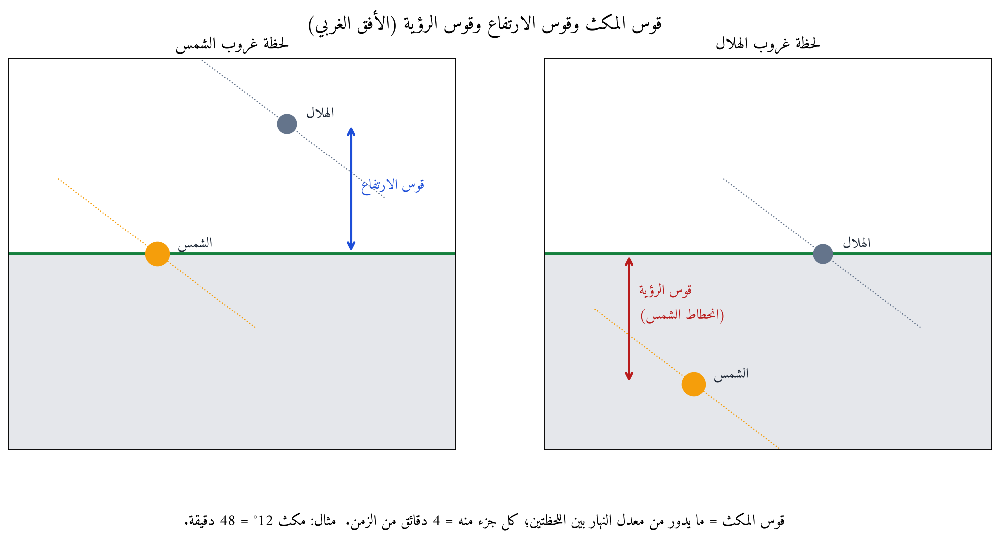

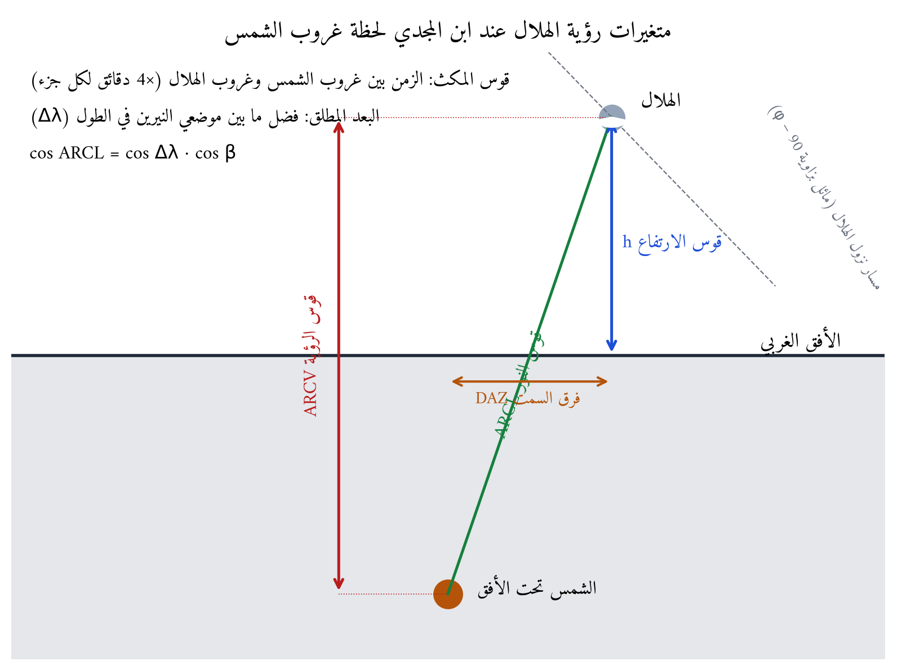

### 1. قوس المكث

**النص**: «وإن استخرجتَ مطالع نظير الشمس ونظير جزء الهلال بالبلد فيهما، وطرحتَ الأول من الثاني، كان الباقي هو قوس المكث بتقريب. وإلا فاطرح الأول من مطالع غروب الهلال بحسب عرضه المرئي ... يحصل قوس المكث المحقّق».

**المعنى**: قوس المكث هو **المدة بين غروب الشمس وغروب الهلال**، مقيسةً بأجزاء معدل النهار، وكل جزءٍ منه 4 دقائق من الزمن.

**طريقة الاستخراج**: الفكرة الأساسية أن **غروب أي نقطةٍ من البروج يكون مع طلوع نظيرها** (النقطة المقابلة لها). فإذا عُرفت مطالع نظير الشمس ومطالع نظير الهلال في البلد، كان الفرق بينهما هو ما يدور من معدل النهار بين غروبهما، وهو «قوس المكث التقريبي». أما «المحقّق» فيدخل فيه عرض الهلال المرئي، لأن الهلال إذا كان شماليًّا تأخر غروبه، وإذا كان جنوبيًّا تقدّم.

**الاختبار**: المكث المحسوب بطريقة ابن المجدي يختلف عن المكث الحقيقي بأقل من دقيقةٍ في المتوسط، وبنحو دقيقتين في أغلب الحالات.

### 2. قوس الرؤية

**النص**: «وإن طرحتَ قوس المكث من نصف قوس الليل لدرجة الشمس، بقي فضل الدائر، وارتفاعه بدرجة نظير الشمس هو قوس الرؤية».

**المعنى**: قوس الرؤية هو **انخفاض الشمس تحت الأفق لحظة غروب الهلال** (الشكل 31، يسار). وهو مقياسٌ لظلمة السماء حول الهلال: كلما كان أكبر كانت السماء أظلم والهلال أوضح.

**طريقة الاستخراج**: لحظة غروب الهلال تكون الشمس قد دارت بعد غروبها بقدر قوس المكث. فيُحسب «فضل دائرها» من نصف قوس الليل، ثم يُحسب ارتفاع نظيرها بالمعادلة (1)، فيكون هو انحطاط الشمس.

### 3. قوس الارتفاع

**النص**: «وإن أسقطتَ قوس المكث من نصف قوس النهار بدرجة الهلال، بقي فضل الدائر، وارتفاعه ببعد درجة الهلال هو قوس الارتفاع».

**المعنى**: قوس الارتفاع هو **ارتفاع الهلال فوق الأفق لحظة غروب الشمس** (الشكل 31، يمين).

### 4. البعد المطلق

**النص**: «وفضل ما بين موضعي النيرين إذ ذاك هو البعد المطلق».

**المعنى**: الفرق بين طول الهلال المرئي وطول الشمس وقت الرؤية.

### 5. قوس النور

**النص**: «وإن وضعتَ على الستيني والمري على جيب تمام البعد المطلق، ونقلتَ إلى تمام العرض، ونزلتَ من المري إلى القوس، وجدتَ تمام قوس النور».

**المعنى**: قوس النور هو **البعد الحقيقي بين مركز الهلال ومركز الشمس** في السماء، ويدخل فيه الطول والعرض معًا. وعليه يتوقف غِلَظ الهلال ومقدار ضوئه (الشكل 33).

**المعادلة**:

$$\cos(\text{قوس النور}) = \cos(\text{البعد المطلق}) \times \cos(\text{العرض المرئي}) \tag{15}$$

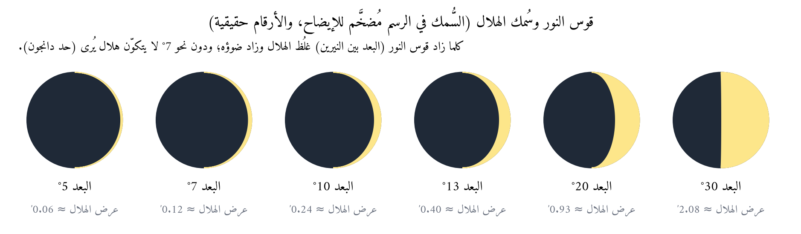

**التعليق على الأقواس الخمسة**: هذه المتغيرات الخمسة هي نفسها التي تقوم عليها المعايير الحديثة، وإن اختلفت الأسماء: فـ«قوس المكث» يسمى اليوم *Lag*، و«قوس الرؤية» *ARCV*، و«قوس الارتفاع» *Altitude*، و«قوس النور» *ARCL*. وقد بيّن الاختبار أن قوس الرؤية المحسوب بطريقة ابن المجدي لا يختلف عن نظيره الحديث إلا بأقل من درجةٍ في أغلب الحالات.

## الخطوة الخامسة: حدود الرؤية — الأقوال الثلاثة

بعد الحساب يأتي الحكم. ويذكر ابن المجدي ثلاثة أقوال، ثم يقول: «وهذه الحدود كافيةٌ في رؤية الأهلة بأقرب التقريب».

### القول الأول

**النص**: «ومتى كان كلٌّ من قوسي المكث والرؤية **يب يب**، والارتفاع **ي**، فإن الهلال يُرى بيّنًا».

**المعنى**: إذا كان قوس المكث 12 درجة فأكثر (أي 48 دقيقة فأكثر)، **و**قوس الرؤية 12 درجة فأكثر، **و**ارتفاع الهلال عند الغروب 10 درجات فأكثر، فالهلال يُرى رؤيةً واضحة.

### القول الثاني

**النص**: «وقيل: إن كان المكث **ح** والارتفاع **ز** والنور **ي**، رُئي الهلال».

**المعنى**: إذا كان قوس المكث 8 درجات فأكثر (32 دقيقة)، والارتفاع 7 درجات فأكثر (وفي نسخة: 6)، وقوس النور 10 درجات فأكثر، فالهلال يُرى. وهو قولٌ أقل تشددًا من الأول. وقد تبيّن من «غنية الفهيم» أن هذا القول هو **حدّ ابن يونس المصري** (الباب الثامن).

### القول الثالث: قول المتأخرين

**النص**: «والذي جرى به المتأخرون: أنه متى كان نصف مجموع قوسي الرؤية والبعد المطلق أقلَّ من سبع درج، فإن الهلال لا تجوز رؤيته. وإن كان **يج** رُئي بيّنًا. وإن كان أقل من **يج** إلى **ي** فرؤيته جائزةٌ قريبةٌ إلى البيان. وإن كان أقل من **ي** إلى **ز** فرؤيته جائزةٌ قريبةٌ من الخفاء».

**المعنى**: يُجمع قوس الرؤية والبعد المطلق، ويُقسم المجموع على اثنين. ولنسمِّ الناتج «مؤشر المتأخرين». ثم يُحكم بحسب قيمته:

| مؤشر المتأخرين = (قوس الرؤية + البعد المطلق) ÷ 2 | الحكم |
|---|---|
| أقل من 7 درجات | لا تجوز رؤيته |
| من 7 إلى أقل من 10 | رؤيته جائزةٌ قريبةٌ من الخفاء |
| من 10 إلى أقل من 13 | رؤيته جائزةٌ قريبةٌ إلى البيان |
| 13 فأكثر | يُرى بيّنًا |

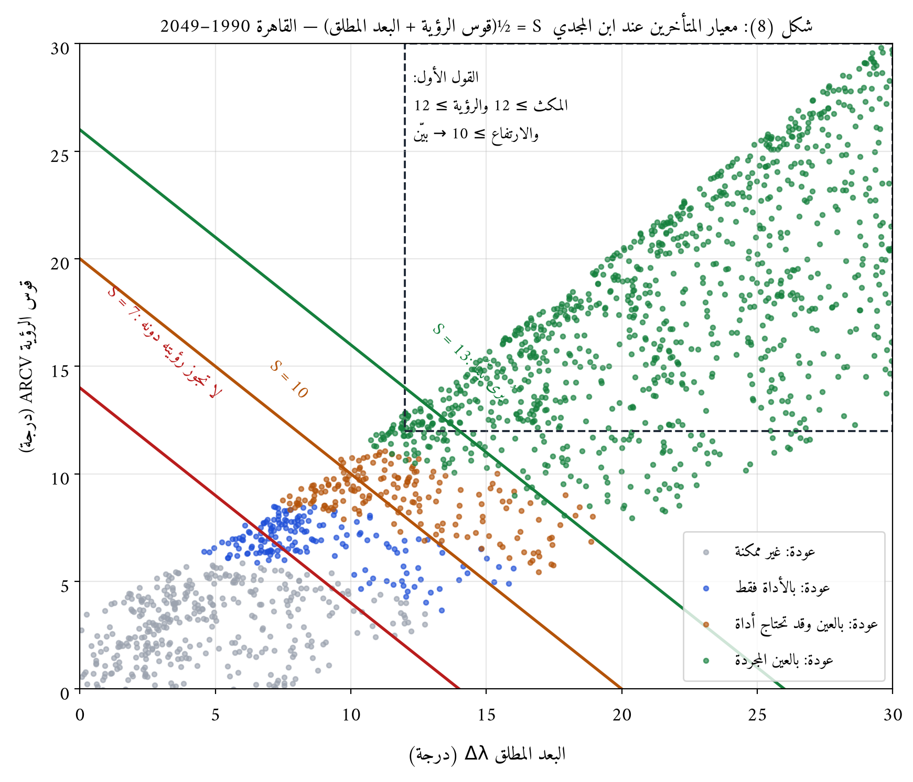

**كيف نقرأ الشكل (34)؟** كل نقطةٍ فيه أمسيةٌ من أمسيات تحرّي الهلال في القاهرة: موضعها الأفقي البعد المطلق، وموضعها الرأسي قوس الرؤية، ولونها حكم المعيار الحديث (الأخضر: يُرى بالعين، البرتقالي: قد يحتاج إلى أداة، الأزرق: لا يُرى إلا بالأداة، الرمادي: لا يُرى). والخطوط المائلة الثلاثة هي حدود المتأخرين. ونلاحظ أن:

- النقاط الرمادية كلها تقريبًا تحت خط 7 أو قريبةٌ منه.
- النقاط الخضراء كلها تقريبًا فوق خط 10.
- المنطقة بين خطي 7 و10 فيها النقاط الحرجة: الزرقاء والبرتقالية، وهي التي سمّاها ابن المجدي «قريبة من الخفاء».

**التعليق التراثي**: القول الأول امتدادٌ لشرط المكث القديم (12 درجة)، وقد زاد عليه قوس الرؤية والارتفاع. أما القول الثالث فهو أنضجها علميًّا، لأنه يجمع بين أمرين مختلفين في طبيعتهما: **ظلمة السماء** (قوس الرؤية) و**غِلَظ الهلال** (البعد). وهذه بعينها فكرة المعايير الحديثة، التي تجمع قوس الرؤية مع عرض الهلال (وهو تابعٌ للبعد).

## خريطة الفصل كله

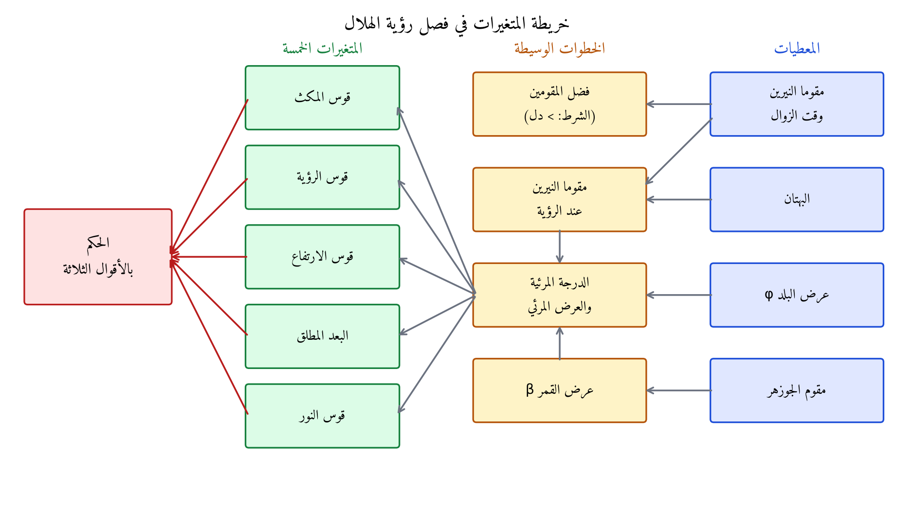

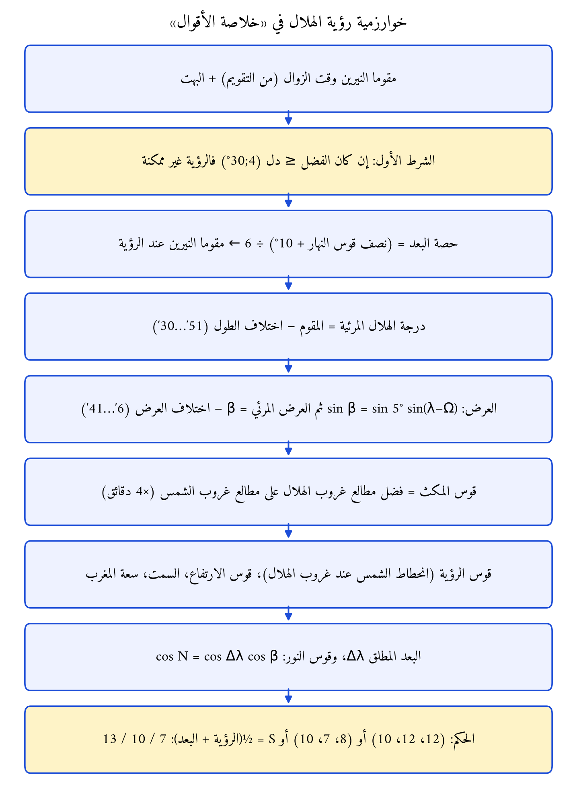

يلخّص الشكلان (35) و(36) فصل الهلال كله: يبدأ المؤقت بمعطياتٍ أربعة من التقويم والبلد (مقوّما الزوال، والبهتان، وعرض البلد، والجوزهر)، فيختبر الشرط الأول، ثم يستخرج موضعي النيرين عند الرؤية، ثم يصحّحهما باختلاف المنظر، ثم يحسب الأقواس الخمسة، ثم يحكم بالأقوال الثلاثة.

# الباب الثامن: فصل «في حساب رؤية الأهلّة» من «غنية الفهيم»

## صلة «الغنية» بـ«الخلاصة»

ختم ابن المجدي فصل الهلال في «خلاصة الأقوال» بقوله: «فمن أراد عمل هذه المطالب الحسابية المحرّرة فعليه بكتابنا المسمّى بغنية الفهيم والطريق إلى حلّ التقويم». فـ«الخلاصة» تحيل في هذا الموضع على «الغنية»، وهي الكتاب الحسابي المطوّل الذي يعمل فيه المؤقّت بالجداول لا بالربع. ولذلك لا تكتمل دراسة فصل الهلال في «الخلاصة» إلا بالنظر في الفصل المقابل له في «الغنية».

وقد نُشر هذا الفصل محقّقًا على أربع نسخ خطية، رُمز لها بـ«المعتمدة» و«أ» و«ب» و«ز»، في كتابٍ بالإندونيسية عن منهج تحقيق المخطوطات العربية[^metode]. وننقل نصّه هنا كاملًا، ثم ندرسه: نقابله بـ«الخلاصة» خطوةً خطوة، ونشرح ما فيه من حدود الرؤية، ونختبر قواعده بالحساب على أمسيات القاهرة نفسها التي اختبرنا عليها «الخلاصة» (1990–2049).

[^metode]: *Metode Penelitian Naskah Arab: Teori dan Aplikasi*، ص 162–167. ولم يظهر اسم المؤلف وبيانات النشر في الصفحات المصوّرة التي اعتمدنا عليها.

## النص

> **فصل في حساب رؤية الأهلّة**
>
> قريبة المأخذ جدًّا ببعض تقريبٍ غير مضرٍّ إذا لم يكن الهلال قريبًا من حدود الرؤية والامتناع. والاعتماد على ما قرّرناه أوّلًا، وهو أن تنظر إلى مقوّمي النيّرين نصف نهار التاسع والعشرين من الرؤية وبُهتيهما وساعات نصف النهار بعد أن تزيد عليها ثلثي ساعة، ثم استخرج البُعد لتلك الساعات من جداول أبهات الشمس، وكذا القمر، وزِدْ ذلك على مقوّميهما، ثم أسقِط موضع الشمس بعد ذلك من موضع القمر يحصل البُعد المطلق. ثم ألقِ مطالع نظير جزء الشمس من مطالع نظير جزء القمر يحصل البُعد بالمغارب. ثم انقص من مقوّم الجوزهر دقيقة، وأسقِط الباقي من مقوّم القمر يحصل الحصّة العرض، فاستخرج بها العرض، وزِدْ ثلثيه على البُعد بالمغارب إن كان العرض شماليًّا، وإلا فانقصه، فما بلغ أو بقي فهو قوس المكث[^v1]. فادخل بها إلى جدول معرفة قوس الرؤية من قوس المكث يحصل به قوس الرؤية[^v1].
>
> وإن دخلت بقوس المكث إلى جدول نظير الشمس من جداول الدائر، وأخذت ما وجدت فيه بقدر تعديله فهو قوس الرؤية. ثم استخرج من جدول نور الهلال مقدار دقائق النور، ثم ادخل بقوس الرؤية إلى جدول مقام الرؤية، وقابل به قوس الرؤية كما تقدّم.
>
> **تنبيه**: قال كوشيار: حدّ قوس النور عشر دُرج، وقوس الرؤية ثمانية دُرج، وقوس المكث اثنا عشر درجة. فإن شهد من هذه اثنان فاحكم بالرؤية، وصعُب من جهة الثالث. وعند ابن يونس: أنّ حدّ النور عشرة أيضًا، والارتفاع ستّة ونصف، وقيل ستّة فقط، والمكث ثمانية. وذكر بعضهم أنّ البُعد بالمغارب يُعدَّل بنصف العرض، لا بثلثيه كرأي الطوسي؛ فإن كان جنوبيًّا فلا يُرى بأقلّ من اثني عشر درجة، وإن كان شماليًّا فلا يُرى بأقلّ من عشرة، والله أعلم.
>
> **تنبيه**: إذا حسبتَ الهلال ليلة الثلاثين وكان يُرى، فلا عمل غير ما تقدّم. وإن لم يُرَ، وأردت أن تعرف حالته في الليلة الآتية لاحتمال أن تُسأل عن قوس رؤيته، فاحسب ذلك بالطريقة الثانية. وهكذا إذا كان بين النيّرين عند نصف النهار نحو درجتين فأقلّ أو عشرة فأكثر، إذ لا فائدة في التحرير.
>
> **تنبيه**: قد يوافق أوّلُ يوم الرؤية أوّلَ الشهر بالحساب في شهرٍ تامّ، فليلة الثلاثين منه غير ممكن الرؤية فلا تحسب له شيئًا، فاحسب الليلة الآتية بالطريق الثانية.
>
> وأمّا معرفة سمت الهلال فيُعلم من جدول السمت: إذا قصدت الجدول المساوي لغاية ارتفاع الهلال، وأخذت ما بإزاء ارتفاعه من السمت، فهو سمت الهلال بالتقريب. وإن قصدت من الأفق الغربي مثل سعة مغرب درجة الهلال، ونظرت: إن كان عرض القمر شماليًّا فتشامَلْ عن سعة مغرب جزئه بقدر العرض، وإلا فخُذْ عن مغرب جزئه إلى جهة الجنوب، فهناك يغرب الهلال. ويكون أبدًا جنوبيًّا عن مغرب الشمس تلك الليلة لميل المنطقة أبدًا في جهة الجنوب، ويختلف مقدار عرض القمر وجهته.
>
> وأمّا من اعتمد في كون الهلال منحرفًا أو مستويًا أو منتصبًا بحسب موضعه في البروج، فهو شيءٌ لا أصل له، والله أعلم. فإذا علمت أوائل الشهور بالرؤية، فأثبِتْ أعياد المسلمين على الحواشي كما عرفت في غيرها، والله أعلم.

[^v1]: أثبتنا هنا رواية النسخ «أ» و«ب» و«ز». وفي النسخة المعتمدة عند المحقق: «فهو قوس الرؤية ... يحصل به قوس المكث»، بتبادل اللفظين. وسنبيّن في هذا الباب لماذا نرجّح رواية النسخ الثلاث.

## مقابلة الخطوات بين «الغنية» و«الخلاصة»

يتبيّن من الشكل (37) أن الفصلين يسيران على خطةٍ واحدة، خطوةً بخطوة. والفرق أن «الغنية» تأخذ كل مقدارٍ من جدول، و«الخلاصة» تحسبه بالربع المجيب.

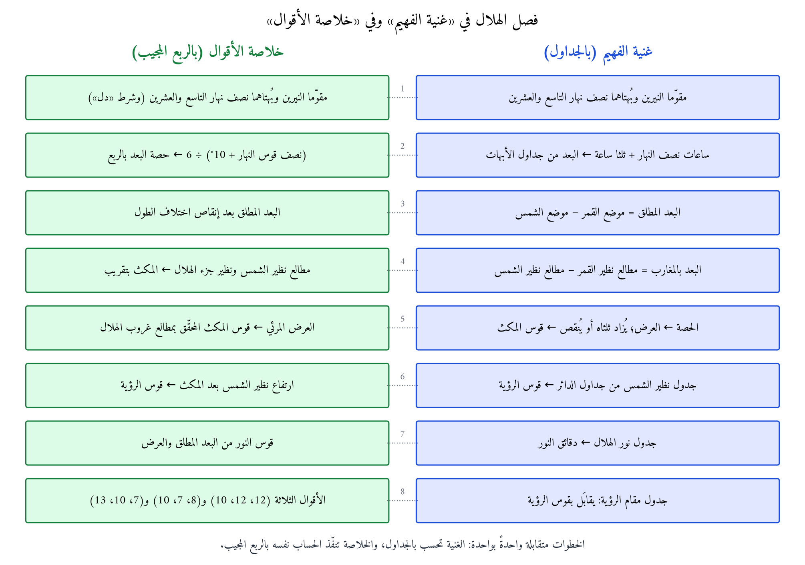

وفي هذه المقابلة ثلاث فوائد لفهم «الخلاصة»:

1. **ثلثا ساعة = عشرة درج**: تزيد «الغنية» على ساعات نصف النهار «ثلثي ساعة»، وتزيد «الخلاصة» على نصف قوس النهار «عشرة درج أبدًا». والساعة خمسة عشر جزءًا، فثلثاها عشرة أجزاء، أي أربعون دقيقة. فالمقداران واحد، وهذا يؤكّد ما فسّرنا به «زيادة عشرة درج» في الباب السابع: أنها زمن تحرّي الهلال بعد الغروب.
2. **البعد بالمغارب**: تسمّي «الغنية» فضلَ مطالع نظير جزء القمر على مطالع نظير جزء الشمس «البعدَ بالمغارب»، وهو بعينه ما سمّته «الخلاصة» «قوس المكث بتقريب». ثم تعدّله «الغنية» بثلثي العرض، أما «الخلاصة» فتعدّله بحساب مطالع غروب الهلال بعرضه المرئي، وتسمّي الناتج «قوس المكث المحقّق».
3. **قوس الرؤية من جدول نظير الشمس**: تأخذ «الغنية» قوس الرؤية من «جدول نظير الشمس من جداول الدائر» بقوس المكث، و«الخلاصة» تحسب «ارتفاع درجة نظير الشمس» بعد طرح قوس المكث من نصف قوس الليل. والطريقتان واحدة: الأولى بالجدول، والثانية بالربع.

## ترجيح رواية النسخ الثلاث: المكث ثم الرؤية

جاء في النسخة المعتمدة عند المحقق أن ما يحصل من تعديل البعد بالمغارب بالعرض «فهو قوس الرؤية»، ثم «فادخل بها إلى جدول معرفة قوس الرؤية من قوس المكث يحصل به قوس المكث». وفي النسخ «أ» و«ب» و«ز» بالعكس: «فهو قوس المكث ... يحصل به قوس الرؤية». والصواب رواية النسخ الثلاث، لثلاثة أدلة:

- **من جهة الفلك**: البعد بالمغارب فرقٌ بين لحظتي غروب، فهو من جنس المكث. وتعديله بالعرض يصحّح لحظة غروب القمر، فالناتج مكثٌ مصحَّح لا قوس رؤية.
- **من جهة السياق**: اسم الجدول «جدول معرفة قوس الرؤية من قوس المكث» يدل على أن المدخل هو المكث والمخرج هو الرؤية.
- **من جهة «الخلاصة»**: فيها الترتيب نفسه صريحًا: قوس المكث أولًا، ثم «ارتفاعه بدرجة نظير الشمس هو قوس الرؤية».

## تعديل البعد بالمغارب بالعرض: ثلثاه أم نصفه؟

تعدّل «الغنية» البعد بالمغارب بثلثي العرض، وتنسب ذلك إلى نصير الدين الطوسي، ثم تنقل عن «بعضهم» أنه يُعدَّل بنصف العرض. ولاختبار القولين حسبنا لكل أمسيةٍ من أمسيات القاهرة الفرقَ بين قوس المكث المحقّق (بطريقة «الخلاصة») والبعد بالمغارب، ثم قارنّاه بعرض الهلال المرئي (الشكل 38).

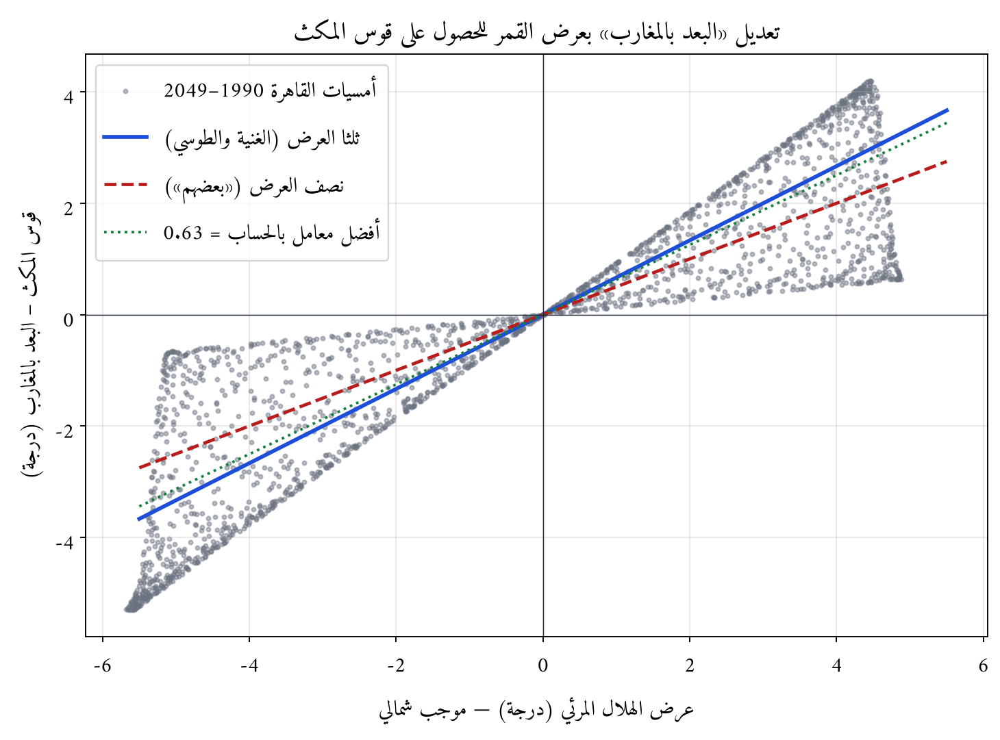

والنتيجة أن **ثلثي العرض أقرب إلى الصواب**: فأفضل معامل يُستخرج من الحساب هو 0.63 بطريقة «الخلاصة»، و0.66 بالحساب الحديث لغروب القمر، وكلاهما أقرب إلى الثلثين (0.67) منه إلى النصف (0.50). وإهمال العرض كليةً يجعل الخطأ في المكث نحو 2.5 درجة في المتوسط، والتعديل بالثلثين ينزل به إلى 1.1 درجة، والتعديل بالنصف إلى 1.2 درجة.

غير أن المعامل الحقيقي ليس ثابتًا، بل يتغير بفصول السنة، لأنه تابعٌ لزاوية فلك البروج مع الأفق عند الغروب (الشكل 29): فهو في القاهرة نحو 0.19 حول الاعتدال الربيعي، ونحو 0.93 حول الاعتدال الخريفي. ولهذا كانت طريقة «الخلاصة» (حساب غروب الهلال بعرضه المرئي) أدقّ من التعديل بنسبةٍ ثابتة، أيًّا كانت.

## حدود الرؤية في «الغنية»

ينقل ابن المجدي في «الغنية» ثلاثة أقوال في حدود الرؤية:

| القائل | الحدود | طريقة الحكم |
|---|---|---|
| كوشيار بن لبّان الجيلي (ت نحو 350 هـ) | النور 10، الرؤية 8، المكث 12 | «فإن شهد من هذه اثنان فاحكم بالرؤية، وصعُب من جهة الثالث» |
| ابن يونس المصري (ت 399 هـ) | النور 10، الارتفاع 6½ (وقيل 6 فقط)، المكث 8 | الحدود الثلاثة معًا |
| «بعضهم» | البعد بالمغارب المعدّل بنصف العرض: 12 إن كان العرض جنوبيًّا، و10 إن كان شماليًّا | حدٌّ واحد |

### القول الثاني في «الخلاصة» هو حدّ ابن يونس

إذا قابلنا هذا الجدول بالأقوال الثلاثة في «الخلاصة»، ظهر أن القول الثاني فيها — الذي ذكره ابن المجدي بصيغة «وقيل: إن كان المكث ح والارتفاع ز والنور ي رُئي الهلال» — هو **حدّ ابن يونس** بعينه: المكث 8، والنور 10، والارتفاع ستة ونصف. وبهذا يُحسم أمران:

1. **الخلاف بين «ز» و«و» في الارتفاع**: ففي «الغنية»: «والارتفاع ستّة ونصف، وقيل ستّة فقط». فرواية «و» (6) في النسخة «أ» من «الخلاصة» هي رواية «ستّة فقط»، ورواية «ز» (7) تقريبٌ لستة ونصف إلى أقرب عددٍ صحيح. فالروايتان صحيحتان، وكلتاهما ترجع إلى ابن يونس.
2. **حكم المحقق**: انتهى المحقق إلى أن الرسالة تعطي معيارًا «في حدود 6 إلى 6.5 درجة، وهذا التحديد موافقٌ لحدود ابن يونس». ونصّ «الغنية» يؤيّد هذا الحكم ويفسّره: فالـ6 والـ6.5 هما حدّ **الارتفاع** عند ابن يونس، كما نُقل في «الغنية». فالحكم صحيحٌ في نسبته إلى ابن يونس، وينبغي أن يُقيَّد بأنه حدّ الارتفاع في القول الثاني، لا المعيار كله؛ إذ في «الخلاصة» قولان آخران، وحدّ المتأخرين فيها «سبع درج» لمؤشرٍ آخر.

### اختبار الأقوال بالحساب

طبّقنا هذه الحدود على الأمسيات الـ2020 نفسها، بالقيم المحسوبة بطريقة «الخلاصة»، وقارنّاها بمعيار عودة (الرؤية بالعين). والنتيجة في الشكل (39):

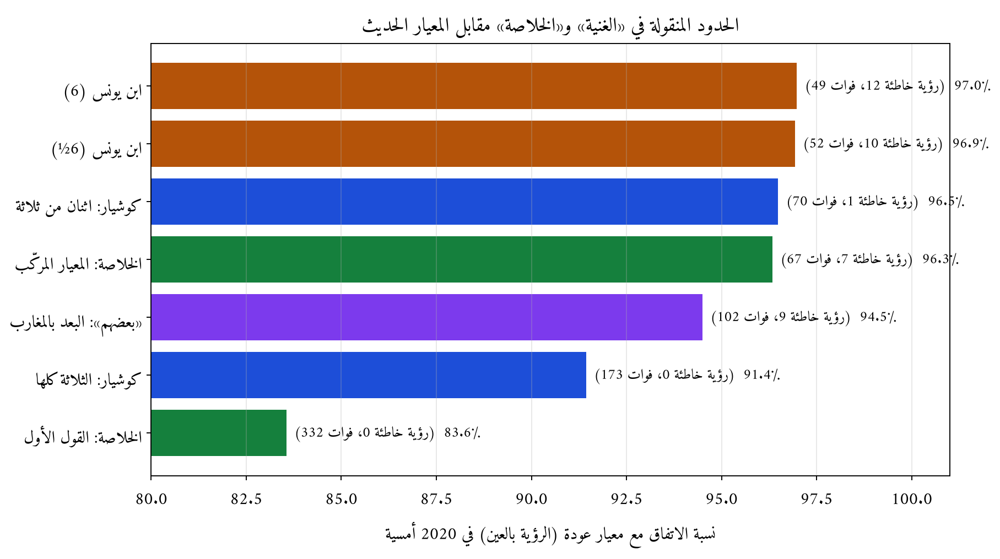

ونقرأ من الشكل (39) ما يأتي:

- **حدّ ابن يونس** أعلى الأقوال اتفاقًا مع المعيار الحديث (96.9٪)، ويليه **قول كوشيار** إذا أُخذ بقاعدته «اثنان من ثلاثة» (96.5٪)، ثم **معيار «الخلاصة» المركّب** (96.3٪). والأقوال الثلاثة متقاربة جدًّا.
- قاعدة كوشيار «فإن شهد من هذه اثنان فاحكم بالرؤية» ليست تساهلًا: فلو اشتُرطت الحدود الثلاثة كلها لانخفض الاتفاق إلى 91.4٪، لأن الشرط يفوّت أهلّةً كثيرة تُرى فعلًا. ولم يحكم قول كوشيار بالرؤية خطأً إلا في 1 أمسية.
- قول «بعضهم» بالبعد بالمغارب وحده أضعف (94.5٪)، لأنه حدٌّ واحد لا يدخل فيه البعد بين النيرين.
- القول الأول في «الخلاصة» (12، 12، 10) لا يخطئ بالإيجاب أبدًا، لكنه يفوّت كثيرًا، فهو حدّ «البيان» كما سمّاه المؤلف، لا حدّ الإمكان.

## «لا فائدة في التحرير»: درجتان فأقل أو عشرة فأكثر

يقول ابن المجدي في «الغنية»: إذا كان بين النيرين عند نصف النهار «نحو درجتين فأقلّ أو عشرة فأكثر، إذ لا فائدة في التحرير». أي أن الحكم في هذين الطرفين معلومٌ بلا حساب: دون درجتين لا يُرى الهلال قطعًا، وفوق عشرٍ يُرى قطعًا، وإنما يُحتاج إلى «التحرير» — أي الحساب الدقيق — فيما بينهما.

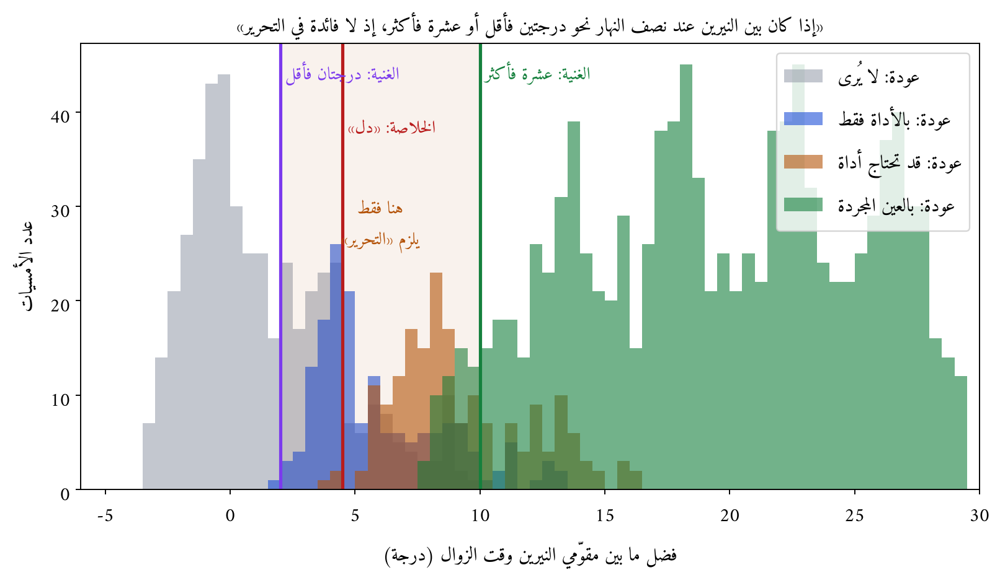

ويؤيّد الحسابُ هذه القاعدة تأييدًا تامًّا (الشكل 40):

- في 288 أمسيةً كان فيها البعد وقت الزوال درجتين فأقل، **لم يُرَ الهلال بالعين في أيٍّ منها**.
- وفي 1235 أمسيةً كان فيها عشر درجات فأكثر، رُئي بالعين في 1221 منها (98.9٪)، وكان في 1164 منها سهل الرؤية بالعين المجردة.

ونفهم من هذا أن «الخلاصة» حين جعلت حدّ عدم الإمكان «دل» (⁦4;30⁩) لم تخالف «الغنية»، بل ضيّقت المنطقة التي تحتاج إلى التحرير: فبين درجتين و⁦4;30⁩ لا يُرى الهلال بالعين إلا نادرًا (3 حالات في ستين سنة)، فحكمت «الخلاصة» فيها بعدم الإمكان دون حساب.

## سمت الهلال وجهة غروبه

تذكر «الغنية» طريقين لمعرفة سمت الهلال: الأول من جدول السمت بارتفاع الهلال، والثاني من الأفق الغربي: يُعدّ من نقطة المغرب مثل سعة مغرب درجة الهلال، ثم يُتشامَل بقدر العرض إن كان شماليًّا، أو يُتجنَّب إن كان جنوبيًّا، «فهناك يغرب الهلال». وهذا هو «سعة مغرب الهلال» في «الخلاصة» (الباب السابع)، وهو ما رسمناه في برنامج الخريطة (الشكل 49).

ثم قال: «ويكون أبدًا جنوبيًّا عن مغرب الشمس تلك الليلة لميل المنطقة أبدًا في جهة الجنوب». واختبرنا ذلك في أول ليلةٍ يُرى فيها الهلال في كل شهر (الشكل 41)، فوجدنا أن الهلال يغرب جنوب مغرب الشمس في 54٪ فقط من الشهور، وأن ذلك تابعٌ للفصل:

- إذا كانت الشمس في **البروج الهابطة** (من السرطان إلى الجدي، أي في الصيف والخريف) غرب الهلال جنوب مغرب الشمس في أغلب الشهور: نحو 73٪ في الصيف، و94٪ في الخريف. لأن فلك البروج شرقيَّ الشمس يميل حينئذٍ نحو الجنوب.
- وإذا كانت الشمس في **البروج الصاعدة** (من الجدي إلى السرطان) غرب الهلال شمالها في أغلب الشهور، ولا سيما في الربيع (لا يغرب جنوبها إلا في 12٪ من الشهور).

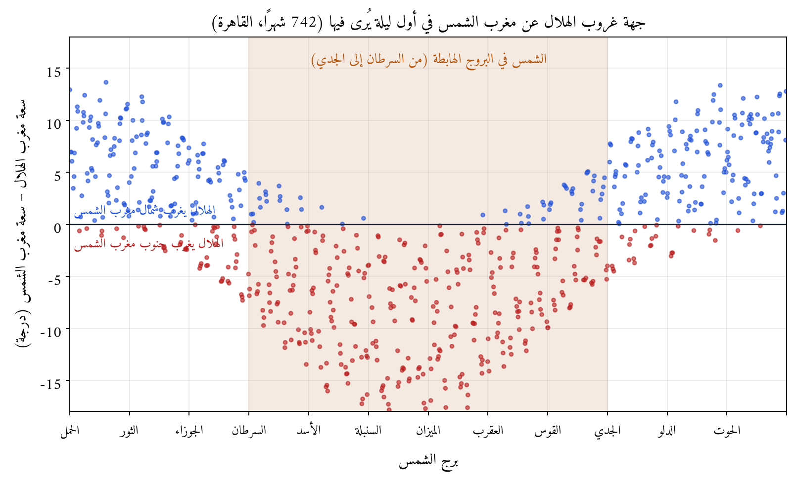

فالعبارة صحيحةٌ إذا قُيّدت بكون «ميل المنطقة في جهة الجنوب»، أي حين تكون الشمس في البروج الهابطة. أما إطلاق «أبدًا» فلا يصح في الربيع. ويحتمل أن يكون في النص سقطٌ أو تصرّفٌ من النسّاخ، فيحسن الرجوع فيه إلى المخطوطات.

## «الهلال منحرف أو مستوٍ أو منتصب»

قال: «وأمّا من اعتمد في كون الهلال منحرفًا أو مستويًا أو منتصبًا بحسب موضعه في البروج، فهو شيءٌ لا أصل له». والمقصود — والله أعلم — من يستدلّ بهيئة الهلال (أي ميل قرنيه) على أحداثٍ أو أحكام. وكلام ابن المجدي صحيحٌ علميًّا: فهيئة الهلال تابعةٌ لزاوية فلك البروج مع الأفق عند الغروب (الشكل 29) ولعرض القمر، فهي أمرٌ هندسي يتكرر كل سنة على نظامٍ معروف، ولا دلالة له وراء ذلك. وهذا من أمثلة فصل ابن المجدي بين علم الهيئة وما ليس منه.

## إثبات الأعياد على الحواشي

ويختم الفصل بقوله: «فإذا علمت أوائل الشهور بالرؤية، فأثبِت أعياد المسلمين على الحواشي». وفي هذا دلالةٌ على وظيفة الكتاب: فـ«الغنية» دليلٌ لعمل **التقويم السنوي**، الذي تُكتب فيه أوائل الشهور القمرية بحسب الرؤية المتوقعة، ثم تُثبت الأعياد في حواشيه. فحساب الرؤية عند ابن المجدي خطوةٌ في صناعة التقويم، لا غايةٌ مستقلة.

## خلاصة الباب

1. فصل الهلال في «الغنية» هو الأصل الحسابي لفصل الهلال في «الخلاصة»: الخطوات واحدة، والأولى بالجداول والثانية بالربع.
2. «ثلثا ساعة» في «الغنية» = «عشرة درج» في «الخلاصة» = أربعون دقيقة بعد الغروب.
3. الصحيح في تعديل البعد بالمغارب «فهو قوس المكث ... يحصل به قوس الرؤية»، برواية النسخ «أ» و«ب» و«ز».
4. تعديل البعد بالمغارب بثلثي العرض (رأي الطوسي الذي أخذت به «الغنية») أصحّ من تعديله بنصفه.
5. القول الثاني في «الخلاصة» هو حدّ ابن يونس (النور 10، الارتفاع 6½ أو 6، المكث 8)، وبه يُفسَّر الخلاف بين «ز» و«و»، وحكم المحقق «6 إلى 6.5 درجة».
6. حدّ ابن يونس وقاعدة كوشيار («اثنان من ثلاثة») يتفقان مع المعيار الحديث بنحو 97٪، مثل معيار «الخلاصة» المركّب.
7. قاعدة «لا فائدة في التحرير» (درجتان فأقل أو عشرة فأكثر) صادقة، و«دل» في «الخلاصة» تضييقٌ لها.
8. عبارة «ويكون أبدًا جنوبيًّا عن مغرب الشمس» صحيحةٌ حين تكون الشمس في البروج الهابطة، ولا تصح على إطلاقها.

# الباب التاسع: معيار ابن المجدي — صياغته وتعيين متغيراته واختباره

## صياغة المعيار

بجمع الشرط الأول والأقوال الثلاثة، يمكن صياغة **معيار ابن المجدي** في أربع درجات:

| الدرجة | الحكم | الشرط |
|---|---|---|
| 0 | غير ممكنة | البعد وقت الزوال ≤ ⁦4;30⁩ درجة، **أو** مؤشر المتأخرين < 7 |
| 1 | جائزة قريبة من الخفاء | مؤشر المتأخرين من 7 إلى أقل من 10 |
| 2 | جائزة قريبة إلى البيان | مؤشر المتأخرين من 10 إلى أقل من 13 |
| 3 | يُرى بيّنًا | المكث ≥ 12 والرؤية ≥ 12 والارتفاع ≥ 10، **أو** مؤشر المتأخرين ≥ 13 |

## تعيين المتغيرات

يجمع الجدول الآتي متغيرات المعيار: معناها، وطريقة استخراجها، وقيمتها أو حدّها.

| المتغير | معناه | طريقة استخراجه | القيمة أو الحد |
|---|---|---|---|
| فضل المقوّمين وقت الزوال | البعد بين القمر والشمس في البروج ظهر التاسع والعشرين | من التقويم | الحد: **⁦4;30⁩** («دل») |
| البهت | مسير الكوكب في يوم وليلة | فرق مقوّمي زوالين | القمر من ⁦11;48⁩ إلى ⁦15;24⁩ درجة، والشمس نحو درجة |
| زمن التحرّي | الزمن بعد الغروب | ثابت | **10 أجزاء = 40 دقيقة** |
| حصة البعد | الزمن من الزوال إلى التحرّي بستينيات اليوم | (نصف قوس النهار + 10) ÷ 6 | في القاهرة من ⁦14;14⁩ (الشتاء) إلى ⁦19;06⁩ (الصيف) |
| اختلاف الطول | ما يُنقص من طول الهلال | المعادلة (14) | **51** دقيقة (الحمل) إلى **30** (الميزان) |
| اختلاف العرض | ما يُنقص من عرض الهلال | المعادلة (14) | **6** دقائق (الحمل) إلى **41** (الميزان) |
| الميل الأعظم لفلك القمر | أقصى عرض القمر | ثابت | **5** درجات |
| قوس المكث | المدة بين الغروبين | المطالع | **12** (القول الأول)، **8** (الثاني) |
| قوس الرؤية | انحطاط الشمس عند غروب الهلال | المعادلة (1) | **12** (القول الأول) |
| قوس الارتفاع | ارتفاع الهلال عند غروب الشمس | المعادلة (1) | **10** (الأول)، **7** أو **6** (الثاني) |
| البعد المطلق | فرق الطولين المرئيين | طرح | يدخل في مؤشر المتأخرين |
| قوس النور | البعد الحقيقي بين المركزين | المعادلة (15) | **10** (القول الثاني) |
| مؤشر المتأخرين | نصف مجموع الرؤية والبعد | جمع وقسمة | **7 / 10 / 13** |

## اختبار المعيار

لمعرفة مقدار صواب المعيار، كتبنا برنامجًا ينفّذ خطوات ابن المجدي كما وردت في الرسالة، ولم نأخذ من الحساب الحديث إلا ما كان ابن المجدي يأخذه من التقويم، وهو «مقوّما النيرين وقت الزوال». ثم طبّقناه على كل أمسيات تحرّي الهلال في القاهرة من سنة 1990 إلى 2049 (مساء يوم الاجتماع والأمسيتان بعده)، وهي 2020 أمسية، وقارنّا حكمه بحكم معيار عودة الحديث. والنتيجة في الشكل (42):

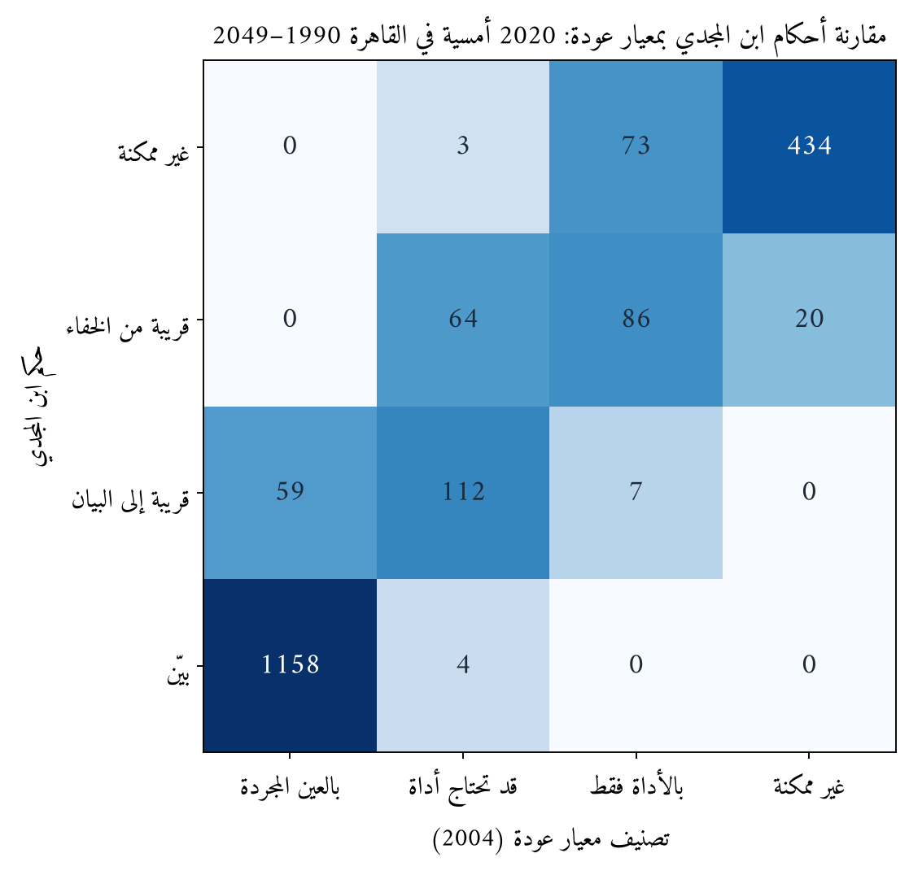

**كيف نقرأ الشكل (42)؟** كل خانةٍ فيه عدد الأمسيات التي حكم فيها ابن المجدي بالحكم المكتوب بجانب الصف، وحكم فيها معيار عودة بالحكم المكتوب أسفل العمود. ومنه نتبيّن:

1. **لا يوجد تناقضٌ حادّ**: لم يحكم ابن المجدي بأن الهلال «بيّن» في أي أمسيةٍ يقول المعيار الحديث إنه لا يُرى أو لا يُرى إلا بالأداة. ولم يحكم بأنه «غير ممكن» في أي أمسيةٍ يُرى فيها بالعين المجردة بسهولة.
2. **حكم «بيّن»** (1162 أمسية) جاء في 1158 منها موافقًا لحكم «يُرى بالعين المجردة» عند عودة، أي بنسبة **99.7٪**.
3. **حكم «غير ممكنة»** (510 أمسيات) جاء في 507 منها موافقًا لحكم «لا يُرى بالعين» عند عودة.
4. **حكم «قريبة من الخفاء»** وقع أغلبه في الأهلة التي يقول عنها المعيار الحديث إنها تُرى بالأداة أو قد تحتاج إلى أداة، وهذا وصفٌ دقيق لمعنى «الخفاء».
5. إذا عددنا «قريبة إلى البيان» فما فوقها حكمًا بالرؤية، كان الاتفاق مع حكم الرؤية بالعين عند عودة **96٪** من الحالات.

## هل أصاب ابن المجدي في الحدود 7 و10 و13؟

بحثنا بالحساب عن أفضل قيمةٍ لمؤشر المتأخرين تفصل بين درجات الرؤية في المعيار الحديث، فكانت النتيجة:

| الفصل بين | أفضل حدٍّ بالحساب | حدّ ابن المجدي |
|---|---|---|
| ما يمكن رؤيته بأي وسيلة، وما لا يمكن | 6.2 درجة | 7 («لا تجوز رؤيته» دونها) |
| ما يُرى بالعين، وما لا يُرى إلا بالأداة | 8.6 درجة | بين 7 و10 («قريبة من الخفاء») |
| ما يُرى بالعين بسهولة، وما دونه | 11.7 درجة | بين 10 و13 («قريبة إلى البيان») |

فالحدود الثلاثة لابن المجدي تقع في مواضعها الصحيحة: الحد الأدنى (7) قريبٌ جدًّا من حد الإمكان (6.2)، وحد البيان (13) فوق حد الرؤية السهلة (11.7) بهامش احتياط.

**مناقشة حكم المحقق**: انتهى المحقق إلى أن الرسالة تعطي معيارًا «في حدود 6 إلى 6.5 درجة»، وأنه «موافقٌ لحدود ابن يونس». وقد ظهر من «غنية الفهيم» (الباب الثامن) أن هذين العددين هما حدّ **الارتفاع** عند ابن يونس، وهو القول الثاني في «الخلاصة». فالحكم صحيحٌ في نسبته، وينبغي تقييده بأنه حدّ الارتفاع في أحد الأقوال الثلاثة، لا المعيار كله. ومن الطريف أن حدّ الإمكان الأدنى لمؤشر المتأخرين كما يظهر بالحساب (6.2) قريبٌ من هذين العددين أيضًا.

## معيار ابن المجدي المعدَّل (مقترح)

بناءً على هذا الاختبار، نقترح صيغةً معاصرة تحفظ بنية معيار ابن المجدي ومتغيراته، مع تعديل حدوده بحسب الحساب:

| مؤشر المتأخرين = (قوس الرؤية + قوس النور) ÷ 2 | الحكم |
|---|---|
| أقل من 6.2 درجة | لا يُرى مطلقًا |
| من 6.2 إلى أقل من 8.6 | لا يُرى إلا بالأداة البصرية |
| من 8.6 إلى أقل من 11.7 | يُرى بالعين في صفاء الجو |
| 11.7 فأكثر | يُرى بالعين المجردة بسهولة |

مع الإبقاء على الشرط الأول (البعد وقت الزوال أكبر من 4.5 درجة)، ورفعه إلى 6.5 درجة إن أُريدت الرؤية بالعين. وينبغي التنبيه إلى أن هذا المعيار مضبوطٌ على عرض القاهرة، لأن قيم اختلاف المنظر في الرسالة خاصةٌ بها؛ فإذا أريد تعميمه احتاج إلى اختبارٍ على عروضٍ أخرى.

# الباب العاشر: فصل الشهور

## توالي الشهور النواقص والكوامل

**النص**: «ومما عُلم بالاطّلاع على أصول حركات القمر في أفلاكه، أنه لا يجوز أن تتوالى أكثر من ثلاثة شهورٍ نواقص، ولا أكثر من أربعة كوامل».

**المعنى**: الشهر القمري إما ناقصٌ (29 يومًا) أو كاملٌ (30 يومًا). ويقرّر ابن المجدي أنه لا تأتي أربعة شهورٍ ناقصة متتالية، ولا خمسة شهورٍ كاملة متتالية.

**الاختبار**: بنينا تقويمًا هجريًّا للقاهرة يبدأ فيه كل شهرٍ بأول ليلةٍ تجوز فيها الرؤية بمعيار ابن المجدي نفسه، لمدة 741 شهرًا (1990–2049). فكانت النتيجة (الشكل 43): أطول توالٍ للشهور الناقصة **ثلاثة**، وأطول توالٍ للكاملة **أربعة**، بالضبط كما قال. وجاء التقويم المبني على معيار عودة الحديث مطابقًا له تمامًا في أطوال الشهور.

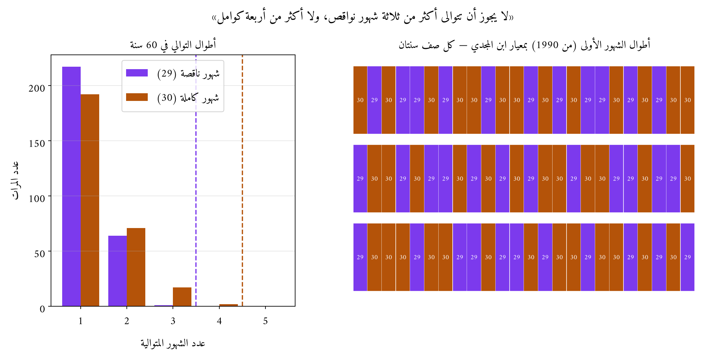

**التعليق**: هذه القاعدة ليست بديهية؛ فهي ناتجةٌ عن اجتماع أمرين: اختلاف سرعة القمر في مداره، وشروط الرؤية. ولم يكن الوصول إليها ممكنًا إلا بحسابٍ طويل أو رصدٍ طويل، وهو ما أشار إليه بقوله: «مما عُلم بالاطلاع على أصول حركات القمر في أفلاكه».

## مكث الهلال في الليلتين الثانية والثالثة

**النص**: «ويجوز أن يغرب الليلة الثانية من رؤيته والماضي [من الليل] لا يزيد على ساعة، كما يجوز أن يغرب تلك الليلة والماضي أكثر من ساعتين. ويجوز غروبه ثالث ليلة والماضي لا يزيد على ساعة ونصف، كما يجوز غروبه في تلك الليلة على ثلاث ساعات».

**المعنى**: يردّ ابن المجدي على من يستدل بطول مكث الهلال في الليلة الثانية على أنه كان قد رُئي في الليلة السابقة، أو بقصره على أنه لم يُرَ. فيقول: الهلال في ليلته الثانية قد يغرب بعد ساعةٍ فقط، وقد يمكث أكثر من ساعتين؛ وفي ليلته الثالثة قد يغرب بعد ساعةٍ ونصف، وقد يمكث ثلاث ساعات.

**الاختبار** (الشكل 44):

| قول ابن المجدي | هل يقع؟ (بعد أول رؤية بمعياره) | أقل مكث وأكثره بالحساب الحديث |
|---|---|---|
| في الليلة الثانية قد يغرب بعد ساعةٍ فقط | نعم، في 4.3٪ من الشهور | أقل مكث بعد أول رؤية بالعين: **1.02 ساعة** |
| وقد يمكث أكثر من ساعتين | نعم، في 33٪ من الشهور | أكثر مكث: 3.07 ساعة |
| في الليلة الثالثة قد يغرب بعد ساعةٍ ونصف | نعم، في 1.5٪ من الشهور | أقل مكث بعد أول رؤية بالعين: **1.51 ساعة** |
| وقد يمكث ثلاث ساعات | نعم، في 29٪ من الشهور | أكثر مكث: 4.11 ساعة |

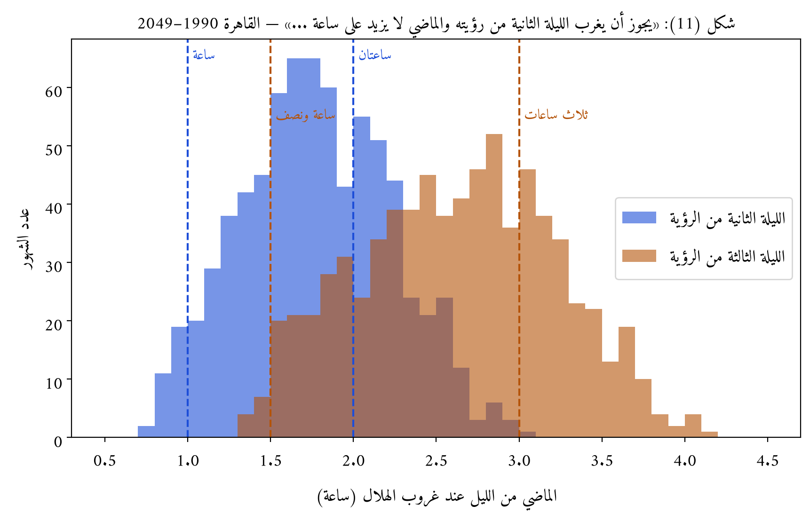

**التعليق**: الأقوال الأربعة كلها صادقة. بل إن الحدّين الأدنيين اللذين ذكرهما (ساعة في الليلة الثانية، وساعة ونصف في الثالثة) هما بالضبط أقل مكثٍ يقع بالحساب الحديث بعد أول رؤيةٍ بالعين (1.02 ساعة و1.51 ساعة). والمعنى الفقهي: **لا يصح الاستدلال بطول مكث الهلال أو قصره على صحة الرؤية في الليلة السابقة أو بطلانها**.

# الباب الحادي عشر: أمثلة محلولة

نعرض في هذا الباب أمثلةً لأهلّةٍ قريبة، محسوبةً بخطوات الرسالة، ومقارنةً بالحساب الحديث.

## المثال الأول: هلال شوال 1447 هـ

وقع الاجتماع فجر الخميس 19 مارس 2026. ويبيّن الشكل (45) موضعي الشمس والهلال في الأفق الغربي للقاهرة مساء الخميس ومساء الجمعة.

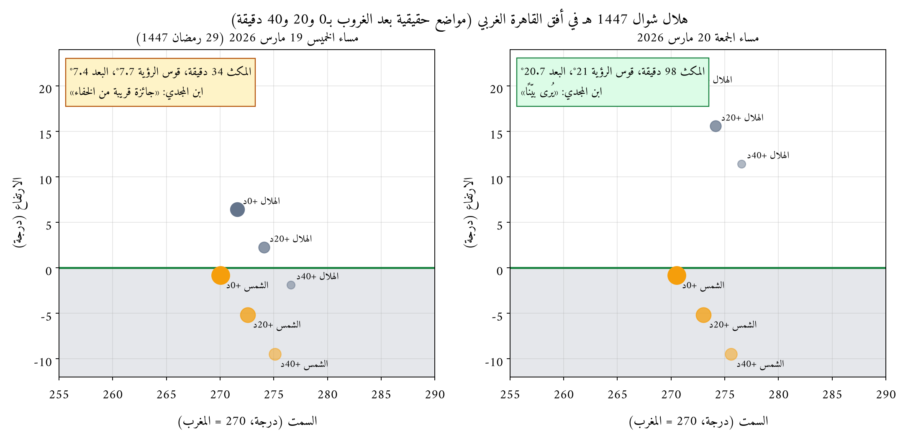

**مساء الخميس 19 مارس**، نسير مع خطوات ابن المجدي:

1. **الشرط الأول**: البعد وقت الزوال 4.63 درجة، وهو فوق «دل» (4.5) بقليل، فالرؤية «ممكنة»، ويُكمل الحساب.
2. **قوس المكث**: 8.9 درجة، أي 35 دقيقة.
3. **قوس الرؤية**: 7.7 درجة.
4. **قوس الارتفاع**: 7.7 درجة.
5. **البعد المطلق**: 7.4 درجة، و**قوس النور** 7.8 درجة.
6. **الحكم**:
   - القول الأول: المكث أقل من 12، فلا يتحقق.
   - القول الثاني: المكث أكثر من 8 والارتفاع أكثر من 7، لكن النور أقل من 10، فلا يتحقق.
   - قول المتأخرين: (7.7 + 7.4) ÷ 2 = 7.6، فهو بين 7 و10: **«جائزةٌ قريبةٌ من الخفاء»**.

ويصنّفه معيار عودة: «لا يُرى إلا بالأداة البصرية»، ويعدّه معيار يالوب أصعب من ذلك. فهو هلالٌ حرج على حدّ الإمكان، ووصفُ ابن المجدي له بأنه «قريبٌ من الخفاء» وصفٌ صادق.

**مساء الجمعة 20 مارس**: المكث 98 دقيقة، وقوس الرؤية 21 درجة، والارتفاع 21 درجة، فالقول الأول متحقق: **«يُرى بيّنًا»**.

## جدول الأمثلة

يجمع الجدول الآتي ثلاثة أهلّة، كل هلالٍ في أمسيتين. وكل الأرقام بطريقة ابن المجدي، إلا قوس المكث ففيه رقمان: الأول بطريقته، والثاني بالحساب الحديث.

| المتغير | شوال 1446 29 مارس 2025 | شوال 1446 30 مارس 2025 | رمضان 1447 17 فبراير 2026 | رمضان 1447 18 فبراير 2026 | شوال 1447 19 مارس 2026 | شوال 1447 20 مارس 2026 |
|---|---|---|---|---|---|---|
| عمر الهلال عند الغروب (ساعة) | 5.2 | 29.2 | 3.7 | 27.8 | 14.7 | 38.7 |
| البعد وقت الزوال (درجة) | -0.61 | 13.53 | -1.06 | 11.20 | 4.63 | 17.82 |
| الشرط الأول (> دل) | غير متحقق | متحقق | غير متحقق | متحقق | متحقق | متحقق |
| قوس المكث (دقيقة): ابن المجدي / الحديث | 12.5 / 9.4 | 79.4 / 79.7 | 5.4 / 2.6 | 63.4 / 63.2 | 35.4 / 33.8 | 97.7 / 98.9 |
| قوس الرؤية (درجة) | 2.7 | 16.9 | 1.1 | 13.5 | 7.7 | 21.0 |
| قوس الارتفاع (درجة) | 2.7 | 16.9 | 1.1 | 13.5 | 7.7 | 21.0 |
| البعد المطلق (درجة) | 2.6 | 16.7 | 1.3 | 13.6 | 7.4 | 20.7 |
| قوس النور (درجة) | 2.8 | 16.9 | 1.6 | 13.6 | 7.8 | 21.0 |
| مؤشر المتأخرين | 2.6 | 16.8 | 1.2 | 13.6 | 7.6 | 20.9 |
| حكم ابن المجدي | غير ممكنة | بيّن | غير ممكنة | بيّن | قريبة من الخفاء | بيّن |
| معيار عودة | لا يُرى | بالعين | لا يُرى | بالعين | بالأداة فقط | بالعين |

# الباب الثاني عشر: برنامج «خريطة معيار ابن المجدي»

## فكرة البرنامج

رأينا في الأبواب السابقة أن حكم ابن المجدي على الهلال يتوقف على موضع الراصد: فاختلاف العرض يغيّر قوس النهار وقوس المكث، واختلاف الطول يغيّر وقت الزوال فيغيّر البعد بين النيرين. ولكي يُرى أثر ذلك في العالم كله دفعةً واحدة، أعددنا برنامجًا يعمل في المتصفح، يطبّق خطوات الرسالة على كل موضعٍ من الأرض، ويلوّن خريطة العالم بدرجات الحكم الأربع. ولا يأخذ البرنامج من الحساب الحديث إلا ما كان ابن المجدي يأخذه من التقويم، وهو مقوّما الشمس والقمر وقت الزوال في اليوم المختار واليوم الذي بعده؛ ثم يسير بعد ذلك بخطوات الرسالة كما شرحناها في الباب السابع.

ويتيح البرنامج للقارئ أن يختار التاريخ بالميلادي أو بالهجري، وأن ينتقل يومًا يومًا أو إلى الاجتماع السابق والتالي، وأن يختار مدينةً من قائمةٍ أو ينقر على أي موضعٍ في الخريطة، كما في الشكل (46).

## خريطة العالم مساء الخميس 19 مارس 2026

يبيّن الشكل (47) حكم ابن المجدي في العالم كله مساء الخميس 19 مارس 2026، وهو مساء التاسع والعشرين من رمضان 1447 هـ، الذي درسناه في المثال الأول من الباب الحادي عشر. وكل خليةٍ في الخريطة مساحتها درجتان في درجتين، ولونها درجة الحكم:

- **الأخضر الداكن**: يُرى بيّنًا.
- **الأخضر الفاتح**: جائزةٌ قريبةٌ إلى البيان.
- **البرتقالي**: جائزةٌ قريبةٌ من الخفاء.
- **الأحمر**: غير ممكنة.
- **الرمادي**: لم يقع الاجتماع بعدُ وقت الزوال، فهذا اليوم «ليس هو تاسع عشرين الرؤية» كما قال ابن المجدي.

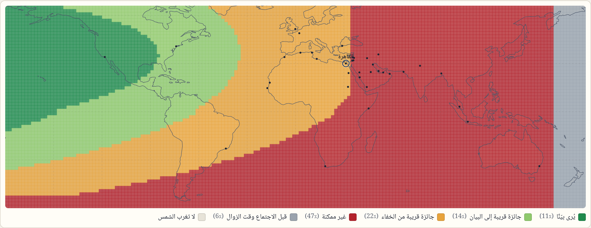

**كيف نقرأ الشكل (47)؟** تتدرّج الألوان من الشرق إلى الغرب: فآسيا كلها حمراء، أي أن الرؤية فيها غير ممكنة؛ ثم يمر الحد بين الأحمر والبرتقالي بمصر والشام تقريبًا، فتقع القاهرة على أول منطقة «الخفاء»؛ ثم يتحسّن الحكم كلما اتجهنا غربًا، حتى يصير الهلال «بيّنًا» في الأمريكتين. والسبب أن الشمس تغرب في البلاد الغربية بعد غروبها في البلاد الشرقية بساعات، فيكون القمر قد ابتعد عن الشمس أكثر، وطال مكثه بعدها. وهذا الشكل المقوّس للحدود هو الشكل المعروف في خرائط الرؤية الحديثة، وقد خرج هنا من خطوات ابن المجدي وحدها.

## لوحة القاهرة: الأوقات والقيم والخطوات

إذا اختار القارئ مدينةً، عرض البرنامج لها لوحتين (الشكل 48): الأولى فيها الحكم، ووقت غروب الشمس، ووقت غروب القمر، والمكث بينهما بالدقائق، و**فضل ما بين مقوّمي النيرين وقت الزوال** مع بيان تحقق شرط «دل» أو عدمه، ومقوّما النيرين، وبهتاهما. والثانية فيها خطوات ابن المجدي واحدةً واحدة، ثم الأقوال الثلاثة وما تحقق منها.

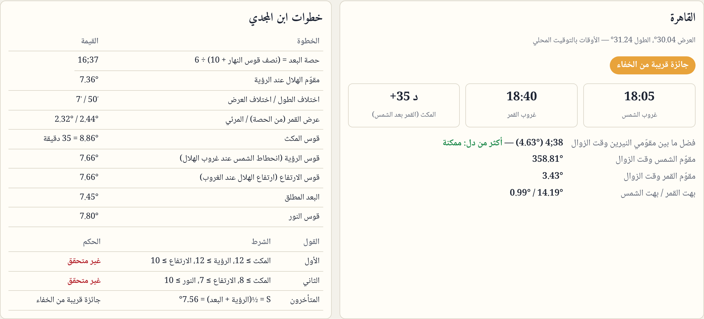

## رسم القيم

ولأن الأرقام وحدها لا تكفي لتصوّر الهلال، يرسم البرنامج قيم الموضع المختار في ثلاثة رسوم.

### السماء الغربية لحظة غروب الشمس

يرسم الشكل (49) الأفق الغربي للقاهرة كما يراه المؤقت لحظة غروب الشمس، والدرجات فيه بمقياسٍ واحد أفقيًّا ورأسيًّا، فتظهر الأقواس بنسبها الحقيقية:

- **قوس الارتفاع** (السهم الأزرق): من الأفق إلى الهلال، وهو هنا 7.7 درجة.
- **قوس النور** (الخط الأخضر): من الشمس إلى الهلال، وهو 7.8 درجة.
- **فرق السمت** (تحت الأفق): الفرق بين جهتي الشمس والهلال، وهو 1.5 درجة.
- **قوس الرؤية** (السهم الأحمر): انحطاط الشمس تحت الأفق لحظة غروب الهلال، وهو 7.7 درجة. وتظهر الشمس في موضعين: عند غروبها على الأفق، وعند غروب الهلال تحته.
- **مسار نزول الهلال** (الخط المنقّط) إلى موضع غروبه على الأفق، مع سعة مغربه.

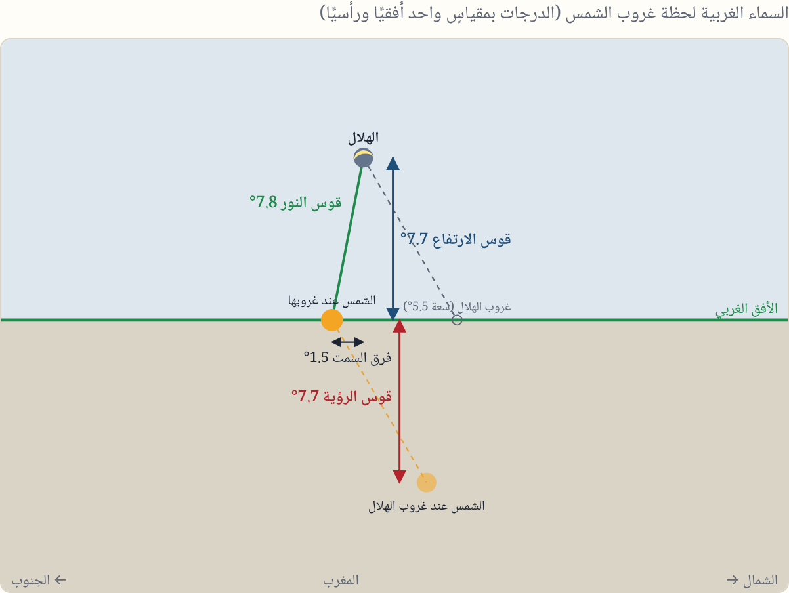

ويظهر من الشكل أن الهلال قريبٌ جدًّا من الشمس (قوس النور أقل من 8 درجات)، وأنه منخفض، وأن الشمس عند غروبه لم تنحطّ إلا قليلًا، فالسماء حوله لم تظلم بعد. وهذه صورة الهلال «القريب من الخفاء».

### فلك البروج وشريط الزمن

يرسم الجزء الأعلى من الشكل (50) فلك البروج، والطول فيه يزداد نحو اليسار (على توالي البروج)، وعليه:

- موضع الشمس وموضع القمر **وقت الزوال**، والسهم بينهما هو «فضل ما بين مقوّمي النيرين»؛ وهو هنا أكبر من «دل» بقليل، فالرؤية ممكنة.
- المنطقة المظلّلة بالأحمر هي **منطقة «دل»**: إذا وقع القمر فيها وقت الزوال فالرؤية غير ممكنة.
- موضع الهلال **عند الرؤية**، ثم انتقاله باختلاف المنظر إلى **موضعه المرئي**، و**عرضه المرئي** عن فلك البروج، و**البعد المطلق** بينه وبين الشمس.

ويرسم الجزء الأسفل **شريط الزمن** بعد الغروب: يبدأ بغروب الشمس، وينتهي بغروب الهلال بعد مكثٍ قدره 35 دقيقة بطريقة ابن المجدي، وعليه علامة الحساب الحديث للمقارنة، وعلامة وقت التحرّي بعد الغروب بأربعين دقيقة. ويظهر منه أن الهلال في هذا المساء يغرب **قبل** وقت التحرّي المعتاد، وهذا من أسباب صعوبة رؤيته.

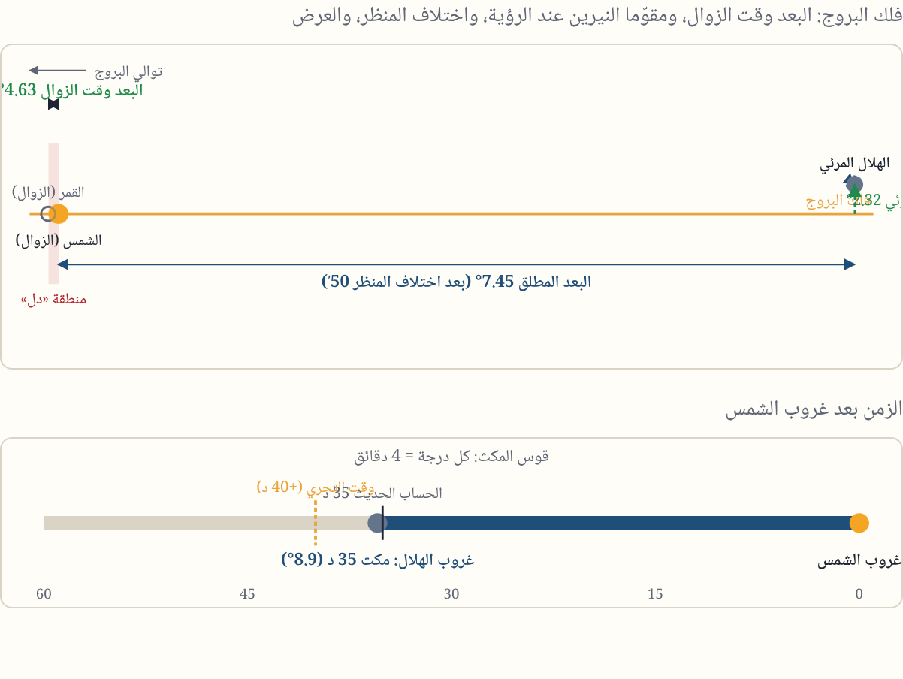

### القيم مقابل حدود الأقوال الثلاثة

يضع الشكل (51) كل قيمةٍ على مسطرةٍ عليها حدود الأقوال: فقوس المكث مقابل 8 (القول الثاني) و12 (القول الأول)، وقوس الرؤية مقابل 12، وقوس الارتفاع مقابل 7 و10، وقوس النور مقابل 10، ومؤشر المتأخرين على مسطرةٍ ملوّنة بمناطق 7 و10 و13. واللون الأخضر للقيمة التي بلغت الحد، والأحمر لما قصر عنه.

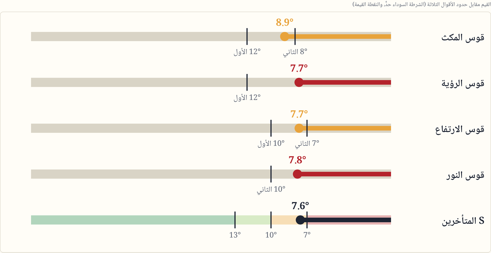

ويُقرأ الحكم من الشكل مباشرة: القيم كلها حمراء دون حدود القولين الأول والثاني، ومؤشر المتأخرين (7.6) واقعٌ في أول منطقة «القرب من الخفاء». فالحكم: **«جائزةٌ قريبةٌ من الخفاء»**، وهو ما انتهينا إليه في الباب الحادي عشر.

## الليلة التالية: مساء الجمعة 20 مارس 2026

ثم ننتقل في البرنامج يومًا واحدًا، فيتغير المشهد كله (الشكل 52): يصير الهلال «بيّنًا» في نحو 86٪ من الخريطة، ومنها العالم الإسلامي كله، ولا يبقى «غير ممكن» إلا في شريطٍ ضيق في أقصى الجنوب، وتقع أستراليا ونيوزيلندا في منطقتي «القرب إلى البيان» و«القرب من الخفاء».

ويبيّن الشكلان (53) و(54) القاهرة في تلك الليلة: ارتفع الهلال إلى 21 درجة، وصار قوس النور 21 درجة، وانحطّت الشمس عند غروبه 21 درجة، وجاوزت القيم كلها حدود القول الأول. فالحكم: **«يُرى بيّنًا»**.

## ملاحظات على البرنامج

1. قيم اختلاف المنظر في الرسالة مضبوطةٌ على عرض القاهرة؛ وفي نصف الكرة الجنوبي عكسنا الجدول (فجعلنا الحمل مكان الميزان، والاختلاف في العرض نحو الشمال)، لأن هيئة فلك البروج عند الغروب هناك معكوسة. وهذا اجتهادٌ منّا، لا نصٌّ للمؤلف.
2. أوقات غروب الشمس والقمر في لوحة المدينة محسوبةٌ بالحساب الحديث مع الانكسار، للمقارنة بقوس المكث المحسوب بطريقة ابن المجدي.
3. التاريخ الهجري المعروض بتقويم أم القرى، وهو تقويمٌ حسابي قد يخالف الرؤية.
4. البرنامج في ملف `app/hilal_map.html`، ويُفتح في أي متصفح.

# الباب الثالث عشر: تعليقٌ تراثيٌّ عام

بعد هذا العرض يمكن أن نخلص إلى ملاحظاتٍ عامة على الرسالة ومنهج مؤلفها:

**أولًا: الرسالة حلقةٌ في سلسلة**. تقف «الخلاصة» بين الزيجات الكبرى التي تحسب مواضع الكواكب، والجداول الجاهزة لأوقات الصلاة. ووظيفتها أن تمكّن المؤقت من حساب كل شيءٍ بآلةٍ واحدة (الربع المجيب) ومعطيين من التقويم (مقوّما النيرين). وهذا يفسّر أسلوبها المضغوط: فهي أشبه بخطواتٍ تُنفَّذ على الآلة واحدةً بعد أخرى، لا بكتابٍ يُقرأ.

**ثانيًا: الأمانة في نقل الأقوال**. لم يتبنَّ ابن المجدي قولًا واحدًا في حدود الرؤية، بل عرض ثلاثة أقوال: الأول بلا نسبة («ومتى كان»)، والثاني بصيغة التمريض («وقيل»)، والثالث منسوبًا إلى عمل المتأخرين. فجاء العنوان «خلاصة الأقوال» مطابقًا للمضمون.

**ثالثًا: الوعي بحدود الدقة**. قوله: «وفي استقصاء ذلك فوات المقصود» يدل على فهمٍ عميق لطبيعة رؤية الهلال: فهي ظاهرةٌ تتوقف على العين والجو، والتدقيق فيما وراء دقة الرصد بالعين لا يفيد.

**رابعًا: الرسالة في مدرسةٍ حيّة**. ما تزال أعمال ابن المجدي في «الخلاصة» قريبةً من أعمال شيخه المارديني في «مجملة المطلوب»، في المصطلح والترتيب وطريقة التنبيه على الحالات الخاصة، مع زياداتٍ له كطريقة المحفوظين. وقد بقيت رسائل هذه المدرسة تُشرح وتُدرَّس إلى العصر العثماني، كما في شرح كرباصة التونسي، فالرسالة جزءٌ من تقليدٍ تعليميٍّ متصل، لا عملٌ منفرد.

**خامسًا: الصلة بالفقه**. الرسالة لا تقول إن الحساب يُثبت الشهر، بل تبيّن متى تكون الرؤية «غير ممكنة»، ومتى تكون «جائزة»، ومتى تكون «بيّنة». وهذا يوافق ما ذهب إليه جماعةٌ من الشافعية المتأخرين — وابن المجدي شافعيٌّ معاصرٌ لهم — من ردّ الشهادة بالرؤية إذا قطع الحساب باستحالتها.

**سادسًا: ملاحظاتٌ على التحقيق المنشور**. يحتاج التحقيق — على فضله — إلى استدراكاتٍ يسيرة: تفسير «دل» بأنها ⁦4;30⁩، وتفسير «و دقائق» بأنها 6 دقائق، وتصحيح «يح» إلى «يج»، والتعليق على تاريخ «112»، وتقييد حكم الخاتمة («6 إلى 6.5 درجة») بأنه حدّ الارتفاع عند ابن يونس في القول الثاني، كما يظهر من «غنية الفهيم»، لا المعيار كله.

# الخاتمة

من خلال ما عرضناه يتضح أن رسالة «خلاصة الأقوال في معرفة الوقت ورؤية الهلال» لابن المجدي، على صغر حجمها، تحمل علمًا كثيرًا مضغوطًا في عباراتٍ قليلة. وقد انتهت الدراسة إلى النتائج الآتية:

1. أعمال الرسالة كلها ترجع إلى قاعدةٍ واحدة من حساب المثلثات الكروية (المعادلة 1)، نفّذها ابن المجدي على الربع المجيب بطرقٍ بارعة، أبرزها طريقة «المحفوظين» التي تحوّل الضرب الثلاثي إلى طرح عددين.
2. أدوات الرسالة التقريبية دقيقة: فالمكث المحسوب بطريقتها لا يختلف عن الحقيقي إلا بنحو دقيقتين، وقوس الرؤية بأقل من درجة، وعرض القمر بنحو خُمس درجة.
3. قيم اختلاف المنظر في الرسالة (51 و30 دقيقة في الطول، و6 و41 دقيقة في العرض) مضبوطةٌ هندسيًّا على عرض القاهرة.
4. «دل» = 4 درجات و30 دقيقة، وهي حدّ عدم الإمكان وقت الزوال؛ و«و دقائق» = 6 دقائق؛ و«يح» مصحّفة عن «يج» = 13.
5. معيار ابن المجدي يتفق مع معيار عودة الحديث في نحو 96٪ من 2020 حالة، دون أي تناقضٍ حاد.
6. حدود المتأخرين (7 و10 و13) قريبةٌ جدًّا من أفضل الحدود بالحساب الحديث (6.2 و8.6 و11.7).
7. قاعدة «لا تتوالى أكثر من ثلاثة نواقص ولا أكثر من أربعة كوامل» صادقةٌ تمامًا، وكذلك أقواله في مكث الهلال في ليلتيه الثانية والثالثة.
8. فصل الهلال في «غنية الفهيم» هو الأصل الحسابي لفصل «الخلاصة»، ومنه عرفنا أن القول الثاني حدّ ابن يونس، وأن «عشرة درج» هي «ثلثا ساعة»، وأن تعديل البعد بالمغارب بثلثي العرض أصحّ من نصفه.

**التوصيات**:

- البحث عن نسخٍ أخرى للرسالة لحسم مواضع الخلاف: تاريخ التأليف، و«يح/يج»، و«ز/و».
- استكمال دراسة «غنية الفهيم»، ولا سيما جداولها التي يحيل عليها فصل الهلال («جدول معرفة قوس الرؤية من قوس المكث» و«جدول نور الهلال» و«جدول مقام الرؤية»)، وتحقيق «المنهل العذب الزلال»، لاستكمال نظرية ابن المجدي في الهلال.
- اختبار المعيار المعدّل على أرصادٍ فعلية للأهلة في مصر.
- الإفادة من البرنامج المرفق بهذه الدراسة في تعليم علم الميقات، فهو يحوّل نص الرسالة إلى خطواتٍ قابلة للتشغيل.

# ملحق (1): حساب الجُمَّل في الرسالة

الأعداد في الرسالة مكتوبةٌ بحروف الجمّل على ترتيب «أبجد هوز حطي كلمن سعفص قرشت ثخذ ضظغ»، فالحروف التسعة الأولى للآحاد، والتسعة الثانية للعشرات، والتسعة الثالثة للمئات[^jummal]. والحرفان المتجاوران يُقرآن إما مجموعًا (يب = 10 + 2 = 12)، وإما درجاتٍ ودقائق (دل = 4 درجات و30 دقيقة)، بحسب السياق.

| الرمز | قيمته | موضعه في الرسالة |
|---|---|---|
| دل | ⁦4;30⁩ | الشرط الأول في فصل الهلال |
| و | 6 | المقسوم عليه في حصة البعد؛ واختلاف العرض في رأس الحمل |
| ز | 7 | ارتفاع القول الثاني (حدّ ابن يونس 6½ مقرّبًا)؛ أدنى حدود المتأخرين |
| ح | 8 | مكث القول الثاني |
| ي | 10 | زيادة نصف قوس النهار؛ ارتفاع القول الأول؛ نور القول الثاني؛ حدٌّ عند المتأخرين |
| يب | 12 | المكث والرؤية في القول الأول |
| يج | 13 | حد «البيان» عند المتأخرين |
| يز / يط | 17 / 19 | الشفق والفجر |
| نه | 55 | 60 × جيب تمام الميل الأعظم، في حساب المطالع |
| ص | 90 | الربع |
| قف | 180 | نصف الدور |

[^jummal]: الخوارزمي الكاتب: مفاتيح العلوم، ص 195. وانظر: التحقيق، ص 82–84.

# ملحق (2): معجم المصطلحات

| المصطلح | معناه |
|---|---|
| الستيني | ضلع الربع المقسوم ستين قسمًا |
| المريّ | خرزةٌ تتحرك على خيط الربع |
| التجييب / التقويس | إيجاد الجيب من القوس / إيجاد القوس من الجيب |
| الميل | بعد الكوكب عن معدل النهار |
| الميل الأعظم | ميل فلك البروج عن معدل النهار (⁦23;35⁩ عندهم) |
| الغاية | ارتفاع الشمس وقت الزوال |
| الدائر | الماضي من النهار منذ الشروق |
| فضل الدائر | البعد الزمني عن الزوال |
| التعديل | فضل قوس النهار على 180 درجة |
| نصف الفضلة | اسم «نصف التعديل» عند المارديني وشارحه |
| الأصل المعدل | جيب الارتفاع مطروحًا منه بعد القطر (في الشمال)، عند المارديني |
| الأصل / بعد القطر | جزءا ارتفاع الشمس (انظر الشكل 13) |
| المحفوظ الأول / الثاني | العددان اللذان يُحسب منهما الوقت |
| جيب الترتيب | الفرق بين المحفوظين |
| السمت | جهة الكوكب على الأفق |
| المطالع | ما يطلع من معدل النهار مع قوسٍ من البروج |
| المقوّم | موضع الكوكب في البروج (طوله) |
| البهت | مسير الكوكب في يوم وليلة |
| الجوزهر | العقدة الصاعدة لفلك القمر (الرأس) |
| الحصة | بعد القمر عن الجوزهر |
| اختلاف المنظر | الفرق بين موضع القمر من الراصد ومن مركز الأرض |
| قوس المكث | المدة بين غروب الشمس وغروب الهلال |
| قوس الرؤية | انحطاط الشمس تحت الأفق عند غروب الهلال |
| قوس الارتفاع | ارتفاع الهلال عند غروب الشمس |
| البعد المطلق | فرق الطول بين الهلال المرئي والشمس |
| قوس النور | البعد الحقيقي بين مركزي الهلال والشمس |

# ملحق (3): البرنامج الحاسوبي

أُرفق بهذه الدراسة برنامجٌ مكتوبٌ بلغة Python، فيه أعمال الرسالة على هيئة دوالّ، وعلى كل دالةٍ نصُّ ابن المجدي الذي تنفّذه. وملفاته:

- `code/majdi.py`: أعمال الرسالة.
- `code/analysis.py`: حساب متغيرات الهلال لأمسيات القاهرة 1990–2049.
- `code/stats.py` و`code/lag_nights.py`: الإحصاءات.
- `code/figures.py` و`code/concepts.py`: الرسوم.
- `app/hilal_map.html`: برنامج خريطة معيار ابن المجدي (الباب الثاني عشر).

# المصادر والمراجع

**أولًا: المصادر**

1. ابن المجدي، شهاب الدين أحمد بن رجب: خلاصة الأقوال في معرفة الوقت ورؤية الهلال، تحقيق ودراسة: أروين جولي رخمادي بوتر–بوتر (ميدان، 2019؛ وأصله رسالة ماجستير بمعهد المخطوطات العربية، القاهرة 2009).
2. ابن المجدي: خلاصة الأقوال، نسخة مكتبة الأزهر (1237 هـ)، النص المرقون، إعداد: د. نجلاء شمس.
3. ابن منظور: لسان العرب (بيروت: دار إحياء التراث الإسلامي، د.ت).
4. الخوارزمي الكاتب: مفاتيح العلوم.
5. السخاوي: الضوء اللامع لأهل القرن التاسع.
6. الشوكاني: البدر الطالع بمحاسن من بعد القرن السابع.

**ثانيًا: المراجع العربية**

7. التهانوي: كشاف اصطلاحات الفنون والعلوم، تحقيق: علي دحروج (بيروت: مكتبة لبنان ناشرون، 1996).
8. الخياط، محمد بن يوسف: لآلئ الطل الندية شرح الباكورة الجنية في عمل الجيبية (مصر: مطبعة مصطفى البابي الحلبي، 1348 هـ).
9. محمد مختار بن عطارد: تقريب المقصد في العمل بالربع المجيب (سورابايا: توكو كتاب أوتاما، د.ت).
10. ذو الفقار علي شاه: الحسابات الفلكية وإثبات شهر رمضان (فرجينيا: المعهد العالمي للفكر الإسلامي، 1430 هـ).
11. مكتبة الإسكندرية: إسهامات الحضارة العربية والإسلامية في علوم الفلك (2006).
12. عبد الأمير مؤمن: قاموس دار العلم الفلكي (بيروت: دار العلم للملايين، 2006).

**ثالثًا: المراجع الأجنبية**

13. ابن المجدي: غنية الفهيم والطريق إلى حل التقويم، فصل «في حساب رؤية الأهلة»، منشورًا محقّقًا على أربع نسخ في: *Metode Penelitian Naskah Arab: Teori dan Aplikasi*، ص 162–167.
14. جمال الدين المارديني: مجملة المطلوب في العمل بربع الجيوب (المتن ضمن شرح كرباصة).
15. علي بن مامي كرباصة: إتحاف المحبوب بشرح مجملة المطلوب في العمل بربع الجيوب، وتعليقٌ تراثيٌّ عليه (التعليق على إتحاف المحبوب).
16. Boulahia, Nejib, *Usage du Quadrant-Sinus chez les Arabes* (Paris: Geuthner, 2019).
17. Boulahia, Nejib, "Some Numerical Examples, Using the Sine-Quadrant, by ʿAlī Ibn Māmī Karbāṣā", *Actes du 14e Colloque maghrébin sur l'histoire des mathématiques arabes* (Sousse, 2022), pp. 65–81.
18. King, David A., "An Analog Computer for Solving Problems of Spherical Astronomy: The Shakkāziyya Quadrant of Jamāl al-Dīn al-Māridīnī", in *Islamic Astronomical Instruments* (London: Variorum, 1987).
19. Worrell, W. H. & Carpenter, W., "Mardini's Introduction to the Use of the Quadrant", *Scripta Mathematica* 10 (1944), pp. 170–180.
20. King, David A., *A Survey of the Scientific Manuscripts in the Egyptian National Library* (Winona Lake: Eisenbrauns, 1986).
21. King, David A., *Islamic Mathematical Astronomy* (London: Variorum, 1986).
22. King, David A., *Astronomy in the Service of Islam* (Aldershot: Variorum, 1993).
23. King, David A., *In Synchrony with the Heavens*, 2 vols. (Leiden: Brill, 2004–2005).
24. King, David A., "Some Early Islamic Tables for Determining Lunar Crescent Visibility", *Annals of the New York Academy of Sciences* 500 (1987).
25. Kennedy, E. S. & King, D. A., "Ibn al-Majdī's Tables for Calculating Ephemerides", *Journal for the History of Arabic Science* 4 (1980).
26. Kennedy, E. S., "The Crescent Visibility Theory of Thābit ibn Qurra" (1960).
27. Kennedy, E. S. & Janjanian, M., "The Crescent Visibility Table in al-Khwārizmī's Zīj", *Centaurus* 11 (1965).
28. Kennedy, E. S., "The Lunar Visibility Theory of Yaʿqūb ibn Ṭāriq", *Journal of Near Eastern Studies* 27 (1968).
29. Hogendijk, J. P., "Three Islamic Lunar Crescent Visibility Tables", *Journal for the History of Astronomy* 19 (1988).
30. Danjon, A., "Jeunes et vieilles lunes", *L'Astronomie* 46 (1932).
31. Yallop, B. D., *A Method for Predicting the First Sighting of the New Crescent Moon*, NAO Technical Note 69 (1997).
32. Odeh, M. Sh., "New Criterion for Lunar Crescent Visibility", *Experimental Astronomy* 18 (2004).
33. Folkner, W. M. et al., *The Planetary and Lunar Ephemeris DE421*, JPL IOM 343R-08-003 (2008).

> تنبيه: بيانات النشر لبعض المراجع الأجنبية (الأعداد والسنوات) مذكورةٌ من ذاكرة الباحث العلمية، فيحسن التحقق منها قبل النشر الأكاديمي.
